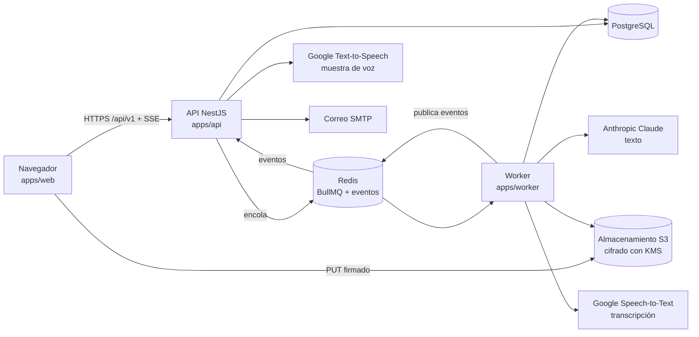
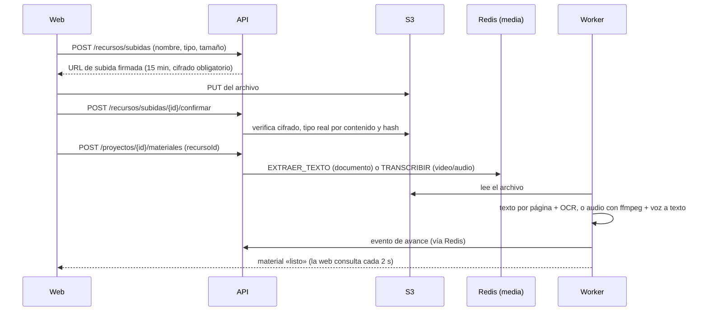
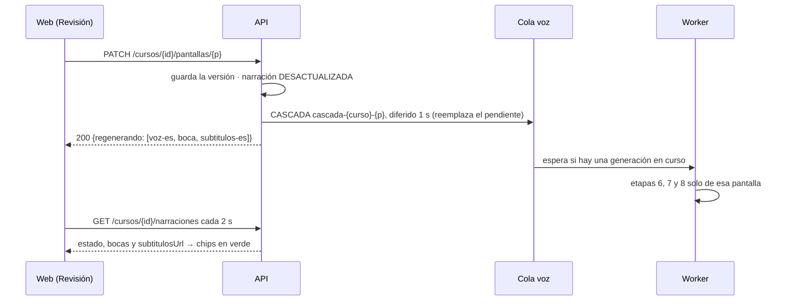
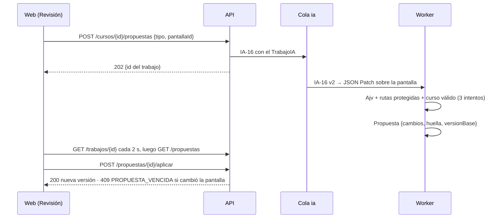
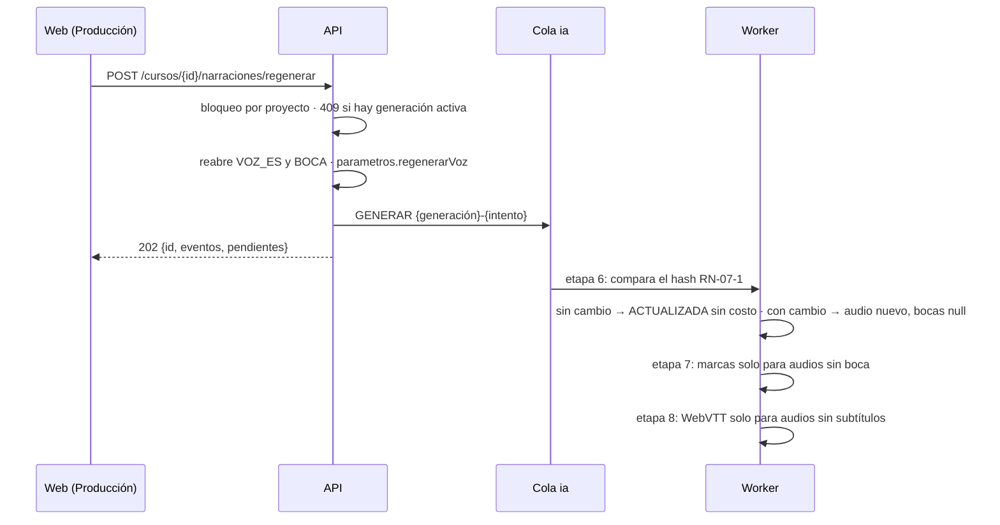

# Aptio SCORM · Manual del sistema

**Versión 0.21 · actualizado con la décima entrega del Sprint 5 (11 de noviembre de 2026)**

Describe cómo está construido y cómo funciona Aptio SCORM en conjunto: sus componentes, cómo viajan los datos, la seguridad, los proveedores externos, la configuración y la operación. Está pensado para el ingeniero a cargo, el área de infraestructura y quien audite el sistema. El detalle de código está en [`MANUAL-PROGRAMADOR.md`](MANUAL-PROGRAMADOR.md), y el uso de las pantallas, en [`MANUAL-USUARIO.md`](MANUAL-USUARIO.md).

---

## 1. Propósito y alcance

Aptio SCORM es la herramienta interna de AulasEducativas (Grupo de Soluciones Creativas SAC) para producir cápsulas de microaprendizaje con ayuda de IA. Toma el material del cliente y lo convierte en un SCORM revisable. El equipo revisa y ajusta, y nada se publica sin revisión humana.

**Estado al cierre del S2:**

| Área | Estado |
| --- | --- |
| Acceso: correo y clave, Google para invitados, roles, invitaciones y recuperación | Disponible |
| Clientes, kit de marca, personaje, pantallas modelo, glosario y pronunciación | Disponible |
| Proyectos y Nuevo SCORM | Disponible |
| Material del cliente: PDF, Word, PowerPoint (con OCR), video y audio (transcripción) | Disponible |
| Generador: lanzar, ver en vivo, cancelar y continuar | Disponible |
| Etapas 1 a 3: resumen con acta de omitidos, objetivos y estructura, guion por pantalla | Disponible |
| Etapas 4 a 11: pantallas, ilustraciones, voz, boca, subtítulos, inglés, calidad y paquete | Planificadas (S3 en adelante) |
| Revisión pantalla por pantalla, editor, exportación SCORM, fase comercial | Planificadas |

## 2. Arquitectura

| Componente | Tecnología | Responsabilidad |
| --- | --- | --- |
| Web | React 19 + Vite, `@aptio/ui` | Interfaz para celular primero. Sube archivos directo al almacenamiento y recibe el avance en vivo por SSE. |
| Reproductor | TypeScript sin dependencias (`@aptio/player`) | Dibuja el curso para el participante. Es el mismo en la vista previa de la web y dentro de cada paquete; corre en un Shadow DOM propio. |
| API | NestJS sobre Node.js | Sesión, roles, alcance por organización, validación, reglas de negocio, contrato OpenAPI y envío de trabajos a las colas. |
| Worker | BullMQ sobre Node.js | Trabajos largos: extracción de texto y OCR, transcripción, generación por etapas y borrado programado. |
| PostgreSQL 16 | Prisma (`@aptio/db`) | Datos de negocio, resultados de cada etapa, costos y auditoría. |
| Redis 7 | BullMQ (`@aptio/colas`) | Colas `ia`, `voz`, `media` y `export`, cola de mantenimiento y canal de eventos `aptio:eventos`. |
| Almacenamiento | S3 compatible con KMS (`@aptio/almacen`); LocalStack en local | Archivos del cliente y recursos, siempre cifrados y accesibles solo con URL firmada. |

Las decisiones de arquitectura están en `docs/adr/` y en `CLAUDE.md` («Decisiones tomadas»).

## 3. Flujos principales

### 3.1 Subir material del cliente

- **Documentos:** texto por página. Una página con menos de 25 caracteres se trata como escaneada y pasa por OCR (Tesseract, español e inglés).
- **Video y audio:** ffmpeg extrae el audio en tramos de 55 s (FLAC mono, 16 kHz). Cada tramo se transcribe y los tiempos se ajustan al inicio del tramo. Se guardan los fragmentos `{desde, hasta, texto}` y la duración.
- En ambos casos, el texto que parece una orden para la IA se marca como `posibleInstruccion` (CP-102).

### 3.2 Generar un SCORM

1. `POST /proyectos/{id}/generaciones` exige material leído y una sola generación activa por proyecto (protegida con un cerrojo en PostgreSQL). Crea las 11 etapas «En cola», pasa el proyecto a Producción y encola `GENERAR`.
2. El worker corre las etapas en orden y salta las ya completadas. Cada etapa recibe los resultados de las anteriores.
3. Cada etapa publica su estado. La web lo recibe por SSE (`GET /generaciones/{id}/eventos`) y, como respaldo, consulta cada 2 s.
4. Al final:
   - si las 11 etapas terminaron, el proyecto pasa a Revisión;
   - si faltan etapas por habilitar, vuelve a «Por generar» (SUP-24). Una etapa sin habilitar no frena a las siguientes que sí lo están.
5. **Cancelar** conserva lo terminado. Una etapa a medias deja de llamar a la IA y conserva el costo gastado. **Continuar** retoma desde la etapa con error o cancelada.

| Etapa | Tareas de IA | Resultado |
| --- | --- | --- |
| 1 · Leer y resumir | IA-01 mapa de temas, IA-02 conservar, complementario u omitir, IA-03 ideas clave por tema, IA-13 acta | Ideas clave con archivo y página, y acta de omitidos (CP-038) |
| 2 · Objetivos y estructura | IA-04 v2 | Objetivos con nivel de Bloom, y pantallas con tipo, objetivo, actividad y página. Número exacto de pantallas y mínimo de actividades (CP-039) |
| 3 · Storyboard y guion | IA-05 v2 (por cápsula) | Título, texto en pantalla, narración, visual, actividad y origen. Advertencia si pasa de 30 palabras en pantalla o 45 de narración (CP-040) |
| 4 · Pantallas con el kit | IA-15 v2 (por pantalla, hasta 4 a la vez) e IA-07 v2 (por actividad) | Disposición del kit, fondo y campos por pantalla, y los datos de cada actividad (CP-044; el reto final es sumativo), guardados como avance mientras corre (CP-043). Al terminar, el documento del curso validado en `Curso` con su versión (CP-042) |
| 6 · Voz en español | Google Text-to-Speech con la voz y la velocidad del kit (hasta 4 a la vez, 3 intentos por pantalla) | Un audio por pantalla con narración, con el diccionario de pronunciación aplicado, guardado como `Recurso` del cliente con su duración, y una `Narracion` ACTUALIZADA por pantalla. El curso enlaza el audio y su duración; la narración queda `pendiente` hasta la boca y los subtítulos (CP-071, SUP-34) |
| 7 · Boca del personaje | Rhubarb Lip Sync 1.13 (reconocedor fonético) sobre cada audio; por letras en modo simulado | Marcas `[ms, boca]` por narración en `Narracion.bocas` y en el curso. Local y sin costo (SUP-35) |
| 8 · Subtítulos | Una frase por subtítulo (máximo 84 caracteres) con tiempos repartidos por letras sobre la duración del audio | Un WebVTT por narración (recurso SUBTITULO) enlazado a la narración y al curso; la narración queda «generado». Local y sin costo (SUP-37) |

### 3.3 Vista previa con el reproductor único

1. La web pide `GET /api/v1/proyectos/{id}/curso` (con la versión en `ETag`) y el kit del cliente.
2. Monta `@aptio/player` sobre el documento del curso: dibuja cada pantalla con su disposición y el kit, y las actividades del catálogo.
3. Las reglas de avance del curso (`navegacion.modo`; sin ella, actividades obligatorias) deciden si se puede seguir. En modo revisión se puede ir a cualquier pantalla.
4. El panel de seguimiento muestra lo que se reportaría al LMS (avance, nota, puntos y `lesson_status`). No se guarda nada; la conexión SCORM llega con la exportación (S6).

### 3.3.0 Regeneración en cascada desde Revisión

Al corregir la narración en español de una pantalla que ya tiene voz, se regeneran solas su voz, su boca y sus subtítulos, sin pasar por una generación (HU-0503, SUP-38).

Varios guardados seguidos dejan un solo trabajo, que corre 1 s después del último (CP-051). El costo de la voz queda en `TrabajoIA` con el proyecto y sin generación. Si la voz falla, la narración queda en ERROR y los chips en rojo.

### 3.3.0b Propuestas de la IA

La IA nunca cambia el curso por su cuenta: solo la acción Aplicar crea una versión. Deshacer restaura la anterior conservando la narración y su audio (SUP-39).

### 3.3.0.1 Edición en el lugar (Editor, PNT-21)

El editor (`/proyectos/{id}/editor?pantalla=pXX`) dibuja la pantalla con el mismo reproductor que Revisión y vuelve editables los textos (`data-bloque` de tipo texto). Al terminar con Enter o al salir del texto, la web envía `PATCH /cursos/{id}/pantallas/{pantallaId}` con `titulo` (el primer texto con rol título) o `textos[bloque]`, y la versión que conoce. La API crea una versión, deja la pantalla en borrador y marca el texto como `origen.tipo = manual`. Esc no envía nada. Si la versión cambió, responde 409 y la web recarga el curso. No hay cambios en la API ni en el esquema; el alcance del esqueleto está en SUP-40.

Los retoques (HU-0602) viajan en el mismo `PATCH` como `ajustes: { [bloque]: AjusteElemento | null }` y se guardan en `ajustes` de la pantalla, aparte del contenido (RN-06-1). La API rechaza un elemento que no existe (422 BLOQUE_NO_EXISTE), un color que no es un rol del kit (422 COLOR_FUERA_DEL_KIT, RN-06-4) y un valor fuera del esquema (422 CURSO_NO_VALIDO). El reproductor los aplica en el editor, la vista previa y el paquete: tamaño en `cqw`, color por variable del kit, alineación, escala y 4 animaciones de entrada que se quitan con «reducir movimiento» (SUP-41).

El modo Libre (HU-0603) guarda `ajustes[bloque].desplazamiento {x, y, dispositivo: 'todos'}` en % del ancho, con el mismo `PATCH`. El reproductor lo aplica con `translate` en cqw según el dispositivo (escritorio desde 640 px de ancho del reproductor), así que la posición se mantiene en cualquier resolución (CP-058). El modo en sí no se guarda (SUP-42).

Cambiar el diseño (HU-0605) va en el mismo `PATCH` con `disposicion`: una de las 4 composiciones de contenido (idea, personaje, dato, lista), o volver a portada, objetivos, sección, resumen o cierre. Cambia la plantilla sin tocar los bloques, reinicia los ajustes y conserva los extras (RN-06-3); si vienen `ajustes` en el mismo cambio, se aplican después, y así se deshace. Una pantalla con actividad o video, o la de resultados, responde 422 DISENO_NO_PERMITIDO (SUP-44). Las observaciones por reglas se recalculan, por ejemplo la de tres disposiciones iguales seguidas.

Los elementos agregados (HU-0606) van en el mismo `PATCH` con `extras`: la lista completa de la pantalla, cada uno con `id`, `tipo` (título, texto, dato, botón, imagen, insignia, forma o personaje), posición base `x`, `y`, `ancho` en % y, según el tipo, `texto`, `recursoId` o `alClic` (`siguiente` o `nada`). Un id que falta, repetido o igual al de un bloque responde 422 EXTRA_NO_VALIDO; una posición fuera de 0 a 100 o un tipo desconocido, CURSO_NO_VALIDO. Quitar un extra borra sus ajustes. Ocultar es `oculto: true` en los ajustes del elemento; los bloques de la IA solo se ocultan (SUP-45). Lo oculto no se ve en la vista previa ni en el paquete.

Deshacer y rehacer en el editor (HU-0607) mandan el mismo `PATCH` con `motivo` `deshacer` o `rehacer`, que queda como motivo de la `CursoVersion` (sin él dice «edición»; otro valor responde 422). El historial vive en el navegador, para la sesión del editor, con hasta 60 cambios, y se guarda 1 s después de la última pulsación (RN-06-5, SUP-46). Con 409 el editor recarga el curso y vacía el historial.

Los tiempos de la línea de tiempo (HU-0608) van en los mismos `ajustes`: `retardoS` (cuándo aparece), `finS` (cuándo sale) y `anclaPalabra` (el índice de la palabra de la narración a la que quedó pegada la entrada). Las marcas de palabra no se guardan: se calculan repartiendo la duración del audio en español por letras (SUP-47). La pantalla dura lo mayor entre la voz + 1 s y la última salida (RN-06-7); sin tiempo, los elementos entran escalonados de a 0,3 s (RN-06-9). El reproductor del paquete y de la vista previa aplica los tiempos con el reloj del audio; no hay cambios en la API.

Los retoques (`ajustes` y `extras`) nunca van a la IA (HU-0604, SUP-43): IA-16 recibe la pantalla sin ellos, un patch que los toque se rechaza y la huella que vence una propuesta no los cuenta. Al aplicar una propuesta, al restaurar una versión y al generar el curso de nuevo, cada pantalla conserva sus extras y los ajustes de los elementos que siguen; si cambia la disposición, los ajustes se reinician (RN-06-3) y Revisión lo avisa antes de aplicar (CP-059).

### 3.3.1 Narración con boca sincronizada

La vista previa pide `GET /proyectos/{id}/curso`, que trae las URL firmadas de los audios (15 minutos) y el SVG del personaje. El reproductor dibuja el SVG en línea y, mientras suena el audio, muestra en cada cuadro la boca que marca `audio.currentTime` (CP-072: desfase máximo medido de 16 ms). Con «Siguiente se habilita al terminar la narración», no se avanza hasta el evento `ended` del audio.

La vista previa recibe también el texto de cada WebVTT en `subtitulos` (mismo motivo: sin CORS). Con «CC», el reproductor muestra la frase del momento según `audio.currentTime`, y el texto completo en pausa. Dentro de un paquete exportado, los VTT se leerán de la carpeta del paquete cuando la exportación los incluya (HU-1202, S6).

### 3.3.2 Regenerar narraciones desactualizadas

Una narración pasa a DESACTUALIZADA («Por regenerar») en dos casos: cuando se guarda un cambio del diccionario de pronunciación que afecta a una palabra suya (RN-02-4), y cuando se corrige su texto en Revisión. Sigue sonando su audio anterior hasta que se regenera.

Solo se paga voz por lo que de verdad cambió. Con `pantallaIds` el pedido se limita a esas pantallas, y con `soloDesactualizadas: false` se fuerza una toma nueva. Inglés responde 422 hasta la HU-0901.

### 3.4 Revisión y aprobación de pantallas

1. Al terminar la etapa 4, el worker guarda con el curso las observaciones por reglas: longitud del texto, del dato destacado y de la narración, imagen sin texto alternativo y tres disposiciones iguales seguidas.
2. La web pide el curso y `GET /api/v1/cursos/{id}/observaciones?resuelta=false`. Muestra cada pantalla con el reproductor, sus observaciones y su origen (documento y página, IA o equipo).
3. `PATCH /cursos/{id}/pantallas/{pantallaId}` guarda el título, los textos o la narración con la versión leída. Si la versión no coincide, responde 409. La pantalla vuelve a borrador, se guarda una versión en el historial y se recalculan las observaciones por reglas.
4. `POST /cursos/{id}/pantallas/{pantallaId}/aprobar` aprueba una pantalla, salvo que tenga una observación que bloquea la entrega (409). `POST /cursos/{id}/pantallas/aprobar` con `soloSinObservaciones` aprueba todas las que no tienen observaciones abiertas y devuelve las aprobadas y las pendientes.
5. Editan todos los del equipo y aprueban administración y diseño instruccional. El revisor del cliente solo lee los cursos de su cliente.

### 3.5 Toda salida de IA se valida

Cada respuesta se valida contra el esquema JSON de su tarea y contra las reglas propias de la etapa. Si no valida, se reintenta con los errores, hasta 3 intentos. Si sigue fallando, la etapa queda en ERROR y **nada se guarda a medias** (RN-04-2). Cada intento queda registrado con su consumo y costo.

## 4. Datos

El modelo completo está en `docs/12-modelo-datos.md` y en `packages/db/prisma/schema.prisma`. Las entidades usadas hasta el S2:

| Entidad | Contenido |
| --- | --- |
| `Organizacion` | Inquilino: todo dato raíz lleva `organizacionId` (ADR-012) |
| `Usuario`, `TokenAcceso` | Personas, rol, clave (argon2id), versión de sesión, y tokens de invitación y recuperación (guardados como hash) |
| `Cliente`, `KitMarca`, `PantallaModelo`, `GlosarioTermino`, `PronunciacionTermino` | Clientes y su identidad visual y de voz |
| `Proyecto` | Un SCORM: cliente, estado, parámetros y datos técnicos opcionales |
| `Recurso` | Archivo en el almacenamiento: tipo, origen, clave S3, hash, metadatos (por ejemplo, la duración) y fecha de borrado |
| `MaterialFuente` | Material del proyecto: `paginas`, `transcripcion` y `mapaTemas` |
| `Generacion`, `GeneracionEtapa` | Cada generación y sus 11 etapas, con estado, detalle (`{texto, datos}`) y costo. Una etapa en curso puede guardar su avance en el detalle |
| `Curso`, `CursoVersion` | El documento del curso (lo crea la etapa 4) con su versión para el bloqueo optimista, y su historial: generar de nuevo, editar o aprobar guarda una versión con su motivo |
| `Narracion` | Una por curso, pantalla e idioma: hash del texto, voz y velocidad (RN-07-1), audio, origen (`tts` o `grabacion`) y estado (ACTUALIZADA, que se muestra como «Lista», DESACTUALIZADA, GENERANDO o ERROR) |
| `Observacion` | Observaciones por pantalla con tipo, severidad (`info`, `aviso`, `bloquea-entrega`), origen (`regla`, `ia`, `usuario`) y si está resuelta |
| `TrabajoIA` | Cada llamada a un proveedor: tarea, tipo, proveedor, modelo, versión del prompt, consumo, segundos de audio, intentos y costo |
| `Auditoria` | Acciones relevantes: subidas, materiales, ingresos con Google, borrados |

El documento del curso es un JSON que valida contra `packages/schema/esquemas/curso-v0.schema.json`. Es la fuente de verdad del curso. Desde la etapa 4 contiene módulos, cápsulas y pantallas con bloques de texto, personaje, video e interacción, narraciones pendientes de voz y los documentos del cliente como recursos, para la trazabilidad por página.

## 5. Seguridad

| Tema | Cómo se resuelve |
| --- | --- |
| **Sesión** | Cookie `httpOnly` firmada con HMAC-SHA256 (`SESSION_SECRET`), de 12 h. Se invalida al cambiar la clave, el rol o desactivar al usuario. |
| **Fuerza bruta** | 5 intentos fallidos bloquean la cuenta 15 minutos. Se permiten hasta 3 pedidos de recuperación por hora. |
| **Google** | OpenID Connect con PKCE, `state` y `nonce`, y firma del id_token verificada. Solo entran correos invitados y nunca se crean cuentas. |
| **Roles y alcance** | Una guarda global por rol. Toda consulta se limita a la organización de la sesión, y el revisor del cliente, a su cliente. |
| **Archivos** | Cifrados con KMS y bucket no público. Solo se accede con URLs firmadas de 15 minutos. El tipo real se verifica por contenido (un .exe renombrado se rechaza) y el SVG se sanea con una lista cerrada. |
| **Retención** | Los documentos del cliente se borran a la fecha de entrega más los días de retención del cliente (180 por defecto). El worker los borra cada día a las 3:00 (Lima), incluido el texto extraído y las transcripciones, y lo registra en auditoría. |
| **Inyección en la IA** | El material del cliente va escapado y delimitado en `<material_cliente>`. Lo que parece una orden se marca y nunca se obedece (HU-1402). |
| **Secretos** | Solo en variables de entorno. Ninguna clave real va al repositorio. |

## 6. Proveedores externos

| Uso | Proveedor | Modo simulado | Estado |
| --- | --- | --- | --- |
| Texto (etapas 1 a 3) | Anthropic Claude (`claude-opus-5-5` por defecto, SUP-23) | Salidas grabadas del caso LOTO | Integrado. Los prompts v2 de IA-04 e IA-05 todavía no se han evaluado con la clave real. |
| Transcripción | Google Speech-to-Text v1 (`latest_long`) | Fragmentos de relleno cada 10 s, sin costo | Integrado. Sin probar con una clave real, y tarifa por minuto sin verificar (SUP-28). |
| Boca (etapa 7) | Rhubarb Lip Sync 1.13 (MIT), local en el worker, con ffmpeg | Marcas por letras, sin costo | Integrado y probado en local con un MP3. Falta PT-01 con voz real e instalarlo en la imagen del worker (HU-1405). |
| Voz (muestra y etapa 6) | Google Text-to-Speech (voces GA) | Silencio WAV de 65 ms por carácter, sin costo | Integrado. Sin probar con una clave real; tarifa supuesta de 16 USD por millón de caracteres (Neural2) y 30 USD (Chirp 3 HD), por confirmar (SUP-34). Azure y ElevenLabs todavía no. |
| Correo | SMTP (Mailpit en local) | — | Integrado. |

Las licencias, el uso comercial y el tratamiento de datos de cada proveedor están en `docs/19-proveedores-y-licencias.md` (ADR-010). `PROVEEDORES_MODO` (`simulado` o `real`) elige el modo. En modo real sin clave, la transcripción falla con un motivo en vez de inventar texto.

## 7. Configuración y despliegue

- **Entornos:** desarrollo local (docker compose), pruebas y producción en la nube (ADR-009). La infraestructura de la nube (clave KMS, bucket con bloqueo público y CORS solo para la web) es un pendiente de HU-1405.
- **Requisitos de la imagen del worker:** Node.js 24, ffmpeg y ffprobe (transcripción) y los datos de idioma de Tesseract (vienen por npm, sin red).
- **Variables:** la lista completa está en el manual del programador, §10, y en los `.env.example` de `apps/api`, `apps/worker` y `packages/db`.
- **Escalado:** API y worker no guardan estado propio. El worker se escala con más instancias o con `WORKER_CONCURRENCIA`, y los eventos llegan a todas las instancias de la API por Redis.

## 8. Operación

| Tarea | Cómo |
| --- | --- |
| Salud | `GET /api/v1/salud` responde 200, o 503 si la base no responde. |
| Contrato | OpenAPI generado en `/api/v1/docs`. El contrato de referencia es `docs/api/openapi.yaml`. |
| Seguimiento de trabajos | Estado y avance en `GeneracionEtapa`, `MaterialFuente.estado` y `TrabajoIA`. El worker registra en consola los trabajos fallidos con su motivo. |
| Costos | La suma de `TrabajoIA.costoUsd` por proyecto aparece en la lista de proyectos y en cada generación. |
| Borrado programado | Cola de mantenimiento con un trabajo diario a las 3:00 (America/Lima). |
| Errores visibles al usuario | Siempre con un motivo legible: material en error, etapa en error con «Continuar». |

## 9. Supuestos y limitaciones vigentes

Registrados en `docs/ESTADO.md` (SUP-##). Los que más afectan al sistema hoy:

- **SUP-24:** las etapas sin ejecutor quedan «En espera» sin frenar a las siguientes. El proyecto no pasa a Revisión hasta que estén las 11.
- **SUP-39:** las propuestas no tocan la narración; vencen solo si cambió su pantalla. «Otra ilustración» llega en el S9 e IA-16 v2 aún no se probó con un modelo real.
- **SUP-38:** la regeneración en cascada solo cubre el español hasta el S7 y no muestra el motivo de un error de voz. Espera hasta 30 min a una generación en curso.
- **SUP-37:** los subtítulos se generan por letras sobre la duración del audio, no con marcas de tiempo del proveedor de voz (pendiente de probar con Google). Muestran el texto escrito. La preferencia de «CC» queda en el navegador del participante. Inglés en el S7.
- **SUP-36:** regenerar continúa la última generación, sin crear otra. El hash RN-07-1 decide qué se vuelve a narrar; el revisor del cliente no puede regenerar. CP-073 usa «pasos» (p02, p12, p15 y p27 del caso LOTO).
- **SUP-35:** la boca se calcula con Rhubarb (o por letras en simulado) y no se registra como tarea de IA. El reproductor reemplaza las bocas que faltan (G→B, H→C) y pinta el uniforme con el kit.
- **SUP-34:** la voz solo usa Google. Si un audio falla 3 veces, la etapa queda en error y se conserva lo hecho; al continuar se reutilizan los audios con el mismo hash.
- **SUP-26 y SUP-27:** las reglas estrictas de estructura y guion se aplican solo con proveedor real. El caso LOTO grabado tiene 10 de 30 actividades.
- **SUP-31 y SUP-32:** el reproductor solo tiene el patrón Clásico; si el curso pide otro se avisa. Clasificar y ordenar se hacen con botones (arrastrar llega después) y las imágenes se ven como un marco con su descripción hasta la etapa de ilustraciones.
- **SUP-33:** las observaciones de hoy son solo por reglas; el control de calidad con IA llega en el S7. Al editar la narración, su voz, su boca y sus subtítulos en español se regeneran solos (SUP-38). Por ahora, en la revisión solo se editan el título, los textos y la narración.
- **SUP-30:** el reto sumativo sale de IA-07 con sus propias preguntas; todavía no se exige un banco del doble de preguntas por intento ni se usa el banco de IA-08.
- **SUP-29:** la etapa 4 se compone en paralelo: un tramo de 3 pantallas con la misma disposición puede colarse y queda como advertencia. El curso sale en español, sin imágenes ni datos de actividades (llegan en la etapa 5 y en HU-0407). Al continuar una etapa 4 cancelada, las pantallas se piden de nuevo.
- **SUP-28:** la transcripción usa tramos de 55 s, y una palabra justo en el borde puede quedar partida. La etapa 1 todavía no lee transcripciones.
- **Protección de `main`:** exigir los dos controles de CI es una configuración del repositorio que hace su administrador.

---

## Historial de este manual

| Versión | Fecha | Cambios |
| --- | --- | --- |
| 0.16 | 2026-11-11 | Modo Libre: desplazamiento en % del ancho y SUP-42. |
| 0.17 | 2026-11-11 | Retoques fuera de la IA, conservados en propuestas, Deshacer y Generar de nuevo; SUP-43. |
| 0.18 | 2026-11-11 | Cambiar diseño de la pantalla: 4 composiciones de contenido, DISENO_NO_PERMITIDO y SUP-44. |
| 0.19 | 2026-11-11 | Elementos agregados y capas: `extras` en el PATCH, EXTRA_NO_VALIDO y SUP-45. |
| 0.20 | 2026-11-11 | Deshacer y rehacer: `motivo` en el PATCH y SUP-46. |
| 0.21 | 2026-11-11 | Línea de tiempo: `retardoS`, `finS` y `anclaPalabra` en los ajustes, SUP-47. |
| 0.15 | 2026-11-10 | Retoques del elemento en `ajustes` (PATCH de pantalla, reproductor) y SUP-41. |
| 0.14 | 2026-11-10 | Editor (PNT-21): edición en el lugar con el PATCH de pantalla y SUP-40. |
| 0.13 | 2026-11-10 | Propuestas de la IA (IA-16 v2, aplicar, vencer y deshacer) y SUP-39. |
| 0.12 | 2026-11-10 | Regeneración en cascada desde Revisión (trabajo CASCADA en la cola voz) y SUP-38. |
| 0.11 | 2026-11-10 | Etapa 8 de subtítulos, WebVTT en la vista previa y SUP-37. |
| 0.10 | 2026-11-10 | Flujo para regenerar narraciones desactualizadas, id de trabajo en la cola y SUP-36. |
| 0.9 | 2026-11-10 | Etapa 7 de boca, flujo de la narración con boca sincronizada, Rhubarb como componente y SUP-35. |
| 0.8 | 2026-11-10 | Etapa 6 de voz en el flujo de generación, entidad `Narracion`, proveedor de voz y SUP-34. |
| 0.7 | 2026-11-10 | Flujo de revisión y aprobación (RN-05-1, RN-05-2), entidad `Observacion` y SUP-33. |
| 0.6 | 2026-11-10 | Reproductor único en la arquitectura, flujo de la vista previa y `GET /proyectos/{id}/curso`. |
| 0.5 | 2026-11-10 | IA-07 en la etapa 4 y seguimiento por nota con reto sumativo. |
| 0.4 | 2026-11-10 | Etapa 4: pantallas con el kit, avance en vivo y documento del curso. |
| 0.3 | 2026-11-10 | Primera versión, al cierre del S2: arquitectura, flujos de material y generación, datos, seguridad, proveedores, configuración y operación. |
