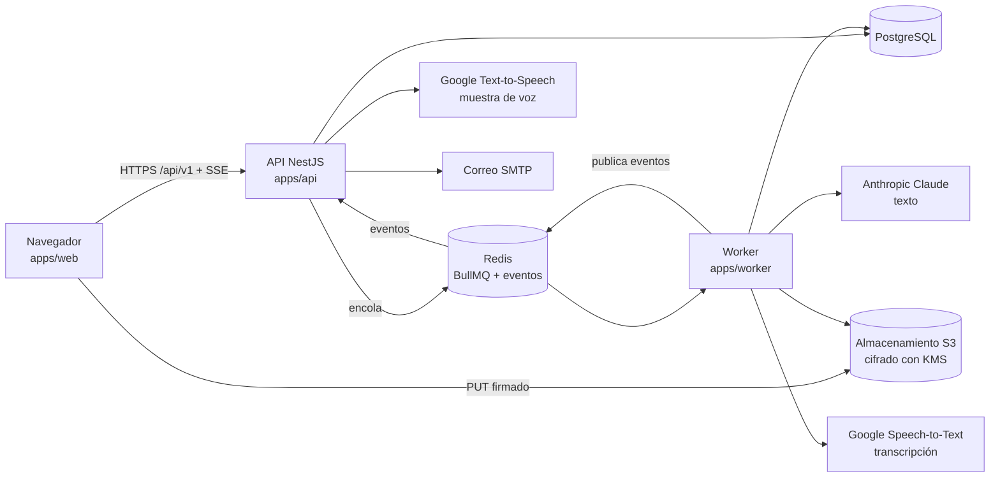
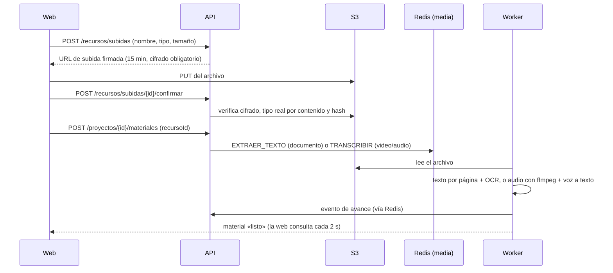
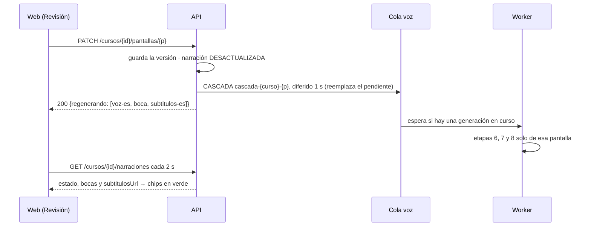
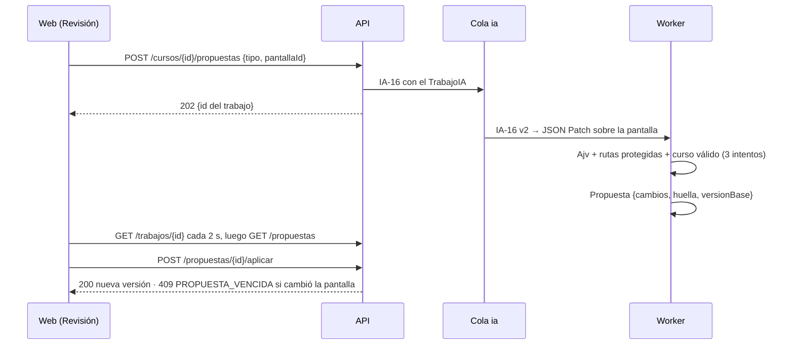
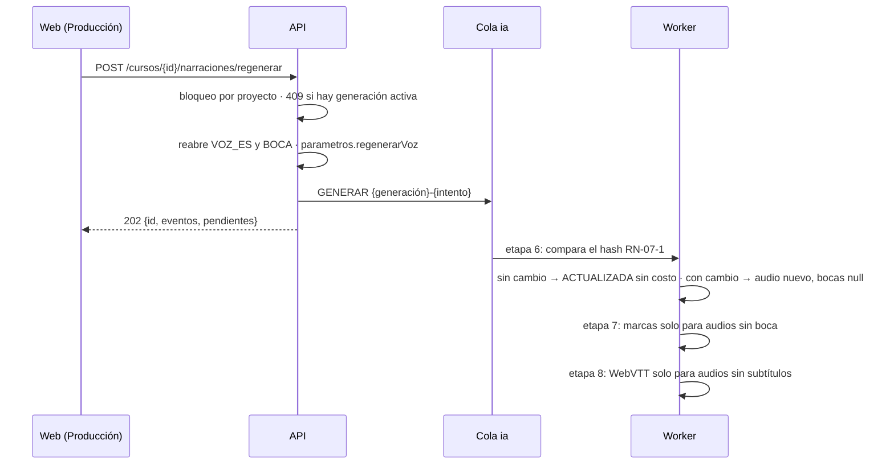
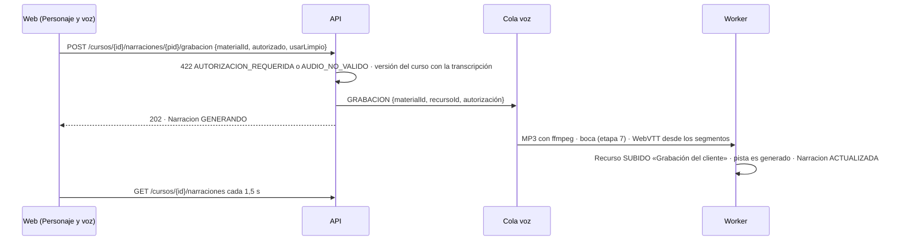
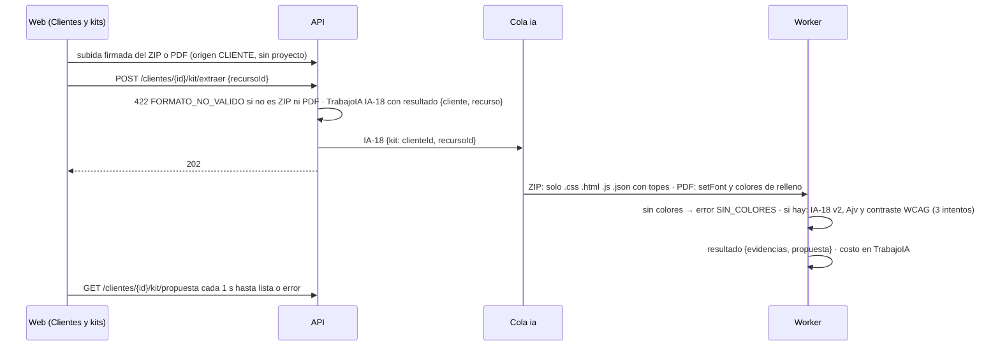

# Aptio SCORM · Manual del sistema

**Versión 0.86 · actualizado con la lista de llaves para producción (18 de noviembre de 2026)**

Describe cómo está construido y cómo funciona Aptio SCORM en conjunto: sus componentes, cómo viajan los datos, la seguridad, los proveedores externos, la configuración y la operación. Está pensado para el ingeniero a cargo, el área de infraestructura y quien audite el sistema. El detalle de código está en [`MANUAL-PROGRAMADOR.md`](MANUAL-PROGRAMADOR.md), y el uso de las pantallas, en [`MANUAL-USUARIO.md`](MANUAL-USUARIO.md).

---

## 1. Propósito y alcance

Aptio SCORM es la herramienta interna de AulasEducativas (Grupo de Soluciones Creativas SAC) para producir cápsulas de microaprendizaje con ayuda de IA. Toma el material del cliente y lo convierte en un SCORM revisable. El equipo revisa y ajusta, y nada se publica sin revisión humana.

**Estado al cierre del S2:**

| Área | Estado |
| --- | --- |
| Acceso: correo y clave, Google para invitados, roles, invitaciones y recuperación | Disponible |
| Clientes, kit de marca, personaje, pantallas modelo, glosario y pronunciación | Disponible |
| Proyectos y Nuevo SCORM | Disponible |
| Material del cliente: PDF, Word, PowerPoint (con OCR), video y audio (transcripción) | Disponible |
| Generador: lanzar, ver en vivo, cancelar y continuar | Disponible |
| Etapas 1 a 3: resumen con acta de omitidos, objetivos y estructura, guion por pantalla | Disponible |
| Etapas 4 a 11: pantallas, ilustraciones, voz, boca, subtítulos, inglés, calidad y paquete | Planificadas (S3 en adelante) |
| Revisión pantalla por pantalla, editor, exportación SCORM, fase comercial | Planificadas |

## 2. Arquitectura

| Componente | Tecnología | Responsabilidad |
| --- | --- | --- |
| Web | React 19 + Vite, `@aptio/ui` | Interfaz para celular primero. Sube archivos directo al almacenamiento y recibe el avance en vivo por SSE. |
| Reproductor | TypeScript sin dependencias (`@aptio/player`) | Dibuja el curso para el participante. Es el mismo en la vista previa de la web y dentro de cada paquete; corre en un Shadow DOM propio. |
| API | NestJS sobre Node.js | Sesión, roles, alcance por organización, validación, reglas de negocio, contrato OpenAPI y envío de trabajos a las colas. |
| Worker | BullMQ sobre Node.js | Trabajos largos: extracción de texto y OCR, transcripción, generación por etapas y borrado programado. |
| PostgreSQL 16 | Prisma (`@aptio/db`) | Datos de negocio, resultados de cada etapa, costos y auditoría. |
| Redis 7 | BullMQ (`@aptio/colas`) | Colas `ia`, `voz`, `media` y `export`, cola de mantenimiento y canal de eventos `aptio:eventos`. |
| Almacenamiento | S3 compatible con KMS (`@aptio/almacen`); LocalStack en local | Archivos del cliente y recursos, siempre cifrados y accesibles solo con URL firmada. |

Las decisiones de arquitectura están en `docs/adr/` y en `CLAUDE.md` («Decisiones tomadas»).

## 3. Flujos principales

### 3.1 Subir material del cliente

- **Documentos:** texto por página. Una página con menos de 25 caracteres se trata como escaneada y pasa por OCR (Tesseract, español e inglés).
- **Video y audio:** ffmpeg extrae el audio en tramos de 55 s (FLAC mono, 16 kHz). Cada tramo se transcribe y los tiempos se ajustan al inicio del tramo. Se guardan los fragmentos `{desde, hasta, texto}` y la duración.
- En ambos casos, el texto que parece una orden para la IA se marca como `posibleInstruccion` (CP-102).

### 3.2 Generar un SCORM

1. `POST /proyectos/{id}/generaciones` exige material leído y una sola generación activa por proyecto (protegida con un cerrojo en PostgreSQL). Crea las 11 etapas «En cola», pasa el proyecto a Producción y encola `GENERAR`.
2. El worker corre las etapas en orden y salta las ya completadas. Cada etapa recibe los resultados de las anteriores.
3. Cada etapa publica su estado. La web lo recibe por SSE (`GET /generaciones/{id}/eventos`) y, como respaldo, consulta cada 2 s.
4. Al final:
   - si las 11 etapas terminaron, el proyecto pasa a Revisión;
   - si faltan etapas por habilitar, vuelve a «Por generar» (SUP-24). Una etapa sin habilitar no frena a las siguientes que sí lo están.
5. **Cancelar** conserva lo terminado. Una etapa a medias deja de llamar a la IA y conserva el costo gastado. **Continuar** retoma desde la etapa con error o cancelada.

| Etapa | Tareas de IA | Resultado |
| --- | --- | --- |
| 1 · Leer y resumir | IA-01 mapa de temas, IA-02 conservar, complementario u omitir, IA-03 ideas clave por tema, IA-13 acta | Ideas clave con archivo y página, y acta de omitidos (CP-038) |
| 2 · Objetivos y estructura | IA-04 v2 | Objetivos con nivel de Bloom, y pantallas con tipo, objetivo, actividad y página. Número exacto de pantallas y mínimo de actividades (CP-039) |
| 3 · Storyboard y guion | IA-05 v2 (por cápsula) | Título, texto en pantalla, narración, visual, actividad y origen. Advertencia si pasa de 30 palabras en pantalla o 45 de narración (CP-040) |
| 4 · Pantallas con el kit | IA-15 v2 (por pantalla, hasta 4 a la vez) e IA-07 v2 (por actividad) | Disposición del kit, fondo y campos por pantalla, y los datos de cada actividad (CP-044; el reto final es sumativo), guardados como avance mientras corre (CP-043). Al terminar, el documento del curso validado en `Curso` con su versión (CP-042) |
| 6 · Voz en español | Google Text-to-Speech con la voz y la velocidad del kit (hasta 4 a la vez, 3 intentos por pantalla) | Un audio por pantalla con narración, con el diccionario de pronunciación aplicado, guardado como `Recurso` del cliente con su duración, y una `Narracion` ACTUALIZADA por pantalla. El curso enlaza el audio y su duración; la narración queda `pendiente` hasta la boca y los subtítulos (CP-071, SUP-34) |
| 7 · Boca del personaje | Rhubarb Lip Sync 1.13 (reconocedor fonético) sobre cada audio; por letras en modo simulado | Marcas `[ms, boca]` por narración en `Narracion.bocas` y en el curso. Local y sin costo (SUP-35) |
| 8 · Subtítulos | Una frase por subtítulo (máximo 84 caracteres) con tiempos repartidos por letras sobre la duración del audio | Un WebVTT por narración (recurso SUBTITULO) enlazado a la narración y al curso; la narración queda «generado». Local y sin costo (SUP-37) |

### 3.3 Vista previa con el reproductor único

1. La web pide `GET /api/v1/proyectos/{id}/curso` (con la versión en `ETag`) y el kit del cliente.
2. Monta `@aptio/player` sobre el documento del curso: dibuja cada pantalla con su disposición y el kit, y las actividades del catálogo.
3. Las reglas de avance del curso (`navegacion.modo`; sin ella, actividades obligatorias) deciden si se puede seguir. En modo revisión se puede ir a cualquier pantalla.
   - El patrón (`navegacion.patron`) solo cambia el marco: Clásico, Historias, Vertical, Mapa de misiones, Menú de temas, Ramificado o Inmersivo (Personalizado usa su base). Reglas, seguimiento, reanudación y teclado son los mismos en todos (HU-1103, SUP-100, SUP-101). Con `?patron=` y `?modo=` la vista previa prueba otro sin guardar.
   - Navegación (PNT-17): `GET /cursos/{id}/navegacion` (equipo) y `PUT` (administración y diseño instruccional) con la versión leída (409), validación del esquema (422) y motivo «navegación»; `patronPreferidoDelCliente` lo guarda en `KitMarca.patronPreferido` (422 SIN_KIT sin kit). Ver SUP-102 a SUP-104.
   - Patrón con IA (HU-1104, CP-088): `POST /cursos/{id}/propuestas` con `tipo: patron` y `modo` (`recomendar`, o `crear` con `descripcion`) encola IA-14 v2 en la cola `ia` con el contexto del curso (duración, público, dispositivo celular, pantallas, actividades, gamificación y estaciones); la descripción va como material no confiable. El worker normaliza el nombre (60 caracteres), valida con Ajv y `erroresPatron` (3 intentos) y guarda una `Propuesta` del curso entero con la versión base. Aplicarla exige la misma versión (409 PROPUESTA_VENCIDA), cambia solo `patron` y `patronPersonalizado` y crea una versión con motivo «navegación». Solo administración y diseño instruccional (403 al resto). El personalizado aplica `progreso`, `avance`, `menu`, `marcador` y `barra` sobre el marco de su base. Ver SUP-105 a SUP-110.
4. El panel de seguimiento muestra lo que se reportaría al LMS (avance, nota, puntos y `lesson_status`). No se guarda nada: la conexión con el LMS y la reanudación son solo del paquete exportado.

### 3.3.0.1 Validar antes de exportar (HU-1201)

1. La vista Entrega pide `POST /api/v1/cursos/{id}/validar` con el formato y el LMS elegidos, y vuelve a pedirlo al cambiar de LMS.
2. La API lee el curso actual, el peso de sus recursos en `Recurso.bytes` y el límite de subida: `limiteSubidaMb` de la `FichaCompatibilidad` más reciente del cliente o, sin ficha, `LIMITE_SUBIDA_REFERENCIA_MB` (100 por defecto). El reproductor se empaqueta una vez por proceso para medir su peso.
3. `validarScorm12` (`@aptio/exporters`) devuelve `errores` (esquema) y `advertencias`: peso estimado sobre el límite, con 5 alternativas y los 5 recursos más pesados; peor caso de `suspend_data` sobre 4096; archivos que faltan; pantallas sin aprobar. Responde 200 aunque haya errores y nunca bloquea por tamaño (RN-12-2).
4. La web deshabilita Exportar si hay errores y pide confirmación si hay pantallas sin aprobar (RN-12-3). La API de exportar no cambia.

### 3.3.0.2 Modo diagnóstico y fichas de compatibilidad (HU-1204)

1. Al abrirse, el paquete busca la API SCORM 1.2 con el algoritmo de ADL (su ventana y hasta 7 padres, luego la ventana que lo abrió) y anota cada ventana revisada en un `RegistroDiagnostico`, también las de otro origen. El adaptador anota cada llamada al LMS con su respuesta y el código de `LMSGetLastError`; se guardan las últimas 200 y cada valor se recorta a 200 caracteres. `cmi.core.student_id` y `student_name` nunca se leen y, si aparecieran, salen como «[omitido]» (SUP-57).
2. Ctrl+Alt+Shift+D o `?diagnostico=1` abren el panel dentro del Shadow DOM del reproductor; nunca se abre solo. «Copiar informe» entrega un JSON `aptio: diagnostico-scorm12` (versión 1) con la búsqueda, el estado inicial, el navegador resumido, la versión del reproductor, el curso con su huella y las llamadas.
3. `Exportacion.incluirDiagnostico` (por defecto true) llega al paquete; con false el paquete no responde al atajo ni a la consulta.
4. `GET` y `POST /api/v1/clientes/{id}/fichas-lms` guardan en `FichaCompatibilidad` el LMS, la versión, el límite de subida, las notas y el informe tal cual (un objeto de menos de 256 KB, como dato; SUP-58). La lista va de la más nueva a la más vieja; crean administración, diseño instruccional y producción, y cada creación queda en la auditoría como `FICHA_LMS_CREADA`. La ficha más nueva fija el límite de la validación (3.3.0.1).

### 3.3.0.3 Kit de gamificación para el LMS (HU-1205)

1. La tarjeta «Kit de gamificación para el LMS» de Entrega pide `POST /api/v1/cursos/{id}/exportaciones` con `formato: KIT_GAMIFICACION`, `perfilLms` (el LMS de la guía) y `modoIdioma` (`unico` o `mismo-paquete`). Sin `perfilLms`, la API toma el LMS de los datos técnicos del proyecto (`perfilPropuesto`). No hay validación previa (`validar` sigue siendo de SCORM 1.2 y HTML) ni migración: el formato ya existía. Con `mismo-paquete` no se exige el inglés.
2. La cola `export` lee la versión ligada del curso y el kit de marca del cliente (paleta, tipografías y logo, que se lee del almacenamiento) y llama a `construirKitGamificacion` de `@aptio/exporters`. Las insignias son las de `gamificacion.insignias` o, si no hay, una por cápsula, una por módulo y una del curso por plantilla, sin IA (SUP-161). Los PNG de 512 px los dibuja `@resvg/resvg-js` con las fuentes del servidor (SUP-163).
3. El ZIP lleva `insignias/svg/`, `insignias/png/`, `plan.json` (nota de `seguimiento.notaMinima` si el curso se completa por la sumativa, niveles y orden de desbloqueo), `guia-<lms>.html` con la nota «Verificar con la versión del cliente» (SUP-162) y `LEEME.txt`. Es determinista para el mismo curso, kit y LMS.
4. Se guarda como recurso PAQUETE `<proyecto>-kit-<lms>-v<n>.zip` con proveedor `aptio` y modelo `kit-gamificacion v1`; el informe trae `lms`, `insignias`, `archivos` y las advertencias (nombres sin inglés). La descarga es la del historial, con los mismos permisos (M14) y el aislamiento por organización.
### 3.3.0.3 HTML autocontenido (HU-1203)

1. Con `formato: HTML`, la API valida sin límite de subida ni `suspend_data` (`limiteMb`, `origenLimite` y `suspendDataCaracteres` en `null`, SUP-60). Crea la Exportacion con perfil `generico` e `incluirDiagnostico: false`.
2. El worker usa `construirHtml`: la misma carpeta que el SCORM 1.2, sin `imsmanifest.xml`, con `LEEME.txt` y `modo: 'html'` en `datos.js`. El archivo es `<proyecto>-html-v<n>.zip`.
3. Al abrir `index.html` (también desde `file://`), el reproductor no busca la API de SCORM, no avisa y no ofrece el modo diagnóstico. Todo es relativo: los scripts van con `src`, y los SVG del personaje y los WebVTT van dentro de `datos.js`, así que no hace falta `fetch`.
4. No hay seguimiento ni avance guardado en el navegador (SUP-61).

### 3.3.0.4 Accesibilidad de la cápsula (HU-1401)

1. Al montar, el reproductor calcula variantes legibles del kit con `colorLegible` (`src/contraste.ts`, razón de contraste de WCAG 2.2): `--ap-bien-texto` y `--ap-mal-texto` a 4,5:1 sobre el blanco y el fondo, y `--ap-foco` a 3:1. El kit guardado no cambia (SUP-63).
2. Todo control tiene foco visible de 3 px con halo blanco. Cuando una acción quita o desactiva el control enfocado, el foco pasa al resultado (`tabindex=-1`), al texto de la pregunta siguiente o al control vecino; el resultado también se anuncia por `aria-live`.
3. El quiz con tiempo ofrece «Quitar el límite de tiempo» (WCAG 2.2.1); no cambia vidas, puntaje ni lo que se informa al LMS.
4. Verificación: Playwright recorre LOTO y un curso con las 8 interacciones solo con teclado, y axe exige cero violaciones WCAG 2.2 A y AA. El lector de pantalla real queda para la demo (SUP-62).

### 3.3.0.5 Licencias y créditos de IA (HU-1406)

1. Todo recurso GENERADO guarda proveedor, modelo y licencia (REQ-062, ADR-010); `conProcedencia` en el worker no deja guardar uno incompleto. Lo que arma la plataforma sin IA (subtítulos por letras, el paquete) usa el proveedor `aptio`; la migración `20261112060000_recurso_procedencia` completa las filas viejas (SUP-64).
2. Al exportar, el worker toma la procedencia de los recursos del curso en el idioma del paquete y `armarCreditos` (`@aptio/exporters`) arma el aviso con el nombre de la organización y una fila por cada qué, proveedor, modelo y licencia, sin `aptio`. Van en `datos.js`; sin recursos de IA no hay créditos.
3. En el paquete, el botón «Créditos» abre un diálogo modal (`role="dialog"`, `aria-modal`, el resto `inert`); Escape o «Cerrar» devuelven el foco al botón.
4. La API devuelve `proveedor`, `modelo` y `licencia` en `GET /recursos` y `GET /recursos/{id}` con el mismo alcance (el revisor solo ve su cliente), y `POST /cursos/{id}/validar` devuelve `creditos` para la vista previa en Entrega.
5. Verificación: CP-106 con una ilustración sembrada hasta el S9 (SUP-65) y CP-107 con el HTML real de LOTO, teclado y axe en 0 violaciones.

### 3.3.0.6 Traducción con glosario (M08, HU-0802)

1. Cada texto `{ es, en }` del curso tiene una fila `Traduccion` (curso, ruta JSON Pointer, idioma `en`, huella del español y estado: Pendiente, Traducido por IA, Revisado). La API pone las filas al día al listar: crea las nuevas, borra las de rutas que ya no existen y devuelve a Pendiente las que cambiaron en español, aunque estuvieran revisadas (SUP-68).
2. `POST /cursos/{id}/traducciones/traducir` crea un `TrabajoIA` IA-10 y lo deja en la cola `ia` (202). El worker manda solo lo Pendiente (RN-08-2) en lotes de 60, neutralizado dentro de `<material_cliente>` y con el glosario del cliente (RN-08-1). La salida se valida con el esquema, con las rutas pedidas y con el glosario; si falla se reintenta con los errores (3 intentos) y, si no, el trabajo queda en error.
3. Cada lote se guarda en una transacción: versión nueva del curso (motivo «traducción») y sus filas en Traducido por IA. Un texto que alguien revisó o cambió mientras la IA traducía no se toca (SUP-67). El avance sale por SSE con un evento por lote.
4. `PATCH /traducciones/{id}` edita el inglés (queda Revisado) o marca Revisado, con `CursosService.guardar`. Traducen administración, diseño instruccional, diseño gráfico y producción; el revisor del cliente solo lee (403); otra organización recibe 404.
5. Verificación: CP-076 y CP-077 en el worker con PostgreSQL, en la API y en Playwright. IA-10 v2 aún no se probó con un modelo real (SUP-71); la voz en inglés va en la HU-0804 (SUP-70).
6. **Desbordes (HU-0803, RN-08-3):** cada texto en pantalla tiene un límite de caracteres por tipo de componente (`LIMITE_CARACTERES`, SUP-72) y va con él a IA-10. Lo que se guarda y no cabe queda en Desborde con el inglés completo en el curso; una segunda pasada de IA-10 (con `limite` y `actual`) propone la versión corta, valida que quepa y la guarda en `Traduccion.propuesta`. Un inglés a mano que no cabe queda en Desborde; la propuesta o «Marcar revisado» lo dejan Revisado (SUP-73). CP-078 se prueba en el worker, la API y Playwright.
7. **Paquete bilingüe (HU-0804 parte 1, RN-08-4):** con `modoIdioma: mismo-paquete`, `POST /cursos/{id}/validar` y `POST /cursos/{id}/exportaciones` arman SCORM 1.2 o HTML con `idiomas: ['es', 'en']` y los recursos de los dos idiomas. Validar cuenta los textos con inglés (`textosIngles`); si falta alguno es un error («Faltan N textos en inglés: tradúcelos en Idiomas») y exportar responde 422 TRADUCCION_INCOMPLETA. Los desbordes (filas en Desborde) y la falta de voz en inglés solo advierten (SUP-78). `separados` sigue en 422 IDIOMA_NO_DISPONIBLE (SUP-79). En el paquete, el botón EN / ES vuelve a montar la cápsula en la misma pantalla con vistas, resultados y puntos (SUP-76); el idioma va en `cmi.suspend_data` v2 con LMSCommit y el paquete abre en él al volver (SUP-77). CP-079 se prueba en Vitest, en la API, en el worker y en Playwright con el LMS de prueba y axe (WCAG 2.2 A/AA).
8. **Voz, boca y subtítulos en inglés (HU-0804 parte 2, RN-07-1):** `POST /cursos/{id}/narraciones/regenerar` con `idiomas: ['en']` continúa las etapas 6 a 8 de la última generación con `parametros.regenerarVoz.idioma = en` (202 con `pendientes`; 422 SIN_TRADUCCION si ninguna narración tiene inglés; 422 IDIOMA_NO_DISPONIBLE con los dos idiomas a la vez; 403 al revisor del cliente). El worker toma el `.en` de cada narración traducida, la voz `voces.en` del kit o `en-US-Neural2-F` con la velocidad del español (SUP-81) y solo la pronunciación en inglés (SUP-82); guarda `porIdioma.en`, la fila `Narracion` en `en` y los recursos `pNN-en.mp3` y `pNN-en.vtt` con su procedencia (REQ-062). El hash decide qué se vuelve a sintetizar y el español no se toca. La vista Producción muestra esa última corrida (SUP-83); las marcas de palabra siguen la voz en español (SUP-84). El paquete bilingüe lleva esos audios y VTT; el aviso de exportación cuenta las pantallas sin voz en inglés.

### 3.3.1 Reanudación en el paquete (HU-1105)

1. Al abrir, el paquete hace `LMSInitialize` y lee `cmi.core.entry`, `lesson_location`, `suspend_data`, `lesson_status` y `score.raw`. Ya no hace `LMSCommit` al entrar.
2. Si `entry` no es `ab-initio`, el `suspend_data` es válido (v1, o v2 con la huella de este curso) y la pantalla guardada existe y no es la primera, pregunta «¿Continuar donde lo dejaste?» según `navegacion.reanudar` del curso (preguntar, automatica o no). Lo inválido se descarta y el curso empieza en p01 (SUP-53).
3. Mientras pregunta no escribe `lesson_location` ni `suspend_data` ni hace commit. Continuar restaura vistas, resultados, puntos e intentos; Empezar de nuevo vuelve a p01 sin avance (SUP-54).
4. Lo informado no baja: un `lesson_status` cerrado nunca pasa a uno menor y, con «mejor nota», `score.raw` no baja.

### 3.3.0 Regeneración en cascada desde Revisión

Al corregir la narración en español de una pantalla que ya tiene voz, se regeneran solas su voz, su boca y sus subtítulos, sin pasar por una generación (HU-0503, SUP-38).

Varios guardados seguidos dejan un solo trabajo, que corre 1 s después del último (CP-051). El costo de la voz queda en `TrabajoIA` con el proyecto y sin generación. Si la voz falla, la narración queda en ERROR y los chips en rojo.

### 3.3.0b Propuestas de la IA

La IA nunca cambia el curso por su cuenta: solo la acción Aplicar crea una versión. Deshacer restaura la anterior conservando la narración y su audio (SUP-39).

### 3.3.0.1 Edición en el lugar (Editor, PNT-21)

El editor (`/proyectos/{id}/editor?pantalla=pXX`) dibuja la pantalla con el mismo reproductor que Revisión y vuelve editables los textos (`data-bloque` de tipo texto). Al terminar con Enter o al salir del texto, la web envía `PATCH /cursos/{id}/pantallas/{pantallaId}` con `titulo` (el primer texto con rol título) o `textos[bloque]`, y la versión que conoce. La API crea una versión, deja la pantalla en borrador y marca el texto como `origen.tipo = manual`. Esc no envía nada. Si la versión cambió, responde 409 y la web recarga el curso. No hay cambios en la API ni en el esquema; el alcance del esqueleto está en SUP-40.

Los retoques (HU-0602) viajan en el mismo `PATCH` como `ajustes: { [bloque]: AjusteElemento | null }` y se guardan en `ajustes` de la pantalla, aparte del contenido (RN-06-1). La API rechaza un elemento que no existe (422 BLOQUE_NO_EXISTE), un color que no es un rol del kit (422 COLOR_FUERA_DEL_KIT, RN-06-4) y un valor fuera del esquema (422 CURSO_NO_VALIDO). El reproductor los aplica en el editor, la vista previa y el paquete: tamaño en `cqw`, color por variable del kit, alineación, escala y 4 animaciones de entrada que se quitan con «reducir movimiento» (SUP-41).

El modo Libre (HU-0603) guarda `ajustes[bloque].desplazamiento {x, y, dispositivo: 'todos'}` en % del ancho, con el mismo `PATCH`. El reproductor lo aplica con `translate` en cqw según el dispositivo (escritorio desde 640 px de ancho del reproductor), así que la posición se mantiene en cualquier resolución (CP-058). El modo en sí no se guarda (SUP-42).

Cambiar el diseño (HU-0605) va en el mismo `PATCH` con `disposicion`: una de las 4 composiciones de contenido (idea, personaje, dato, lista), o volver a portada, objetivos, sección, resumen o cierre. Cambia la plantilla sin tocar los bloques, reinicia los ajustes y conserva los extras (RN-06-3); si vienen `ajustes` en el mismo cambio, se aplican después, y así se deshace. Una pantalla con actividad o video, o la de resultados, responde 422 DISENO_NO_PERMITIDO (SUP-44). Las observaciones por reglas se recalculan, por ejemplo la de tres disposiciones iguales seguidas.

Los elementos agregados (HU-0606) van en el mismo `PATCH` con `extras`: la lista completa de la pantalla, cada uno con `id`, `tipo` (título, texto, dato, botón, imagen, insignia, forma o personaje), posición base `x`, `y`, `ancho` en % y, según el tipo, `texto`, `recursoId` o `alClic` (`siguiente` o `nada`). Un id que falta, repetido o igual al de un bloque responde 422 EXTRA_NO_VALIDO; una posición fuera de 0 a 100 o un tipo desconocido, CURSO_NO_VALIDO. Quitar un extra borra sus ajustes. Ocultar es `oculto: true` en los ajustes del elemento; los bloques de la IA solo se ocultan (SUP-45). Lo oculto no se ve en la vista previa ni en el paquete. Un extra `imagen` (HU-0609, CP-070, REQ-046, REQ-017) lleva `pieza` (una de las 6 de la biblioteca del kit, dibujada con sus colores) o `recursoId` (una imagen o SVG subido o generado en el proyecto), nunca los dos, y puede ser `decorativa`. Si el recurso aún no está en `recursos` del curso, el mismo `PATCH` lo suma con origen `subido`, en la misma versión; quitar la imagen (también con Deshacer) lo saca si ya nadie lo usa. Un recurso de otro proyecto, del material del cliente o que no es imagen responde 422 RECURSO_NO_VALIDO; `pieza` y `recursoId` juntos, EXTRA_NO_VALIDO. `GET /proyectos/{id}/curso` firma también las imágenes y SVG del curso, y `GET /recursos?proyectoId=…&biblioteca=true` da la biblioteca del proyecto con URL firmada (SUP-128 a SUP-131).

Deshacer y rehacer en el editor (HU-0607) mandan el mismo `PATCH` con `motivo` `deshacer` o `rehacer`, que queda como motivo de la `CursoVersion` (sin él dice «edición»; otro valor responde 422). El historial vive en el navegador, para la sesión del editor, con hasta 60 cambios, y se guarda 1 s después de la última pulsación (RN-06-5, SUP-46). Con 409 el editor recarga el curso y vacía el historial.

Los tiempos de la línea de tiempo (HU-0608) van en los mismos `ajustes`: `retardoS` (cuándo aparece), `finS` (cuándo sale) y `anclaPalabra` (el índice de la palabra de la narración a la que quedó pegada la entrada). Las marcas de palabra no se guardan: se calculan repartiendo la duración del audio en español por letras (SUP-47). La pantalla dura lo mayor entre la voz + 1 s y la última salida (RN-06-7); sin tiempo, los elementos entran escalonados de a 0,3 s (RN-06-9). El reproductor del paquete y de la vista previa aplica los tiempos con el reloj del audio. Al corregir la narración, la API pasa cada ancla a la misma palabra del texto nuevo; con la voz nueva, el worker le da el segundo de esa palabra (RN-06-8). Si la palabra ya no está, el elemento conserva su segundo y queda una observación con origen `tiempo` («Revisar tiempo», aviso, no bloquea), que se borra al cambiar su entrada o su ancla. «Sincronizar con la voz» se calcula en el editor, sin IA ni costo (SUP-48), y se guarda como cualquier retoque.

Los disparadores (HU-0610, CP-069, REQ-045) van en el mismo `PATCH` con `disparadores`: la lista completa de la pantalla, cada uno con `id` (`pNN-disp-N`), `cuando` (`tiempo` con `segundo` de 0 a 600, o `fin-voz`) y `accion` (`mostrar` u `ocultar` con `elementoId`, un bloque o un extra de la pantalla, o `ir-a` con `pantallaId`, otra pantalla del curso). La regla 6 del validador (`erroresDisparadores`) exige como mucho 10 por pantalla, ids que no se repiten y referencias que existen; si falla, la API responde 422 DISPARADOR_NO_VALIDO con `detalles`. Quitar un extra borra los disparadores que lo usan. El reproductor los evalúa con el mismo reloj de la línea de tiempo en la vista previa y en el paquete: `mostrar` gana a `oculto` y a `retardoS`, `ocultar` gana a `finS`, «ir a» pasa por la regla de avance (RN-11-4) y, si está bloqueado, no salta y muestra el motivo; volver a la pantalla los reinicia. La pantalla dura hasta 1 s después del último disparador por tiempo. En el editor solo actúan con ▶ Reproducir y el «ir a» se avisa sin cambiar de pantalla (SUP-111 a SUP-115).

Las preguntas del video (HU-0901, CP-080, RN-09-1) viven en `marcadores` del bloque de video y se guardan con el mismo `PATCH`, como `marcadores: { [bloqueDeVideo]: MarcadorVideo[] }`, la lista completa del bloque (capítulos y puntos incluidos). La regla 7 del validador (`erroresMarcadores`) exige tiempos enteros desde 0 que no pasen `recursos[].duracionMs` cuando se conoce, ids únicos y preguntas con enunciado, al menos 2 opciones y exactamente 1 correcta; si falla, la API responde 422 MARCADOR_NO_VALIDO con `detalles`, y BLOQUE_NO_EXISTE si el bloque no es un video de la pantalla. El curso trae la URL firmada de cada video, como la de los audios. El reproductor detiene el video al cruzar el tiempo de una pregunta, la muestra encima, sigue al acertar y deja reintentar al fallar; una no obligatoria se salta. Una pantalla obligatoria con video cuenta como actividad: queda completa, sin puntaje, cuando el video termina con las obligatorias acertadas (SUP-116 a SUP-120). La vista es Video interactivo (`/proyectos/{id}/video`, PNT-10). «Impedir adelantar» (HU-0902, CP-081, RN-09-2) se guarda con el mismo `PATCH` como `reglasVideo: { [bloqueDeVideo]: { impedirAdelantar } }`; `porcentajeMinimo` se conserva si no se manda, y algo mal formado responde 422 REGLA_VIDEO_NO_VALIDA. Con la regla activa, el reproductor no deja ir más allá de una pregunta sin responder ni saltar: vuelve a su segundo, la muestra y lo avisa con una alerta accesible en el idioma del curso; retroceder siempre se puede (SUP-122, SUP-123). `porcentajeMinimo` todavía no se aplica. Las pausas propuestas por la IA (HU-0903, CP-082, REQ-027, IA-09 v2) se piden con `POST /cursos/{id}/propuestas` y `tipo: "pausas-video"` para la pantalla; exige un video en la pantalla (si no, 422 BLOQUE_NO_EXISTE) con su transcripción lista en el material del cliente (si no, 422 SIN_TRANSCRIPCION). El trabajo corre en la cola `ia`: la salida valida contra el esquema y además debe traer al menos un marcador por cambio de tema, ninguno en mitad de una frase ni más allá del video (3 intentos en total), y se guarda como propuesta con su campo `pausas` (`cambiosTema`, `marcadores`, `observaciones`). Al aplicar se mandan los elegidos en `marcadorIds` (hasta 12; ninguno responde 422 MARCADORES_REQUERIDOS); toman ids nuevos, se suman a los existentes marcados como de la IA, y los que quedan a menos de 2 s de otro del mismo tipo se omiten con su motivo en `observaciones`; `agregados` trae los ids nuevos. Si la pantalla cambió, 409 PROPUESTA_VENCIDA; el revisor del cliente recibe 403 (SUP-124 a SUP-127).

Los retoques (`ajustes`, `extras` y `disparadores`) nunca van a la IA (HU-0604, SUP-43): IA-16 recibe la pantalla sin ellos, un patch que los toque se rechaza y la huella que vence una propuesta no los cuenta. Al aplicar una propuesta, al restaurar una versión y al generar el curso de nuevo, cada pantalla conserva sus extras y los ajustes de los elementos que siguen; si cambia la disposición, los ajustes se reinician (RN-06-3) y Revisión lo avisa antes de aplicar (CP-059).

### 3.3.1 Narración con boca sincronizada

La vista previa pide `GET /proyectos/{id}/curso`, que trae las URL firmadas de los audios (15 minutos) y el SVG del personaje. El reproductor dibuja el SVG en línea y, mientras suena el audio, muestra en cada cuadro la boca que marca `audio.currentTime` (CP-072: desfase máximo medido de 16 ms). Con «Siguiente se habilita al terminar la narración», no se avanza hasta el evento `ended` del audio.

La vista previa recibe también el texto de cada WebVTT en `subtitulos` (mismo motivo: sin CORS). Con «CC», el reproductor muestra la frase del momento según `audio.currentTime`, y el texto completo en pausa. Dentro de un paquete exportado, los VTT se leerán de la carpeta del paquete cuando la exportación los incluya (HU-1202, S6).

### 3.3.2 Regenerar narraciones desactualizadas

Una narración pasa a DESACTUALIZADA («Por regenerar») en dos casos: cuando se guarda un cambio del diccionario de pronunciación que afecta a una palabra suya (RN-02-4), y cuando se corrige su texto en Revisión. Sigue sonando su audio anterior hasta que se regenera.

### 3.3.3 Audio del cliente como narración (HU-0704)

La pista queda con `voz.proveedor: cliente` y `grabacion` (material, audio usado, quién autorizó y cuándo; RN-07-4). La etapa 6 no la vuelve a decir y conserva su recurso; corregir su texto no la regenera. El MP3 no tiene fecha de borrado: el borrado del material del cliente no lo toca. `POST /materiales/{id}/limpiar` encola en `media` la limpieza con `afftdn` y `loudnorm` a −16 LUFS: un MP3 nuevo del cliente con la retención del original, que no se pisa; sin ffmpeg queda en error y no se guarda nada. `relocutar` pone la transcripción con la voz del kit y encola la cascada.

Solo se paga voz por lo que de verdad cambió. Con `pantallaIds` el pedido se limita a esas pantallas, y con `soloDesactualizadas: false` se fuerza una toma nueva. Inglés responde 422 hasta la HU-0901.

### 3.3.4 Kit desde un curso anterior o un manual de marca (HU-0206)

El ZIP se lee sin descomprimirlo entero: hasta 5000 entradas, 2 MB por archivo de texto, 20 MB en total y 400 archivos; el flujo se corta en el tope, así que una ZIP bomb no ocupa memoria, y las rutas con `..` o absolutas no se abren. Las fuentes propuestas son siempre de la lista cerrada del kit y la de la marca queda como aviso. El kit no cambia hasta que el equipo pulsa «Guardar kit», con el bloqueo de versión de siempre. `DELETE /clientes/{id}/kit/propuesta` la descarta (auditoría `KIT_PROPUESTA_DESCARTADA`). El productor y el revisor del cliente reciben 403.

### 3.4 Revisión y aprobación de pantallas

1. Al terminar la etapa 4, el worker guarda con el curso las observaciones por reglas: longitud del texto, del dato destacado y de la narración, imagen sin texto alternativo y tres disposiciones iguales seguidas.
2. La web pide el curso y `GET /api/v1/cursos/{id}/observaciones?resuelta=false`. Muestra cada pantalla con el reproductor, sus observaciones y su origen (documento y página, IA o equipo).
3. `PATCH /cursos/{id}/pantallas/{pantallaId}` guarda el título, los textos o la narración con la versión leída. Si la versión no coincide, responde 409. La pantalla vuelve a borrador, se guarda una versión en el historial y se recalculan las observaciones por reglas.
4. `POST /cursos/{id}/pantallas/{pantallaId}/aprobar` aprueba una pantalla, salvo que tenga una observación que bloquea la entrega (409). `POST /cursos/{id}/pantallas/aprobar` con `soloSinObservaciones` aprueba todas las que no tienen observaciones abiertas y devuelve las aprobadas y las pendientes.
5. Editan todos los del equipo y aprueban administración y diseño instruccional. El revisor del cliente solo lee los cursos de su cliente.
6. Control de calidad (HU-0505, IA-12 v2). `recalcularReglas` (`@aptio/db`) recalcula las observaciones por reglas con la paleta del kit y las filas de Traduccion en Desborde, al guardar, al cambiar una traducción, en cada lote de la traducción y en la etapa 4. `POST /cursos/{id}/control-calidad` crea un TrabajoIA `IA-12` y lo encola en `ia` (202; 409 CALIDAD_EN_CURSO si el proyecto ya tiene uno en cola o en curso; 403 al revisor). El worker manda la cápsula a IA-12 en lotes de 10 pantallas, con los textos dentro de `<material_cliente>` y las reglas del lote, valida con Ajv (3 intentos) y, en una transacción, borra las de IA abiertas y crea como mucho 120 nuevas, sin las descartadas (pantalla y mensaje). El avance va por SSE. La etapa 10 del generador hace lo mismo. `PATCH /observaciones/{id}` con `resuelta: true` descarta una de IA; una de reglas responde 422 OBSERVACION_DE_REGLA. Las observaciones de IA nunca bloquean (alta y media → aviso, baja → info). Observacion guarda `categoria`, `sugerencia` y `ruta`. SUP-85 a SUP-90.
7. Alineación pedagógica (HU-1001, M10, PNT-18). `GET /cursos/{id}/alineacion` calcula sin IA, desde el documento, el informe por objetivo con `informeAlineacion` (`@aptio/schema/alineacion`): rol de cada pantalla o pregunta (P contenido y video, A actividad formativa, E actividad sumativa por pregunta), su nivel de Bloom (`nivelBloom` opcional o el de su disposición), las alertas de RN-10-2 y los indicadores. `PATCH /cursos/{id}/alineacion` cambia niveles de objetivos y elementos con la versión leída (409 VERSION_CAMBIO, 422 NIVEL_NO_APLICA) y guarda una versión con motivo «alineación»; lo usan administración y diseño instruccional (gráfico y producción solo leen; el revisor del cliente, 403). La validación de exportación suma `objetivosSinAlinear` y advierte sin bloquear. SUP-91 a SUP-95. Corrección con IA (HU-1002, CP-084): `POST /cursos/{id}/propuestas` con `tipo: alineacion` encola IA-17 v2 en la cola `ia` (422 SIN_ALERTAS sin alertas); el worker valida la salida con Ajv y `erroresCorreccion` (rutas permitidas, curso válido y 0 alertas en los objetivos tratados, 3 intentos) y guarda una `Propuesta` del curso entero con la versión base. Aplicarla exige la misma versión (si no, 409 PROPUESTA_VENCIDA), crea una versión con motivo «alineación» y devuelve `pantallasPorRevisar` (en borrador, con preguntas `origen` IA sin revisar). Solo administración y diseño instruccional piden, aplican y descartan. SUP-96 a SUP-99.

### 3.5 Toda salida de IA se valida

Cada respuesta se valida contra el esquema JSON de su tarea y contra las reglas propias de la etapa. Si no valida, se reintenta con los errores, hasta 3 intentos. Si sigue fallando, la etapa queda en ERROR y **nada se guarda a medias** (RN-04-2). Cada intento queda registrado con su consumo y costo.

### 3.6 Resumen de costos de IA (HU-1302)

Cada llamada a un proveedor deja su consumo y su costo en dólares en `TrabajoIA` (CP-096). `GET /costos` los suma, siempre dentro de la organización de la sesión y sin los trabajos que aún no llamaron a un proveedor:

- **Filtros:** `desde` y `hasta` son días de Lima (UTC−05:00), ambos incluidos, sobre la fecha del trabajo; `clienteId` toma los proyectos del cliente y sus trabajos sin proyecto (`resultado.clienteId`, hoy la propuesta del kit IA-18); `proyectoId`, uno solo. Una fecha que no es AAAA-MM-DD o un identificador que no es UUID dan 422.
- **Respuesta:** `totalUsd`; `porProyecto` (cliente, llamadas, costo y si tiene una exportación COMPLETADO); `porCliente` (proyectos y sin proyecto); `porProveedorTarea` (llamadas y costo); y el promedio por SCORM con `scormContados` y `criterioPromedio`: `exportados` si hay proyectos con paquete exportado en el alcance, o `con-gasto` si aún no los hay. Sin proyectos, el promedio es 0.
- **Permisos:** administración y diseño instruccional (solo lectura); el resto recibe 403. La web lo muestra en «Empresa › Rentabilidad», con el equivalente en soles según el tipo de cambio guardado (SUP-140, SUP-141, SUP-144).

### 3.7 Rentabilidad y mediciones (HU-1303)

La regla RN-13-1 vive en `@aptio/schema/rentabilidad`, que usan la API y la web (la vista recalcula sin llamar al servidor):

- **Cálculo:** capacidad = personas × horas productivas × 22 días hábiles; SCORM al mes = capacidad ÷ horas; costo hoy = horas × tarifa + licencias del mes ÷ SCORM al mes; con el generador se suma la IA por API × tipo de cambio. Días = horas ÷ horas del equipo al día + espera del cliente; márgenes al precio de la competencia y al nuevo precio. Las divisiones entre cero dan 0.
- **Parámetros:** uno por organización (`ParametrosNegocio.organizacionId`, migración aditiva); mientras no se guarden, `GET /negocio/parametros` devuelve el ejemplo del prototipo con `ejemplo: true`. `PUT` solo administración (auditoría PARAMETROS_NEGOCIO_GUARDADOS).
- **Mediciones:** `MedicionProceso` por proyecto (id de la herramienta o nombre), escenario (`hoy` o `generador`) y una de las 8 etapas fijas. Con `GET /negocio/rentabilidad?fuente=mediciones`, cada proyecto suma sus horas por etapa y se promedia entre los proyectos del escenario; el que no tiene mediciones usa los supuestos y lo dice `respaldo`. Registrar y borrar (`DELETE /negocio/mediciones/{id}`, auditoría MEDICION_BORRADA): administración y diseño instruccional; los demás reciben 403 (SUP-143 a SUP-145).

### 3.8 Conexiones IA y límite de gasto (HU-1304)

Cada organización elige proveedor, modelo y límite mensual por tarea (`ConfigProveedor` con `organizacionId`, único por organización y tarea; migración aditiva). Sin fila guardada se usa el entorno, como antes.

- **En caliente (CP-099, RN-13-2):** el worker lee la conexión al empezar cada trabajo; no hace falta reiniciarlo. En texto, `tareaRegistrada` registra el tipo real (texto, pantallas con IA-15/IA-16, traducción con IA-10, calidad con IA-12) y usa el modelo de la conexión, que debe tener tarifa en `TARIFAS`. En voz, la etapa 6 usa el proveedor activo: la voz del kit si es de ese proveedor o la voz por idioma de la conexión; una narración ya lista se conserva.
- **Límite (CP-100, RN-04-7):** antes de llamar al proveedor (texto, voz y transcripción) se suma `TrabajoIA.costoUsd` de la organización y el tipo desde el día 1 del mes de Lima. Si llega al límite, el trabajo queda en error con «LIMITE_GASTO: …», se audita LIMITE_GASTO_ALCANZADO y no se llama al proveedor; la generación se continúa con `POST /generaciones/{id}/continuar` después de subirlo. Desde HU-1403, el primer tope del mes con ese límite avisa por correo a cada administración activa (el worker usa `SMTP_URL`; un fallo queda en el registro y no cambia nada).
- **API (solo administración):** `GET /conexiones-ia` (las 8 tareas con opciones, `claveConfigurada`, costo estimado, gasto del mes, límite y `limiteAlcanzado`, más el total del mes y la suma de límites para el medidor), `PUT /conexiones-ia/{tarea}` (auditoría CONEXION_IA_GUARDADA; 422 PROVEEDOR_NO_VALIDO, MODELO_NO_VALIDO o un campo de clave) y `POST /conexiones-ia/{tarea}/probar` (llamada mínima en modo real, «simulado, OK» en simulado; no se registra en TrabajoIA).
- **Claves (RN-13-3):** solo en variables de entorno (`ANTHROPIC_API_KEY`, `GOOGLE_TTS_API_KEY`, `ELEVENLABS_API_KEY`); nunca se guardan ni se devuelven (SUP-146 a SUP-150).

### 3.9 Comentarios del revisor del cliente (HU-0506)

Los comentarios son por pantalla (`Comentario` con `cursoId` y `pantallaId`, índice compuesto) y no tocan el documento del curso ni su versión.

- **Quién (CP-055):** `GET` y `POST /cursos/{id}/comentarios` los usan el equipo y REVISOR_CLIENTE con el mismo alcance que el curso: el revisor solo en los proyectos de su cliente; otro cliente u otra organización responde 404. El revisor sigue sin poder guardar pantallas (403).
- **Qué:** texto plano de 1 a 1000 caracteres, recortado y sin caracteres de control salvo saltos de línea y tabulaciones; la pantalla debe existir en el curso (422 PANTALLA_NO_EXISTE). La respuesta trae el autor con su rol para el distintivo «Cliente». El texto no se edita ni se borra.
- **Resolver:** `PATCH /comentarios/{id}` con `{resuelto}`, solo el equipo (403 al revisor); guarda o limpia `resueltoPorId` y `resueltoEn` (migración aditiva) y audita COMENTARIO_RESUELTO o COMENTARIO_REABIERTO.
- **Estado de aprobación:** comentar no lo cambia y los comentarios abiertos no bloquean la exportación. Desde HU-1403, un comentario del revisor del cliente avisa por correo a quien creó el proyecto y a diseño instruccional, sin esperar el envío (SUP-151 a SUP-155, SUP-158).

### 3.10 Observabilidad y copias de seguridad (HU-1403)

- **Copia diaria (CP-108):** la cola `mantenimiento` del worker corre `respaldar` a las 3:00 de Lima (y con «Respaldar ahora», `POST /operacion/respaldar`, id fijo `respaldo-manual`, 409 si hay una corriendo o pendiente). `@aptio/respaldo` crea la fila `Respaldo` (EN_CURSO), hace `pg_dump --format=custom` con la clave en `PGPASSWORD` (nunca en los argumentos), lo sube a `<carpeta>/base.dump` del bucket `S3_BUCKET_RESPALDOS`, copia cada objeto del bucket de recursos a `<carpeta>/objetos/` con el cifrado KMS y sube al final `manifiesto.json`. Termina EXITOSO (tamaño, duración y objetos) o FALLIDO (con el error, y borra lo subido a medias), con auditoría RESPALDO_CREADO o RESPALDO_FALLIDO. Después purga las carpetas de más de 14 días (EXPIRADO, RESPALDOS_PURGADOS).
- **Restaurar:** `pnpm respaldo:restaurar <AAAA-MM-DD o carpeta> --base postgresql://… --bucket nombre` toma la última copia con manifiesto de ese día de Lima, exige una base vacía, se niega a usar la base o el bucket en uso o el de respaldos, corre `pg_restore --exit-on-error` y copia los objetos al bucket nuevo. La prueba CP-108 levanta la API sobre lo restaurado y comprueba salud, ingreso, proyectos y curso.
- **Operación (`GET /operacion`, solo administración):** errores por proveedor de la organización (24 h y 7 días de Lima, desde TrabajoIA y los fallos de BullMQ sin TrabajoIA, LIMITE_GASTO aparte), pendientes, activos y fallidos de las 5 colas (null si Redis no responde en 2 s), tiempo y costo promedio de las 11 etapas en 30 días y las copias de 14 días (SUP-156 a SUP-160).

### 3.11 Sitio web: acceso del superadmin (HU-1501)

`GET /sitio/paginas` (módulo `sitio`, M16) responde solo al SUPERADMIN. En la web, el superadmin entra directo a «Sitio web › Resumen» (`/sitio`, PNT-24) y cualquier otra ruta lo devuelve ahí (SUP-166). Para el resto de los roles, el grupo no existe y `/sitio` muestra «Página no encontrada». No hay migración: el rol ya estaba en el esquema y en la semilla (`superadmin@aptio.test`).

### 3.12 Páginas con estados y programación (HU-1502)

- **Estados (RN-16-6):** BORRADOR, PROGRAMADA y PUBLICADA en `SitioPagina`, única por ruta e idioma. `POST` y `PATCH /sitio/paginas` cambian el título, la ruta (en una publicada crea la 301 de la anterior, HU-1512) y el estado; `DELETE` solo en borrador. Cada cambio deja una fila `SITIO_PAGINA_*` en la auditoría, sin organización.
- **Sitio público:** `GET /publico/paginas?ruta=&idioma=` responde 404 si la página no está publicada (CP-110) y `GET /publico/sitemap.xml` lista solo las publicadas con `SITIO_URL` (el inglés bajo `/en`, SUP-168). Toda ruta `/publico/*` tiene un límite de 60 peticiones por minuto por IP (SUP-169).
- **Programación (CP-111):** la tarea `publicar-paginas` de la cola `mantenimiento` corre cada 30 s y publica las programadas vencidas, con auditoría sin usuario; la cola atiende 2 tareas a la vez para que una copia de seguridad no la atrase (SUP-171).

### 3.13 Editor de página por bloques (HU-1503)

- **Bloques (REQ-066):** cada página tiene filas `SitioBloque` (tipo del catálogo cerrado de 18, `orden` 0, 1, 2… sin huecos, `visible` y `ajustes` en JSON), que se borran con su página. Un bloque nuevo va al final y oculto (RN-16-2); ocultarlo no borra sus `ajustes` (CP-112).
- **Rutas (solo SUPERADMIN):** `GET`, `POST` y `PATCH /sitio/paginas/{paginaId}/bloques` (listar, agregar, reordenar con la lista completa de ids; 422 ORDEN_INVALIDO si faltan, se repiten o son de otra página) y `PATCH` y `DELETE /sitio/paginas/{paginaId}/bloques/{bloqueId}` (mostrar u ocultar; borrar y compactar). Cada cambio deja una fila `SITIO_BLOQUE_*` o `SITIO_BLOQUES_REORDENADOS` en la auditoría.
- **Sitio público:** `GET /publico/paginas` devuelve `bloques` con solo los visibles y en su orden (CP-113); si la página no está publicada, 404 sin bloques (RN-16-4). Mientras no exista la publicación con versiones (HU-1507), los cambios se ven al momento (SUP-172).

### 3.14 Contenido administrable (HU-1504)

- **Colecciones (REQ-066):** `SitioElemento` guarda cifras, testimonios, logos, funcionalidades, pasos, LMS y preguntas con `orden`, `visible` (nace en false, CP-115) y `datos`. Los campos de cada colección son cerrados y solo texto plano, sin etiquetas HTML (RN-16-7); los valida `@aptio/schema/sitio-contenido` en la API y en la web.
- **Rutas (solo SUPERADMIN):** `GET`, `POST` y `PATCH /sitio/elementos` (listar por `coleccion`, agregar, reordenar con la lista completa) y `PATCH` y `DELETE /sitio/elementos/{id}` (datos parciales o visibilidad; borrar y compactar). Cada cambio deja una fila `SITIO_ELEMENTO_*` o `SITIO_ELEMENTOS_REORDENADOS` en la auditoría.
- **Sitio público:** en `GET /publico/paginas`, cada bloque visible con colección trae sus `elementos` visibles en orden; la visibilidad va en cascada página → bloque → elemento (RN-16-4, CP-114). Las preguntas generales salen en todas las páginas y las de una ruta solo en esa (SUP-177).

### 3.15 Datos ficticios y bloqueo de publicación (HU-1505)

- **Entorno (`SITIO_ENTORNO`):** `pruebas` o, si falta o trae otro valor, `produccion` (SUP-179). Lo leen la API en cada uso y el worker en cada vuelta.
- **Regla (RN-16-3):** un `SitioElemento` con `ficticio` y `visible` bloquea en producción publicar cualquier página: `PATCH` o `POST /sitio/paginas` con `accion=publicar` responde 409 FICTICIOS_VISIBLES con la lista (CP-116). En pruebas publica y devuelve `avisoFicticios` (CP-117). `GET /sitio/ficticios` lista los visibles y `POST /sitio/ficticios/ocultar` los oculta de una vez, con auditoría.
- **Programadas:** en producción la tarea de 30 s no publica mientras haya ficticios visibles; deja SITIO_PAGINA_BLOQUEADA una vez en la auditoría y publica en la primera vuelta sin ficticios (SUP-181).
- **Sitio público:** en producción `GET /publico/paginas` nunca devuelve ficticios; en pruebas salen con `ficticio: true` (SUP-182).

### 3.16 Menú y pie administrables (HU-1506)

- **Datos (REQ-066):** `SitioEnlace` guarda el menú principal (plano) y el pie (columnas y sus enlaces, dos niveles) con `orden` entre hermanos y `visible` en false al crearse (RN-16-2). Borrar una columna borra sus enlaces.
- **Reglas:** el texto es texto plano de hasta 60 caracteres (RN-16-7). La ruta es interna (`/precios`, `/#testimonios`) o `https://` y se marca `externo`; `javascript:`, `http:`, `data:` y el resto dan 422 (SUP-185). Las rutas `/sitio/navegacion` son solo del superadmin y cada cambio queda en la auditoría (SITIO_ENLACE_*).
- **Sitio público:** `GET /publico/navegacion` devuelve `{ menu, pie }` solo con lo visible y en su orden. Una columna oculta oculta sus enlaces, y la cabecera y el menú de celular usan la misma lista (CP-118, SUP-183). Desde la HU-1507 sale de la última versión publicada (SUP-184).

### 3.17 Vista previa, versiones y restauración (HU-1507)

- **Versiones (REQ-068, RN-16-5):** `SitioVersion` guarda instantáneas inmutables y numeradas del sitio completo: páginas PUBLICADAS con sus bloques y elementos visibles en orden, y el menú y el pie visibles. Las crean «Publicar cambios» (`POST /sitio/publicar`), publicar o retirar una página y la cola al publicar programadas; cada una publica todo lo pendiente (SUP-188). Se conservan todas y el panel lista las 50 últimas (SUP-191).
- **Sitio público:** `GET /publico/paginas`, `GET /publico/navegacion` y el sitemap leen solo la última versión; sin versiones, 404, navegación vacía y sitemap vacío. En producción la instantánea nunca guarda ficticios y lo servido los vuelve a filtrar.
- **Restaurar (CP-119):** `POST /sitio/versiones/{numero}/restaurar` crea la versión siguiente con la instantánea de la N; el panel no cambia (SUP-189). 422 VERSION_ACTUAL para la versión actual y, en producción, 409 FICTICIOS_VISIBLES si la instantánea los tiene. Auditoría SITIO_VERSION_PUBLICADA y SITIO_VERSION_RESTAURADA.
- **Pendientes y vista previa:** `GET /sitio/versiones` compara por contenido la instantánea del panel con la última versión (`pendientes`). `GET /sitio/paginas/{paginaId}/vista-previa` devuelve la página en cualquier estado con el menú y el pie del panel; los ficticios salen marcados (SUP-190).

### 3.18 Sitio público rápido y accesible (HU-1508)

- **Cómo se sirve (DA-08, REQ-109):** cada versión nueva del sitio encola la tarea `sitio-prerender` en la cola `mantenimiento`. El worker arma el HTML de todas sus páginas (sin JavaScript, con el CSS en línea y fuentes propias), la 404, el sitemap y robots.txt, los sube al bucket bajo `sitio/v{n}/` y al final escribe `sitio/actual.json` con el número. El puntero solo avanza, así que el sitio cambia de una vez y un trabajo atrasado no lo devuelve a una versión vieja. La API sirve `GET /s/*` sin sesión: lee el puntero (lo guarda 5 s) y entrega el archivo de esa versión (que guarda en memoria, porque no cambia).
- **Caché y CDN:** páginas, sitemap y robots con `public, max-age=0, s-maxage=60, must-revalidate`; la 404 con `s-maxage=30`; las fuentes, con su hash en el nombre, con `public, max-age=31536000, immutable`. Todo lleva `ETag` y responde 304 si coincide. En producción la CDN atiende el dominio, reenvía cada ruta a `/s/*`, respeta esas cabeceras, reenvía `If-None-Match` y no reenvía cookies ni la cadena de consulta (SUP-196, SUP-197); el worker usa `SITIO_BASE` vacío.
- **Seguridad:** la ruta pedida solo admite segmentos con minúsculas, números y guiones (máximo 8) o una fuente con su hash; cualquier otra cosa es la 404. Las páginas llevan una CSP sin scripts, `nosniff` y `Referrer-Policy`. En producción el HTML nunca trae un dato ficticio (RN-16-3) y todo texto va escapado (RN-16-7).
- **Estado y errores:** `SitioVersion.prerenderEstado` (`en_curso`, `listo`, `error`), con la fecha y el motivo; `GET /sitio/versiones` lo devuelve y el panel lo muestra en «Versiones». Auditoría SITIO_PRERENDER_LISTO y SITIO_PRERENDER_ERROR. Si falla, el sitio sigue con la versión anterior y se reintenta al arrancar el worker (si es la última) o con la próxima versión (SUP-198).
- **Medición:** `pnpm sitio:lighthouse` y el trabajo «Sitio público (Lighthouse)» del CI miden la portada en celular con 4G simulado: LCP < 2,5 s, SEO ≥ 90 y accesibilidad ≥ 90 (SUP-199).

### 3.19 Ajustes del sitio y modo mantenimiento (HU-1509)

- **Datos (REQ-073, PNT-38):** una sola fila `SitioAjustes` con dominio, nombre, logo, favicon, IDs de analítica, WhatsApp, correo de leads y mantenimiento. Nombre, dominio, logo, favicon y WhatsApp entran en la instantánea de cada versión y llegan al sitio al publicar; el dominio publicado reemplaza a `SITIO_URL` en canonical y sitemap. El correo de leads y el mantenimiento valen al instante (SUP-202).
- **Marca:** logo y favicon SVG (saneado) o PNG de hasta 200 KB, guardados como `sitio/marca/{tipo}-{sha8}.{ext}` y servidos en `/s/_marca/` con caché de un año. Quitar uno no borra el archivo porque lo usan versiones anteriores (SUP-204).
- **Mantenimiento (CP-121):** la API lee los ajustes cada 5 s como máximo. Con el modo activo, `GET /s/*` (salvo fuentes y marca) responde 503 con `Retry-After: 600` y la página «Volvemos pronto» (noindex) a todo visitante; el superadmin con sesión ve el sitio con un aviso arriba y `Cache-Control: private, no-store`. En producción el panel y el sitio comparten el dominio de la cookie y la CDN no debe guardar respuestas `private` ni 503 (SUP-201).
- **Dominio:** «Comprobar» abre una conexión TLS al 443 (5 s) y muestra si el certificado es válido, su emisor y vencimiento. Emitir el certificado lo hace la CDN (HU-1405, SUP-203).
- **Analítica:** los IDs se guardan validados pero no se cargan hasta el banner de cookies; el sitio sigue sin JavaScript (SUP-200).
- **Auditoría:** SITIO_AJUSTES_ACTUALIZADOS (campos y si requieren publicar), SITIO_MANTENIMIENTO_ACTIVADO y SITIO_MANTENIMIENTO_DESACTIVADO.

### 3.20 Landings por sector (HU-1514)

- **Datos (REQ-092, PNT-25):** una landing es una fila de `SitioPagina` con `tipo = sector`, nombre del sector, portada (título y texto), meta título y categoría inicial del blog. Vive en `/sectores/{slug del sector}`; la ruta no cambia si cambia el sector (SUP-208).
- **Creación:** nace en borrador con los bloques de la plantilla ocultos (SUP-210). RN-16-9: sin portada completa y meta título no se publica, no se programa y no se deja así si ya está publicada (422 LANDING_INCOMPLETA).
- **Publicación:** solo una landing completa lleva `sector` en la instantánea. Sus testimonios son los de su sector, comparados por nombre sin mayúsculas, o todos los visibles si no hay ninguno (CP-157, SUP-209); sus preguntas, las de su ruta, las del inicio y las generales (SUP-207). El bloque «Sectores» del inicio y la columna «Sectores» del pie salen de las landings publicadas del idioma: una en borrador no está en la versión, así que no aparece y su ruta da 404 (CP-158).
- **Resuelto:** la categoría del blog la usa la HU-1511 (CP-159, SUP-206) y el SEO por página llegó con la HU-1512 (SUP-205, 3.23).
- **Auditoría:** SITIO_PAGINA_CREADA con `tipo` y `sector`, y SITIO_PAGINA_EDITADA con los campos de landing cambiados.

### 3.21 Sitio en español e inglés (HU-1510)

- **Datos (REQ-069):** cada elemento de contenido y cada enlace del menú y del pie es de un idioma (`es` o `en`); lo que existía antes queda en español. El orden y la compactación al borrar van dentro de cada idioma. Las páginas ya tenían idioma: las de inglés viven en `/en…`.
- **Publicación:** la versión arma cada página con el contenido de su idioma y guarda el menú y el pie de cada idioma. El ajuste «Mostrar selector ES/EN» (activo por defecto) entra en la versión, así que llega al sitio al publicar.
- **Sitio:** las páginas en inglés usan su menú, su pie y los textos fijos en inglés (traducción pendiente de revisión, SUP-212). El selector ES · EN es HTML puro en la cabecera y el menú de celular: sale si el inicio del otro idioma está publicado y lleva a la misma ruta si está publicada en ese idioma, o a su inicio (CP-122). Los `hreflang` (es, en y x-default hacia el español) y los alternos del sitemap salen solo entre páginas publicadas en los dos idiomas. La 404 va en español.
- **Ficticios:** los del inglés cuentan igual: salen en la lista, se ocultan con los demás y bloquean publicar en producción (RN-16-3).
- **Auditoría:** las acciones de elementos y enlaces guardan el idioma; el ajuste queda en SITIO_AJUSTES_ACTUALIZADOS con `publicar` true.

### 3.22 Blog desde WordPress (HU-1511)

- **Datos (REQ-070, RN-16-8):** WordPress es la fuente de los artículos. Aptio guarda la conexión (URL, frecuencia, artículos por filtro, imagen y autor, última sincronización y último error) y una copia de lectura de las categorías y de los artículos publicados sin clave, con su visibilidad y el orden de las categorías.
- **Sincronización:** el worker revisa cada minuto y lee la API REST de WordPress cuando pasó la frecuencia (15, 30 o 60 minutos) o con «Sincronizar ahora». Lee hasta 100 categorías y los 100 artículos más nuevos, 10 s como máximo por pedido, sin seguir redirecciones y sin dominios que apunten a la red interna. Lo oculto sigue oculto; una categoría nueva entra visible al final; lo que WordPress deja de mandar se quita. La imagen destacada (hasta 800 px y 1 MB, JPEG, PNG o WebP) se copia al bucket y se sirve en `/s/_blog/`. Si WordPress falla, la copia queda y el error se guarda para el panel (CP-156).
- **Fuera de las versiones:** el blog no entra en la instantánea. Cada sincronización con cambios y cada cambio del panel que se ve en el sitio vuelven a renderizar la versión vigente, así que llegan en segundos sin «Publicar cambios».
- **Sitio:** la sección Blog filtra por categoría sin JavaScript (un radio y una lista por filtro, con su número de artículos, CP-123); en una landing empieza en su categoría inicial (CP-159). El pie suma «Últimos artículos». Una categoría o un artículo ocultos no salen en ningún lado (CP-155). Sin WordPress conectado no hay sección ni columna. `robots.txt` enlaza el sitemap de WordPress.
- **Auditoría:** SITIO_BLOG_ACTUALIZADO, SITIO_BLOG_SINCRONIZACION_PEDIDA, SITIO_BLOG_CATEGORIAS_ORDENADAS, SITIO_BLOG_CATEGORIA_OCULTADA o _MOSTRADA, SITIO_BLOG_ARTICULO_OCULTADO o _MOSTRADO, SITIO_BLOG_SINCRONIZADO y SITIO_BLOG_ERROR (solo cuando el error cambia).

### 3.23 SEO técnico (HU-1512)

- **Datos (REQ-071):** `SitioPagina` suma meta descripción, canonical, `indexar` y el tipo de datos estructurados (WebPage, FAQPage o Product). `SitioRedireccion` guarda las redirecciones 301 (origen único, destino y activa) y `SitioSeo`, las reglas extra de robots.txt. Todo entra en la instantánea, así que llega al sitio con «Publicar cambios» (SUP-225).
- **Reglas:** meta título hasta 60 caracteres y meta descripción hasta 160 (también en las landings). La canonical es una ruta interna o `https://`. Las redirecciones van entre rutas internas en minúsculas, hasta 500, sin bucles ni cadenas, sin el inicio como origen y sin pisar una página publicada; las reglas de robots son solo `Allow`, `Disallow` y comentarios, hasta 50 líneas, sin bloquear todo el sitio (SUP-226 a SUP-228).
- **Cambio de ruta (CP-124):** cambiar la ruta de una página publicada crea sola la 301 de la anterior, con auditoría marcada como automática, y la respuesta trae el aviso; reemplaza el 422 RUTA_PUBLICADA. El pre-render escribe las redirecciones de la versión en `_redirecciones.json` y `GET /s/*` responde 301 antes del 404. La CDN debe aplicar lo mismo (HU-1405).
- **Sitio:** cada página lleva su título, descripción, canonical, Open Graph y JSON-LD (FAQPage con las preguntas visibles, Product con la marca sin precios, Organization en el inicio), escapado para que no cierre la etiqueta; la CSP lo permite porque no se ejecuta. Una página sin indexar lleva `noindex` en producción, sale del sitemap y de los hreflang (CP-125). robots.txt suma las reglas extra en producción; en pruebas bloquea todo (SUP-229).
- **Problemas:** `GET /sitio/seo` analiza todas las páginas y las redirecciones: sin descripción (alta), descripción o título largos (media), sin indexar (baja), redirección sin destino (alta, o media si la página no está publicada) y redirección tapada por una página (baja). Google Search Console y el puntaje de auditoría quedan para después (SUP-224).
- **Auditoría:** SITIO_ROBOTS_EDITADO, SITIO_REDIRECCION_CREADA, _EDITADA y _BORRADA; los cambios de SEO de una página van en SITIO_PAGINA_EDITADA.

### 3.24 SEO para IA (HU-1513)

- **Datos (REQ-072):** `SitioSeo` suma `llmsTxt` y `rastreadoresBloqueados`; `SitioPreguntaIa` guarda las preguntas objetivo con la marca de cada asistente y `SitioPropuestaIa`, las propuestas de IA-19 (pendiente, borrador creado o descartada). `TrabajoIA.organizacionId` pasa a ser opcional para el consumo de la plataforma. llms.txt y los rastreadores entran en la instantánea solo cuando no están vacíos y llegan al sitio con «Publicar cambios».
- **Rastreadores (CP-126):** catálogo cerrado de GPTBot, ClaudeBot, Google-Extended, PerplexityBot y CCBot, todos permitidos por defecto. Cada bloqueado suma a robots.txt su grupo `User-agent` con `Disallow: /`; en pruebas robots.txt bloquea todo. Que el rastreador lo respete depende de su operador (SUP-231).
- **llms.txt:** texto plano de hasta 20 000 caracteres, sin HTML. `GET /s/llms.txt` lo sirve como `text/plain` con la caché de las páginas, o la 404 si está vacío. «Armar con las páginas publicadas» se calcula en el navegador con las páginas publicadas e indexables, sin IA (SUP-232).
- **Menciones:** las marca el superadmin a mano (sí, no o sin revisar, con fecha) para ChatGPT, Claude, Gemini y Perplexity. No hay comprobación automática (ADR-010, SUP-230).
- **Propuestas (IA-19, CP-127):** `POST /sitio/seo-ia/proponer` ejecuta IA-19 dentro de la solicitud, con las preguntas objetivo, las páginas y las preguntas frecuentes como datos neutralizados. La salida valida contra su esquema y las reglas del sitio (3 intentos; si no, 502 y nada se guarda) y las repetidas se descartan. «Crear borrador» crea una página en BORRADOR o una pregunta frecuente oculta: nada se publica sin revisión humana (SUP-233).
- **Costo:** el consumo es un `TrabajoIA` sin organización, fuera del costo y del límite de las organizaciones. El modelo y el límite mensual de la plataforma salen de la conexión de texto sin organización (`ConfigProveedor`), que todavía no tiene pantalla; al llegar al límite responde 422 LIMITE_GASTO (SUP-234).
- **Auditoría:** SITIO_LLMS_EDITADO, SITIO_RASTREADORES_EDITADOS, SITIO_PREGUNTA_IA_CREADA, _EDITADA, _REVISADA y _BORRADA, SITIO_PROPUESTAS_IA_PEDIDAS, SITIO_PROPUESTA_IA_BORRADOR y _DESCARTADA, y LIMITE_GASTO_ALCANZADO.

### 3.25 Leads con origen y UTM (HU-1601)

- **Datos (REQ-074, RN-17-1):** el modelo `Lead` (migración `20261113220000_leads`) guarda un lead por correo, en minúsculas: contacto, atribución del primer contacto (origen, vía, página de entrada, página del formulario, los cinco `utm_*`, referente e idioma), etapa del embudo, consentimiento con su fecha (Ley 29733), `totalContactos` e `historialContactos` (los últimos 50). Un nuevo envío del mismo correo conserva la atribución, completa los datos que faltaban y suma al historial (SUP-236).
- **Atribución:** un referente o un `utm_source` de un asistente de IA (ChatGPT, Claude, Gemini, Perplexity, Copilot y otros) da origen `asistente_ia` y la vía conserva el canal. Las reglas viven en `@aptio/schema/leads`, las mismas en la API, el sitio y la web.
- **Captura en el sitio:** el bloque «Formulario de contacto» es un formulario HTML que hace `POST /s/_lead` (303 a `_gracias` o la página con los errores) y funciona sin JavaScript. Como la CDN no reenvía el query string, el script propio `/s/_captacion.js` guarda en `sessionStorage` la entrada, el referente externo y el UTM de la primera visita y los copia al formulario; no usa cookies ni terceros. La CSP de las páginas pasa a `script-src 'self'` y `form-action 'self'` (SUP-238). La CDN debe reenviar `POST /_lead` al origen.
- **API pública:** `POST /publico/leads` (para el popup, el chatbot, el agendador y la suscripción en sus historias) valida texto plano, correo, consentimiento y el campo trampa `website`, que descarta sin decirlo. Límite de 5 envíos en 10 minutos por IP, en memoria de la instancia (SUP-239). El aviso al «Correo de leads» se envía sin bloquear la respuesta y su falla no pierde el lead.
- **Panel (PNT-34):** `GET /captacion/leads` (filtros por origen y etapa, de a 25), `GET /captacion/leads/exportar.csv` (hasta 5 000 filas, UTF-8 con BOM, celdas con fórmulas neutralizadas) y `PATCH /captacion/leads/{id}` (etapa), solo del superadmin.
- **Auditoría:** LEAD_ETAPA_CAMBIADA y LEADS_EXPORTADOS. La creación de un lead no se audita; la retención de los leads queda pendiente con producto (SUP-237).

### 3.26 Integración con CRM (HU-1602)

- **Datos (REQ-075, RN-17-2):** `CrmConexion` (una por tipo: hubspot, pipedrive, zoho, webhook; activa, mapeo, URL y clave del webhook) y `LeadEnvio` (por lead y conexión: pendiente, enviado o error, intentos, motivo, id externo y fecha), con la migración `20261116220000_crm`.
- **Claves:** las de HubSpot, Pipedrive y Zoho viven en el entorno de la API y del worker (`HUBSPOT_TOKEN`, `PIPEDRIVE_TOKEN`, `ZOHO_CLIENT_ID`, `ZOHO_CLIENT_SECRET`, `ZOHO_REFRESH_TOKEN`, `ZOHO_DOMINIO`); el panel solo dice cuáles faltan y no deja activar sin ellas. La clave del webhook se genera en el panel y se guarda en la base (SUP-241).
- **Envío:** el alta de un lead, un contacto nuevo y el cambio de etapa encolan un trabajo por conexión activa en la cola `crm`. El worker hace alta o actualización por correo, con 10 s por pedido y sin seguir redirecciones; 1 intento y 3 reintentos a los 30 s, 2 min y 8 min ante errores pasajeros. Al agotarlos, o ante un error que no cambia al repetir, el envío queda en «error» con el motivo sin claves (CP-129, SUP-242). Encolar nunca hace fallar la captura del lead.
- **Webhook (CP-130):** `POST` en JSON con `X-Aptio-Firma: t=<unix>,v1=<hex>` (HMAC-SHA256 de `${t}.${cuerpo}`), `X-Aptio-Evento` y `X-Aptio-Entrega`. Solo https:// con dominio público; antes de cada envío se comprueba que no resuelva a la red interna (SSRF). Se recomienda al receptor rechazar firmas de más de 5 minutos (SUP-244).
- **Panel (PNT-34):** `GET` y `PATCH /captacion/crm`, `POST /captacion/crm/webhook/secreto`, `POST /captacion/crm/{tipo}/probar` y `POST /captacion/leads/{id}/sincronizar`, solo del superadmin. La lista de leads trae el estado CRM de cada conexión activa.
- **Auditoría:** CRM_CONEXION_EDITADA, CRM_SECRETO_REGENERADO (sin la clave), CRM_PRUEBA_ENVIADA y LEAD_SINCRONIZACION_REINTENTADA.
- **Sin verificar:** los clientes de HubSpot, Pipedrive y Zoho están probados solo con respuestas simuladas (SUP-243). Enviar leads a terceros es tratamiento por un encargado (Ley 29733, SUP-245).

### 3.27 Popups (HU-1603)

- **Datos (REQ-076):** la tabla `SitioPopup` guarda cada popup, con la migración `20261116230000_popups`:
  - Tipo (modal, deslizable o barra) e idioma.
  - Disparador y su valor; páginas, como rutas exactas, `/blog/*` o `*`.
  - Título, texto y botón; la acción (pedir el correo o abrir un enlace interno) y el enlace.
  - Frecuencia en días (de 7 a 365), activo, orden y ficticio.
  - Impresiones y conversiones.
- **En vivo (CP-132, SUP-246):** los popups no van en la versión del sitio.
  - Toda versión trae el script `/s/_popups.js` y todas sus páginas lo cargan.
  - El script pide `/s/_popups.json`, que trae solo los popups activos (en producción, sin los ficticios) y la CDN guarda 30 s.
  - Activar o apagar un popup vale en menos de un minuto sin republicar.
  - La API registra el módulo de captación antes que el del sitio, para que esa ruta no caiga en el comodín `GET /s/*`.
- **Reglas en el navegador (RN-17-3, CP-131, SUP-247 a SUP-249):**
  - `localStorage` (`aptio.popups`) guarda cuándo vio cada popup y si dejó su correo, sin cookies; sin `localStorage` no se muestra ningún popup automático.
  - Un popup no vuelve antes de su frecuencia y nunca vuelve tras dejar el correo.
  - Nunca en `/pago*`, y como máximo uno automático por página.
  - La intención de salida no se dispara en pantallas táctiles.
  - Con `#popup-<id>` en la dirección o en un enlace del contenido, se abre ese popup.
  - El modal es un diálogo con el foco atrapado y Escape. El deslizable y la barra son fijos, así que no mueven la página: en Lighthouse, ningún desplazamiento viene del popup.
- **Resultados (SUP-250):**
  - `POST /s/_popup` suma impresiones, y conversiones de los popups con enlace, sin guardar la IP ni datos personales. Límite: 30 eventos por minuto por IP.
  - El popup de correo envía el lead a `POST /api/v1/publico/leads` con `via: popup` y `popupId`, que suma su conversión.
- **Panel (PNT-31):** `GET` y `POST /captacion/popups`, `PATCH` y `DELETE /captacion/popups/{id}`, `PUT /captacion/popups/orden` y `POST /captacion/popups/{id}/reiniciar`, solo del superadmin.
- **Auditoría:** POPUP_CREADO, POPUP_EDITADO, POPUP_BORRADO, POPUPS_ORDENADOS y POPUP_RESULTADOS_REINICIADOS.

### 3.28 Agendamiento de demos (HU-1605)

- **Datos (REQ-078):** migración `20261117000000_agenda`.
  - `AgendaTipo`: nombres en español e inglés, minutos, asesores, ofrecido, orden y ficticio.
  - `AgendaAsesor`: nombre, correo, enlace fijo de videollamada, recibe citas y ficticio.
  - `AgendaAjustes`: una fila con las franjas, la anticipación, el horizonte, los días bloqueados y los recordatorios por correo.
  - `AgendaCita`: tipo, asesor, inicio y fin en UTC, datos del visitante, idioma, estado (confirmada, cancelada, realizada, no asistió), lead, quién canceló, el SHA-256 del token y la fecha de cada aviso enviado.
  - Índice único parcial `(asesorId, inicio)` de las citas confirmadas.
- **Franjas (RN-17-5, SUP-251, SUP-252):** de lunes a viernes en hora de Lima (UTC−5 fijo), desde la anticipación hasta el horizonte, sin feriados nacionales de Perú ni días bloqueados. Una franja está libre si algún asesor del tipo no tiene otra cita confirmada que se cruce. `GET /s/_agenda.json` las sirve en vivo (la CDN 15 s), sin datos de asesores ni de otras citas.
- **Reserva (CP-135, SUP-255):** `POST /api/v1/publico/citas` vuelve a comprobar la franja dentro de una transacción con un candado de PostgreSQL por asesor y el índice único: de dos reservas a la vez, una gana y la otra recibe 409 FRANJA_OCUPADA. Con varios asesores libres va al que tiene menos citas por delante. Límite: 5 reservas o cancelaciones cada 10 minutos y 60 lecturas por minuto por IP, en memoria.
- **Lead (SUP-254):** cada reserva crea o actualiza el lead con vía «Agendador» y lo pasa a Demo si estaba en Nuevo o Contactado.
- **Avisos (CP-136):** la cola `agenda` (4 intentos: 30 s, 2 min y 8 min) envía la invitación al visitante con copia al asesor (.ics `REQUEST`, Google Calendar, videollamada y cancelación), los recordatorios demorados de 24 h y 1 h si están encendidos y el aviso de cancelación (.ics `CANCEL`). Antes de cada envío el worker vuelve a mirar la cita y no repite un aviso ya enviado.
- **Cancelación (SUP-253):** el token aleatorio solo viaja en el correo y en la tarea de la cola; la base guarda su SHA-256. `GET /s/_cita?t=…` muestra la cita y pide confirmar; `POST /s/_cita` o `POST /api/v1/publico/citas/cancelar` cancelan hasta la hora de inicio y quitan los recordatorios pendientes.
- **Sitio:** el bloque «Agendador» reserva su alto (en Lighthouse, CLS 0 y ningún desplazamiento del bloque) y carga `_agenda.js` solo en sus páginas; sin JavaScript ofrece el formulario de contacto y el WhatsApp.
- **Panel (PNT-33):** `GET` y `PATCH /captacion/agenda`, los tipos (`POST`, `PATCH`, `DELETE`, `PUT orden`), los asesores (`POST`, `PATCH`, `DELETE`), `GET /captacion/agenda/citas` y `PATCH /captacion/agenda/citas/{id}`, solo del superadmin.
- **Auditoría:** AGENDA_AJUSTES_EDITADOS, AGENDA_TIPO_CREADO, AGENDA_TIPO_EDITADO, AGENDA_TIPO_BORRADO, AGENDA_TIPOS_ORDENADOS, AGENDA_ASESOR_CREADO, AGENDA_ASESOR_EDITADO, AGENDA_ASESOR_BORRADO, AGENDA_CITA_CANCELADA y AGENDA_CITA_MARCADA.

### 3.29 Chatbot del sitio (HU-1604)

- **Datos (REQ-077):** migración `20261117010000_chatbot`.
  - `SitioChatbot`: una fila con el nombre, los saludos, el tono, el objetivo, el horario y los días de atención y si se muestra.
  - `SitioChatRapida`: texto en español e inglés, acción (pregunta a la IA, agendar demo, hablar con una persona), visible, orden y ficticio.
  - `SitioChatFuente`: título, contenido en texto plano, idioma y visible.
  - `SitioConversacion`: idioma, mensajes, resultado y fecha de borrado (90 días). No guarda IP ni cookies.
- **Sitio (SUP-261):** toda versión trae `_chat.js`, que cargan todas las páginas salvo `/pago*` (diferido, sin cookies, conversación en `sessionStorage`). Lee `GET /s/_chatbot.json` en vivo (la CDN 30 s): mostrar u ocultar el chatbot no necesita publicar. El botón y el diálogo son fijos, así que no mueven la página (Lighthouse: CLS 0 con el chat activo).
- **Conversación (RN-17-4, SUP-258):** `POST /api/v1/publico/chat`, con 500 caracteres por mensaje, 20 mensajes del visitante por conversación y 10 por minuto por IP (en memoria). Responde 404 CHATBOT_OCULTO con el chatbot oculto.
- **IA-20 (SUP-256, SUP-257):** responde dentro de la solicitud con las páginas y preguntas frecuentes publicadas del idioma (sin ficticios en producción) y las fuentes manuales visibles: hasta 6 fuentes y 12 000 caracteres. El mensaje y el historial van neutralizados como datos. La salida valida contra un esquema estricto y debe citar una fuente del contexto. Sin fuentes, sin cita válida, con la salida no válida, a los 20 s o con el tope de gasto de la plataforma alcanzado, responde «no lo sé» con «Agendar demo» y «Hablar con una persona» (CP-133). El consumo queda como trabajo de IA de la plataforma.
- **Agendar y traspaso (CP-134, SUP-259, SUP-260):** las respuestas rápidas «Agendar demo» y «Hablar con una persona» no llaman a la IA. La reserva va a `POST /publico/citas` con `via: chatbot`: el lead entra con vía «Chatbot» y pasa a Demo. El traspaso ofrece WhatsApp dentro del horario de atención (hora de Lima) y, siempre, el correo y la pregunta (`POST /publico/leads` con `via: chatbot`). El resultado de la conversación sube a Lead o Demo agendada.
- **Panel (PNT-32):** `GET` y `PATCH /captacion/chatbot`, las respuestas rápidas (`POST`, `PATCH`, `DELETE`, `PUT orden`), las fuentes (`POST`, `PATCH`, `DELETE`) y `GET /captacion/chatbot/conversaciones`, solo del superadmin.
- **Auditoría:** CHATBOT_AJUSTES_CAMBIADOS, CHATBOT_MOSTRADO, CHATBOT_OCULTADO, CHATBOT_RAPIDA_CREADA, CHATBOT_RAPIDA_CAMBIADA, CHATBOT_RAPIDA_BORRADA, CHATBOT_RAPIDAS_ORDENADAS, CHATBOT_FUENTE_CREADA, CHATBOT_FUENTE_CAMBIADA, CHATBOT_FUENTE_BORRADA y LIMITE_GASTO_ALCANZADO (una vez al día).

### 3.30 Consentimiento de cookies (HU-1606)

- **Datos:** `cookies.visible` (por defecto true) y `cookies.version` (por defecto 1) en `SitioAjustes.datos` (Json), sin migración (SUP-268). Salen al sitio con «Publicar cambios» junto con los IDs de analítica.
- **Sitio (REQ-079, RN-17-6):** con al menos un ID y el aviso visible, la versión trae `_cookies.js` (diferido, del mismo origen, sin cookies propias) y `_cookies.json` (interno, no se sirve). La decisión del visitante vive en `localStorage` (`aptio.cookies`) por 12 meses; se vuelve a pedir al subir la versión de la política o al sumar una categoría (SUP-262, SUP-263). GA4 y Tag Manager son analítica; Meta Pixel, publicidad; lo que carga el contenedor de Tag Manager lo define quien lo configura (SUP-264).
- **CSP (SUP-266):** sin etiquetas, `script-src 'self'`. Con etiquetas, las páginas suman los orígenes de Google o de Meta en `script-src`, `connect-src` e `img-src`; la 404, los scripts y la marca siguen cerradas. La CDN debe conservar la cabecera de cada respuesta (HU-1405).
- **Retiro (SUP-267):** retirar un permiso borra las cookies conocidas de las etiquetas y recarga la página.
- **Panel (PNT-38):** tarjeta Privacidad; `PATCH /sitio/ajustes` con `cookies.visible` y `cookies.subirVersion`, con la auditoría SITIO_AJUSTES_ACTUALIZADOS.

### 3.31 Resumen del sitio (HU-1607)

- **Datos (REQ-080):** migración `20261117020000_visitas_sitio` con `SitioVisitaDia`: día de Lima, ruta, idioma, visitas (sesiones que empezaron ahí) y páginas vistas. Sin IP, cookies ni identificadores (SUP-269).
- **Contador:** toda versión trae `_visita.js`, que cargan todas las páginas publicadas y manda una vez por página `POST /s/_visita`. La API suma con un `INSERT … ON CONFLICT` atómico; no cuentan bots, Lighthouse ni el superadmin con sesión (SUP-270). Límite de 60 por minuto por IP en memoria de cada instancia. La CDN debe reenviar `POST /s/_visita` al origen (SUP-274, HU-1405).
- **Panel (PNT-24, CP-138):** `GET /sitio/resumen?periodo=7d|30d|90d`, solo SUPERADMIN, lee `SitioVisitaDia`, `Lead` y `AgendaCita`: indicadores contra el período anterior, serie diaria, origen al 100 % por mayor resto, páginas con más conversiones y próximas demos; suscripciones null hasta el S13 (SUP-271 a SUP-273).

### 3.32 Organizaciones aisladas (HU-1701)

- **Aislamiento (RN-18-1, ADR-012):** cada tabla raíz lleva `organizacionId` y cada servicio filtra por la organización de la sesión; las tablas hijas heredan el aislamiento de su padre. Pedir el recurso de otra organización responde el mismo 404 NO_ENCONTRADO que un id que no existe.
- **Auditoría (CP-139):** después de responder un 404 a un usuario con organización, el filtro global de errores busca los UUID de la ruta en las tablas de las organizaciones. Si alguno es de otra, registra `ACCESO_OTRA_ORGANIZACION` en la auditoría de plataforma (`organizacionId` null, solo el superadmin) con el usuario, su rol, la organización de origen y la propietaria, el método, la ruta y los recursos. Se escribe después de responder para que el tiempo no delate el id; si falla, solo queda en el log (SUP-276, SUP-279).
- **Migración (CP-140):** `20261117050000_organizacion_base` crea «AulasEducativas» si falta y no cambia nada si ya existe. Tras `migrate deploy`, `pnpm --filter @aptio/db verificar-organizaciones` cuenta las filas por organización y revisa huérfanas y cruces; sale con 0 si todo está íntegro, 1 si no y 2 si no llega a la base (SUP-275, SUP-280).

### 3.33 Planes administrables (HU-1702)

- **Planes (REQ-082, PNT-35):** el superadmin crea, edita, ordena, oculta y destaca los planes en Ventas › Planes (`/ventas/planes`). Los planes no se borran y su identificador no cambia; un solo plan destacado a la vez. Precios en soles enteros sin IGV; el precio anual es el propio o el mensual × 12 con el descuento anual; el IGV (18 %) se suma solo al mostrarlo si los ajustes lo piden (SUP-281, SUP-286).
- **Publicación (CP-141, CP-142):** los planes visibles y los ajustes viajan en la versión publicada del sitio cuando alguna página publicada muestra un bloque de planes. /precios y `GET /api/v1/publico/planes/{slug}` leen esa versión: un cambio de precio se ve al publicar y un plan oculto da 404 (SUP-283, SUP-287).
- **Ficticios:** en producción un plan ficticio visible bloquea publicar si una página publicada muestra los planes, y nunca sale al público; la semilla carga los 3 planes del prototipo como ficticios hasta validar los precios (DA-12).
- **Sitio:** los bloques salen en HTML estático, sin JavaScript (CLS 0). El botón de un plan con precio lleva a `/pago?plan=` (HU-1703) y el de un plan a medida a `/agendar-demo?plan=` (SUP-284).
- **Auditoría:** PLAN_CREADO, PLAN_EDITADO (con el precio al mes de antes y de después), PLAN_ORDEN_CAMBIADO y PLAN_AJUSTES_ACTUALIZADOS, en la auditoría de plataforma.

### 3.34 Alta de suscripción desde /precios (HU-1703)

- **Checkout (REQ-083, RN-18-2):** `/pago?plan={slug}` es una página estática del sitio, sin indexar, sin popups ni chat, que solo existe si la versión publica un plan con precio. Su script (`_checkout.js`) pide la empresa (RUC opcional con el dígito verificador de SUNAT: con RUC, factura; sin RUC, boleta), el resumen mensual o anual con IGV de 18 % y el pago. `POST /api/v1/publico/checkout` vuelve a validar, toma el precio de la versión publicada y crea la `SolicitudSuscripcion` pendiente; responde 404 si el plan es a medida, está oculto o es ficticio en producción, 409 CORREO_EN_USO si el correo ya es de un usuario y 503 PAGO_NO_DISPONIBLE si no hay pasarela. Límite: 10 checkouts por IP cada 10 minutos.
- **Webhook (RN-18-3, CP-143):** `POST /api/v1/webhooks/pago/{pasarela}` recibe el cuerpo crudo (hasta 64 KB) y comprueba `X-Aptio-Firma: sha256=<HMAC-SHA256 hex>` en tiempo constante; si no coincide, 401 y auditoría PAGO_FIRMA_NO_VALIDA. Un evento se procesa una sola vez (`eventoPagoId` único): el repetido responde 200 con `duplicado: true`. Un pago rechazado deja la solicitud RECHAZADA. Uno aprobado crea, en una sola transacción, la organización vacía, su ADMINISTRADOR sin clave con un token de bienvenida de 72 horas, la `Suscripcion` ACTIVA con el precio pactado sin IGV y el fin del período, y el lead «Suscripción» en Ganado; auditoría SUSCRIPCION_CREADA. Después encola la bienvenida en la cola `suscripciones` (4 intentos: 30 s, 2 min y 8 min) y avisa del lead.
- **Pasarela de pruebas (SUP-288):** solo con `SITIO_ENTORNO=pruebas`. `POST /publico/checkout/{id}/pago-prueba` firma un evento con `PAGO_PRUEBA_SECRETO` y lo procesa como el webhook (4111 1111 1111 1111 aprueba; 4000 0000 0000 0002 rechaza). En producción no existe y el paso 3 ofrece agendar una demo hasta la HU-1704.
- **Fuera de alcance:** pasarelas reales (HU-1704), emisión del comprobante SUNAT (HU-1707), cuotas (HU-1705) y la vista Ventas › Suscripciones. Un pago aprobado cuyo correo ya tenía cuenta queda sin alta, con SUSCRIPCION_SIN_ALTA, para resolverlo a mano (SUP-291).

### 3.35 Pasarelas de pago y webhooks (HU-1704)

- **Pasarelas (REQ-084):** `PasarelasService` registra tres adaptadores con el mismo contrato (`crearPago`, `verificarFirmaWebhook`, `leerEvento`, `reembolsar`): `pruebas` (PEN y USD, simulada, solo con `SITIO_ENTORNO=pruebas`), `culqi` (PEN, formulario incrustado Culqi Checkout) y `stripe` (USD, Stripe Checkout alojado). `PasarelaConfig` guarda solo nombre, visible, orden y modo (`pruebas` o `produccion`); las llaves viven en variables de entorno por modo y el panel solo muestra cuáles faltan. En cada moneda cobra la primera pasarela visible y activa.
- **Checkout en dólares:** `Plan` suma `precioMesUsd` y `precioAnualUsd` (enteros sin IGV), que pasan a la versión publicada. `/pago` muestra Soles/Dólares solo si el plan tiene USD y una pasarela de dólares está visible y activa; el resumen suma 18 % de IGV también en USD (SUP-295). Stripe crea la sesión con Idempotency-Key `checkout-<solicitud>` y vuelve a `/pago?plan=&checkout=`; Culqi devuelve un token que va a `POST /publico/checkout/{id}/token` y la API crea el cargo. La CSP de `/pago` admite los orígenes de Culqi (SUP-294).
- **Webhook único (CP-144, CP-145):** `POST /webhooks/pago/{pruebas|stripe|culqi}` verifica la firma de cada pasarela (`X-Aptio-Firma`, `Stripe-Signature` con 5 minutos de tolerancia, `X-Culqi-Signature`); si no coincide, 401 sin cambios. Los eventos que no son de pago responden `ignorado: true`. Cada pago aprobado crea un `Cobro` (monto, moneda, referencia, 4 últimos dígitos, `eventoPagoId` único, sin datos de tarjeta, REQ-110) y encola «emitir-comprobante» en la cola `comprobantes` con jobId igual al id del cobro; el worker llega con la HU-1707. Monto o moneda distintos, correo con cuenta o solicitud ya cerrada dejan el cobro sin alta.
- **Reembolso:** `POST /ventas/cobros/{id}/reembolsar` (SUPERADMIN) pasa el cobro sin alta a REEMBOLSADO de forma condicional y pide la devolución a la pasarela (Idempotency-Key `reembolso-<cobro>`); si falla, vuelve a APROBADO, responde 502 y audita COBRO_REEMBOLSO_FALLIDO.
- **Fuera de alcance:** cuotas (HU-1705), cambio de plan y cancelación (HU-1706, sin devolución al cancelar). Culqi está sin probar en su sandbox (SUP-294).

### 3.36 Cuotas de cápsulas (HU-1705)

- **Cuota (REQ-085, RN-18-6):** `GET /organizacion/cuota` da la ventana mensual vigente, anclada a `inicioPeriodo` de la suscripción (también en el ciclo anual; sin suscripción, el mes calendario en UTC), con las incluidas del plan, las adicionales aprobadas en la ventana, las usadas y las disponibles. Sin suscripción o con un plan a medida, ilimitada (SUP-302).
- **Consumo (CP-146):** la primera generación de un proyecto crea un `ConsumoCapsula` (`proyectoId` único, origen CUOTA o ADICIONAL) en la misma transacción que la generación, con la fila de `Suscripcion` bloqueada (`FOR UPDATE`): dos lanzamientos a la vez con una disponible consumen una y el otro recibe 402 CUOTA_AGOTADA, con la cuota en `detalles[0]`. Regenerar el mismo proyecto no consume (SUP-301).
- **Adicionales:** `POST /organizacion/cuota/adicionales` (solo ADMINISTRADOR, de 1 a 10) crea una `CompraCapsulas` PENDIENTE al precio `capsulaAdicional` del plan con IGV de 18 % en la moneda de la suscripción (en dólares, proporcional, SUP-300) y cobra con la pasarela de la suscripción o la primera que cobre esa moneda (503 si ninguna). Stripe vuelve a `/?compra=<id>`. `pago-prueba`, `token` y `GET …/{id}` siguen el mismo camino que el checkout (SUP-303).
- **Webhook:** el mismo `POST /webhooks/pago/{pasarela}` resuelve la compra si el evento no es de una solicitud: aprobada, suma las adicionales a la ventana vigente, crea el `Cobro` con `compraCapsulasId` y encola «emitir-comprobante» con jobId = cobro. Monto distinto o compra cerrada deja el cobro sin acreditar y reembolsable (SUP-304). Auditorías CAPSULAS_COMPRA_INICIADA, CAPSULAS_COMPRADAS y CAPSULAS_PAGO_RECHAZADO.
- **Fuera de alcance:** qué pasa con la cuota de una suscripción vencida o suspendida (HU-1708, SUP-305).

### 3.37 Cambio de plan y cancelación (HU-1706)

- **Suscripción (REQ-086):** `GET /organizacion/suscripcion` (solo ADMINISTRADOR) da el plan, el ciclo, el precio pactado sin IGV, la moneda, el período, la cancelación (`cancelarAlFin`, `canceladaEn`), la bajada programada (`planProgramadoId`) y los planes publicados con su precio en el ciclo y la moneda de la suscripción. Sin suscripción, 404 SIN_SUSCRIPCION.
- **Prorrateo (RN-18-7, CP-147):** `@aptio/schema/cambio-plan` cuenta días UTC (el día en curso cuenta como restante, SUP-306) y calcula (precio nuevo − pactado) × restantes ÷ período al céntimo más 18 % de IGV. Es subida si el precio nuevo es mayor que el pactado; si no, bajada (SUP-308). Período vencido sin renovar: 409 PERIODO_VENCIDO (SUP-309).
- **Cambio:** `POST /organizacion/suscripcion/cambio` con `confirmar: false` devuelve la vista previa sin guardar. La bajada confirmada se programa para la renovación sin cobro (PLAN_CAMBIO_PROGRAMADO). La subida confirmada crea un `CambioPlan` PENDIENTE (PLAN_CAMBIO_INICIADO) y cobra la diferencia con la pasarela de la suscripción; Stripe vuelve a `/plan?cambio=<id>`. `GET …/cambios/{id}`, `pago-prueba` y `token` siguen el camino de la compra de cápsulas.
- **Webhook:** el mismo `POST /webhooks/pago/{pasarela}` resuelve el cambio si el evento no es de una solicitud ni de una compra. Aprobado, con la `Suscripcion` bloqueada (`FOR UPDATE`) cambia el plan y el precio pactado de inmediato, quita la bajada programada, crea el `Cobro` con `cambioPlanId` y encola «emitir-comprobante» con jobId = cobro (PLAN_CAMBIADO). Monto o moneda distintos, cambio cerrado o plan ya cambiado (PLAN_YA_CAMBIO) dejan el cobro sin acreditar y reembolsable (SUP-311). `Cobro_origen_check` exige exactamente uno de los tres orígenes.
- **Cancelación:** `POST …/cancelar` marca `cancelarAlFin` sin devolución (SUP-299) y programa en la cola `suscripciones` la tarea retrasada «suscripcion-vencer» (jobId `vencer-<suscripción>`) para `finPeriodo`; el worker pasa la suscripción a CANCELADA solo si la cancelación sigue pedida y el período terminó (SUSCRIPCION_CANCELADA). Si la tarea no corrió, la API ya la trata como cancelada (SUP-310). `POST …/reanudar` quita la cancelación y la bajada programada y retira la tarea (SUSCRIPCION_REANUDADA).
- **Cuota de una suscripción cancelada:** 0; lanzar una cápsula nueva responde 402 SUSCRIPCION_CANCELADA y la compra de adicionales 422, pero regenerar un proyecto que ya consumió sigue permitido y lo exportado se descarga (SUP-312).
- **Fuera de alcance:** aplicar la bajada en la renovación y cambiar de ciclo o moneda (HU-1708, SUP-307, SUP-308) y probar la subida con Culqi y Stripe en sus sandbox.

### 3.38 Comprobantes electrónicos SUNAT (HU-1707)

- **Emisión (REQ-087, CP-148):** cada cobro aprobado ya deja en la cola `comprobantes` la tarea «emitir-comprobante» (jobId = cobro). El worker crea el comprobante una vez por `(cobroId, tipo)`: factura si la solicitud pidió factura y el RUC tiene su dígito verificador; si no, boleta sin documento (RN-18-4, SUP-316, SUP-318). Toma el número de la serie con `SerieComprobante` bloqueada (`FOR UPDATE`, SUP-315), desglosa base e IGV de 18 % al céntimo (RN-18-5), arma el XML UBL 2.1 y el PDF, los guarda en S3 (`comprobantes/<id>/<RUC>-<tipo>-<serie>-<número>.xml|pdf`), los envía al OSE y, aceptado, los manda por correo a `correoFacturacion` con los dos adjuntos.
- **OSE (DA-09, SUP-314):** el contrato común `ProveedorOse` recibe el XML y devuelve ACEPTADO, OBSERVADO, RECHAZADO o PENDIENTE con el motivo. Hoy solo existe el simulado (`pruebas`, con SITIO_ENTORNO=pruebas): acepta todo salvo el RUC 20999999990, que observa, y no envía nada a SUNAT. El XML sale sin firma. Sin RUC del emisor o sin el proveedor en el entorno, el comprobante queda PENDIENTE con el motivo.
- **Detracción (RN-18-9, SUP-317):** desactivada por defecto; activa, la factura en soles desde el umbral lleva el monto, la leyenda 2006 y el tipo de operación 1001. Por validar con el contador.
- **Consola (PNT-37):** `GET /ventas/comprobantes` (filtro por estado), `…/{id}/pdf` y `…/xml` desde S3, `POST …/{id}/reenviar` (CP-149: corrige el receptor de un observado o pendiente, lo deja PENDIENTE y lo reencola con el mismo número) y `GET`/`PUT /ventas/datos-fiscales`, solo SUPERADMIN. Auditorías COMPROBANTE_DESCARGADO, COMPROBANTE_REENVIADO y DATOS_FISCALES_ACTUALIZADOS.
- **Webhook del OSE:** `POST /webhooks/ose/{proveedor}` sin sesión, con HMAC sobre el cuerpo crudo (`X-Aptio-Firma`, `OSE_PRUEBAS_SECRETO_WEBHOOK`); firma inválida, 401 sin cambios. Cada aviso se guarda en `EventoOse` (`<proveedor>:<id>`), así que un aviso repetido no cambia nada; un estado final no vuelve atrás. Aceptado sin correo, encola el envío (COMPROBANTE_ESTADO_OSE).
- **Nota de crédito:** reembolsar un cobro encola la tarea con `tipo: NOTA_CREDITO` (jobId `nota-<cobro>`): FC01 o BC01 según el original, por el total, con su referencia y el motivo 06. Si el original aún no existe, la tarea reintenta.
- **Fuera de alcance:** el proveedor OSE real y la firma del XML (DA-09), pedir el DNI en boletas desde S/ 700 (SUP-316), el portal de comprobantes de la organización (HU-1711) y las notas de crédito por otros motivos.

### 3.39 Cobranza y suspensión (HU-1708)

- **Calendario (REQ-088, RN-18-8, SUP-322):** la tarea periódica `renovar-suscripciones` (cola `suscripciones`, cada 15 min) primero vence las suscripciones con `cancelarAlFin` y el período cumplido (CANCELADA, sin renovar), luego crea la `Renovacion` de cada suscripción ACTIVA con `finPeriodo` alcanzado y después avanza las pendientes. La renovación es única por suscripción y período (idempotente). Al crearla aplica la bajada programada y la suscripción pasa a PAGO_PENDIENTE. Intento 0 al fin del período, reintentos a +1, +3 y +7 días y suspensión a +10, en pasos de 24 h; cada intento se reserva con una actualización condicional.
- **Monto (SUP-321):** el precio pactado sin IGV o, con una bajada programada, el precio publicado vigente del plan nuevo en el ciclo y la moneda de la suscripción, más 18 % de IGV. El aviso de 30 días por cambio de precio (RN-18-2) queda diferido.
- **Cobro (SUP-319):** con la pasarela de pruebas (solo con SITIO_ENTORNO=pruebas) cada intento cobra solo con la tarjeta guardada (la terminada en 0002 rechaza). Con Stripe o Culqi, hasta la HU-1711, cada intento envía a los administradores activos el correo con el total y el enlace a `/plan?renovacion=<id>`. WhatsApp queda pendiente (SUP-320).
- **Pago:** el mismo `POST /webhooks/pago/{pasarela}` resuelve la renovación (después de la solicitud y la compra, antes del cambio de plan), con la `Suscripcion` bloqueada (`FOR UPDATE`). Aprobado, la renovación pasa a APROBADA y la suscripción a ACTIVA con el período nuevo: anclado al fin del anterior si pagó antes de la suspensión o desde el día del pago si estaba SUSPENDIDA. Se crea el `Cobro` con `renovacionId` y se encola «emitir-comprobante» con jobId = cobro (SUSCRIPCION_RENOVADA o SUSCRIPCION_REACTIVADA). Un evento repetido no cambia nada. Un monto distinto o una renovación ya cerrada dejan el cobro sin acreditar y reembolsable. `Cobro_origen_check` exige exactamente uno de los cuatro orígenes.
- **Solo lectura (CP-150, SUP-323):** con la suscripción SUSPENDIDA, la guarda global `GuardaSuspension` responde 403 SUSCRIPCION_SUSPENDIDA (con el enlace para regularizar, el total y si el usuario puede pagar) a toda escritura de los usuarios de la organización. Quedan permitidas la sesión, validar y exportar, y `/organizacion/suscripcion/*`. La lectura y las descargas siguen; el superadmin no se ve afectado. Al día 10 se envía el correo de suspensión (SUSCRIPCION_SUSPENDIDA en la auditoría).
- **Consola:** `GET /organizacion/cobranza` da a todo usuario de la organización el estado para el aviso global (PNT-36). El ADMINISTRADOR paga con `POST /organizacion/suscripcion/renovacion/pago`, `…/pago-prueba` y `…/token` (RENOVACION_PAGO_INICIADO). El SUPERADMIN tiene `GET /ventas/suscripciones` (filtro por estado) y `POST /ventas/suscripciones/{id}/reintentar` (202, encola un intento fuera del calendario; RENOVACION_REINTENTO_PEDIDO).
- **Fuera de alcance:** los medios de pago guardados de Stripe y Culqi (HU-1711), el aviso por WhatsApp (SUP-320) y el aviso de 30 días por cambio de precio (RN-18-2).

### 3.40 Cupones y convenios (HU-1709)

- **Cupón (REQ-089):** de campaña o convenio, con código único en mayúsculas, porcentaje de 1 a 100, pagos con descuento (contando el alta; vacío = permanente), vigencia por días de Lima, límite de usos, planes permitidos (vacío = todos con tarifa) y, en un convenio, dominios de correo (también subdominios). Ocultar (`visible: false`) lo retira del pago sin borrar sus usos; no hay DELETE.
- **Aplicación (CP-151):** `aplicarCupon` de `@aptio/schema/cupones`, la misma en la vista previa (`POST /publico/checkout/cupon`), en el checkout (revalidado en el servidor) y en la simulación. Rechaza con su motivo (no existe, oculto, aún no vigente, vencido, agotado, no aplica al plan o a un plan a medida, correo fuera del convenio, ya usado por la empresa) y deja el total intacto. El descuento va al céntimo sobre el precio de lista sin IGV del ciclo y la moneda, y el IGV de 18 % sobre la base descontada. Un total de 0 no se cobra en línea (SUP-327).
- **Uso (SUP-326):** al aprobarse el alta, el webhook bloquea la fila del cupón (`FOR UPDATE`), suma un uso (CUPON_USADO) y guarda en la suscripción el cupón, el porcentaje y las renovaciones con descuento que quedan. Un evento repetido no suma otra vez. Si dos pagos concurren en el último cupo se respetan los dos y queda CUPON_USO_SOBRE_LIMITE.
- **Renovaciones (SUP-325):** la renovación cobra el precio vigente con el porcentaje mientras queden renovaciones con descuento (o siempre, si es permanente) y, al aprobarse, resta una; un rechazo no consume. La subida de plan prorratea sin descuento y conserva las que quedan (SUP-324).
- **Consola:** `GET`, `POST` y `PATCH /ventas/cupones` solo para SUPERADMIN, auditados (CUPON_CREADO, CUPON_ACTUALIZADO con los cambios y su valor anterior). La pestaña Cupones de Ventas › Facturación (PNT-37) muestra el beneficio, los usos, la vigencia y el estado.
- **Fuera de alcance:** descuentos de monto fijo, pruebas gratis, cupones en cápsulas adicionales y en cambios de plan.

### 3.41 Panel de ingresos (HU-1710)

- **Indicadores (REQ-090, CP-152, SUP-330):** por mes calendario de Lima y frente al anterior. El MRR neto sin IGV suma las suscripciones vigentes en el corte (ACTIVA y PAGO_PENDIENTE; nunca CANCELADA ni SUSPENDIDA), con el anual entre 12 al céntimo y menos el cupón con renovaciones pendientes o permanente; el ingreso en riesgo es el de las que tienen `cancelarAlFin`. Las activas son las vigentes; la cancelación mensual, las que pasaron a CANCELADA en el mes entre las vigentes al empezarlo (0 % sin base), con la variación en puntos; el ARPU, el MRR entre las organizaciones vigentes de esa moneda (0 sin ninguna).
- **Monedas (SUP-329):** soles y dólares por separado, sin tipo de cambio.
- **Corte:** el fin del mes o, en el mes en curso, el momento de la consulta. Sin historial: los meses pasados usan el estado, el precio y el descuento actuales.
- **Consola:** `GET /ventas/ingresos?mes=AAAA-MM` solo para SUPERADMIN (vista de plataforma sobre todas las organizaciones; 422 si el mes no es AAAA-MM). La tarjeta «Ingresos de <mes>» va arriba de Ventas › Planes (PNT-35).
- **Fuera de alcance:** cápsulas adicionales, gráficos históricos y exportar a CSV.

### 3.42 Portal de facturación de la organización (HU-1711)

- **Acceso (REQ-091, CP-153):** solo el ADMINISTRADOR y siempre con la organización de su sesión, también con la cuenta suspendida. Un comprobante de otra organización da 404, igual que uno cuyo archivo aún no se generó (ARCHIVO_PENDIENTE). Cada descarga se audita (COMPROBANTE_DESCARGADO desde el portal).
- **Datos de facturación (SUP-332):** `DatosFacturacionOrg`, una fila por organización. La factura exige un RUC con su dígito verificador; la boleta lo admite vacío. Rigen para los comprobantes nuevos: el worker los lee antes que la solicitud del alta (SUP-318) y los emitidos no cambian. Auditoría DATOS_FACTURACION_ACTUALIZADOS con el antes y el después.
- **Medio de pago (SUP-331):** con la pasarela de pruebas se cambia la tarjeta de prueba y se guardan solo los 4 últimos dígitos, sin CVV (auditoría MEDIO_PAGO_ACTUALIZADO). Con Stripe o Culqi, 409 MEDIO_NO_EDITABLE: la renovación sigue por el enlace del correo (SUP-319).
- **Consola:** `GET /organizacion/facturacion`, `PUT /organizacion/facturacion/datos`, `POST /organizacion/facturacion/medio-pago` y `GET /organizacion/comprobantes/{id}/pdf|xml`; la vista «Facturación» (PNT-40) en el menú Empresa del administrador.
- **Fuera de alcance:** reenviar el correo desde el portal, filtros por fecha, exportación masiva y medios de pago reales guardados en Stripe o Culqi.

### 3.43 Entorno de pruebas en la nube (HU-1405)

- **Dónde (ADR-009, CP-105):** AWS en sa-east-1. La infraestructura está como código en `infra/` (AWS CDK) y las imágenes en `docker/`. La guía de la primera puesta en marcha es `docs/24-puesta-en-marcha-aws.md`. **Aún no se ha desplegado en una cuenta real** (SUP-340).
- **Piezas:** CloudFront (HTTPS, HTTP redirige con 301) sirve la web estática desde un bucket privado y lleva `/api/*` y `/s/*` a un balanceador que solo atiende a CloudFront (SUP-334). Detrás, ECS Fargate con 1 réplica de la API y 1 del worker en subredes privadas, y PostgreSQL 16 (RDS) y Redis 7 (ElastiCache, con TLS y clave) de una instancia en subredes aisladas.
- **Datos y cifrado:** buckets de web, material y respaldos (`aptio-pruebas-<uso>-<cuenta>`), cifrados con KMS, sin acceso público y solo por HTTPS; solo el de material tiene CORS, limitado a la dirección de la web (SUP-342). La base y Redis también cifran con la clave de datos.
- **Secretos:** solo en Secrets Manager (`aptio-pruebas-postgres`, `-redis`, `-aplicacion` y `-origen-cloudfront`). Las tareas los reciben al arrancar; ninguna variable de las tareas ni del repositorio lleva un valor secreto. Las llaves de proveedores se cargan en `aptio-pruebas-aplicacion` (SUP-338).
- **Despliegue continuo:** tras cada CI exitoso de `main`, el workflow «Despliegue a pruebas» entra con OIDC, publica las imágenes en ECR, migra la base con una tarea efímera (`migrate deploy` y `verificar-organizaciones`), actualiza los servicios (vuelven atrás solos si no quedan sanos), sube la web y comprueba `/api/v1/salud` por HTTPS (SUP-337). Producción queda fuera.
- **Modo de pruebas:** proveedores simulados hasta cargar las llaves y `SITIO_ENTORNO=pruebas` (aviso de datos ficticios, pasarela de pruebas y OSE simulado).
- **Producción:** la misma infraestructura con el entorno `produccion`, desplegada a mano. Su secreto trae las llaves `*_PRODUCCION` de las pasarelas y no las de pruebas (SUP-343). La lista de llaves externas, dónde se obtienen y qué hace cada una está en `apiskey.md`. No emite comprobantes válidos ante SUNAT hasta integrar un OSE real (DA-09).

## 4. Datos

El modelo completo está en `docs/12-modelo-datos.md` y en `packages/db/prisma/schema.prisma`. Las entidades usadas hasta el S2:

| Entidad | Contenido |
| --- | --- |
| `Organizacion` | Inquilino: todo dato raíz lleva `organizacionId` (ADR-012) |
| `Plan`, `PlanesAjustes` | Planes de la página de precios (slug fijo, precios en soles sin IGV, características, visible, destacado, orden, ficticio) y los ajustes de la página (opción anual, descuento, IGV); de plataforma, sin organización (HU-1702) |
| `Suscripcion`, `SolicitudSuscripcion` | La suscripción de cada organización (plan, ciclo, precio pactado sin IGV, estado, período, pasarela y 4 últimos dígitos) y el checkout de `/pago` (empresa, RUC, comprobante, montos con IGV, estado y el evento de pago que lo resolvió) (HU-1703) |
| `Usuario`, `TokenAcceso` | Personas, rol, clave (argon2id), versión de sesión, y tokens de invitación y recuperación (guardados como hash) |
| `Cliente`, `KitMarca`, `PantallaModelo`, `GlosarioTermino`, `PronunciacionTermino` | Clientes y su identidad visual y de voz |
| `Proyecto` | Un SCORM: cliente, estado, parámetros y datos técnicos opcionales |
| `Recurso` | Archivo en el almacenamiento: tipo, origen, clave S3, hash, metadatos (por ejemplo, la duración) y fecha de borrado |
| `MaterialFuente` | Material del proyecto: `paginas`, `transcripcion` y `mapaTemas` |
| `Generacion`, `GeneracionEtapa` | Cada generación y sus 11 etapas, con estado, detalle (`{texto, datos}`) y costo. Una etapa en curso puede guardar su avance en el detalle |
| `Curso`, `CursoVersion` | El documento del curso (lo crea la etapa 4) con su versión para el bloqueo optimista, y su historial: generar de nuevo, editar o aprobar guarda una versión con su motivo |
| `Narracion` | Una por curso, pantalla e idioma: hash del texto, voz y velocidad (RN-07-1), audio, origen (`tts` o `grabacion`) y estado (ACTUALIZADA, que se muestra como «Lista», DESACTUALIZADA, GENERANDO o ERROR) |
| `Observacion` | Observaciones por pantalla con tipo, severidad (`info`, `aviso`, `bloquea-entrega`), origen (`regla`, `ia`, `usuario`) y si está resuelta |
| `TrabajoIA` | Cada llamada a un proveedor: tarea, tipo, proveedor, modelo, versión del prompt, consumo, segundos de audio, intentos y costo |
| `Auditoria` | Acciones relevantes: subidas, materiales, ingresos con Google, borrados |

El documento del curso es un JSON que valida contra `packages/schema/esquemas/curso-v0.schema.json`. Es la fuente de verdad del curso. Desde la etapa 4 contiene módulos, cápsulas y pantallas con bloques de texto, personaje, video e interacción, narraciones pendientes de voz y los documentos del cliente como recursos, para la trazabilidad por página.

## 5. Seguridad

| Tema | Cómo se resuelve |
| --- | --- |
| **Sesión** | Cookie `httpOnly` firmada con HMAC-SHA256 (`SESSION_SECRET`), de 12 h. Se invalida al cambiar la clave, el rol o desactivar al usuario. |
| **Fuerza bruta** | 5 intentos fallidos bloquean la cuenta 15 minutos. Se permiten hasta 3 pedidos de recuperación por hora. |
| **Google** | OpenID Connect con PKCE, `state` y `nonce`, y firma del id_token verificada. Solo entran correos invitados y nunca se crean cuentas. |
| **Roles y alcance** | Una guarda global por rol. Toda consulta se limita a la organización de la sesión, y el revisor del cliente, a su cliente. |
| **Superadmin de plataforma (ADR-011, HU-1501)** | Rol `SUPERADMIN` sin organización. Es el único que entra a `/api/v1/sitio/*` (403 al administrador de cada organización y al resto, CP-109) y ve el grupo «Sitio web» en la web; no ve las vistas de una organización. Por ahora entra con correo y clave: el segundo factor obligatorio va en una historia propia antes de producción (SUP-167). |
| **Archivos** | Cifrados con KMS y bucket no público. Solo se accede con URLs firmadas de 15 minutos. El tipo real se verifica por contenido (un .exe renombrado se rechaza) y el SVG se sanea con una lista cerrada. |
| **Retención** | Los documentos del cliente se borran a la fecha de entrega más los días de retención del cliente (180 por defecto). El worker los borra cada día a las 3:00 (Lima), incluido el texto extraído y las transcripciones, y lo registra en auditoría. |
| **Inyección en la IA** | El material del cliente va escapado y delimitado en `<material_cliente>`. Lo que parece una orden se marca y nunca se obedece (HU-1402). |
| **Secretos** | En local, variables de entorno. En la nube, solo en Secrets Manager y cifrados con KMS; ECS los entrega a cada tarea al arrancar (3.43). Ninguna clave real va al repositorio, y GitHub despliega con OIDC, sin llaves de AWS. |
| **Entrada en la nube** | Solo HTTPS hacia el visitante (TLS 1.2 como mínimo, HSTS de un año). El balanceador solo acepta a CloudFront, y la API toma la IP real del visitante para sus límites (`TRUST_PROXY`, SUP-336). |

## 6. Proveedores externos

| Uso | Proveedor | Modo simulado | Estado |
| --- | --- | --- | --- |
| Texto (etapas 1 a 3) | Anthropic Claude (`claude-opus-5-5` por defecto, SUP-23) | Salidas grabadas del caso LOTO | Integrado. Los prompts v2 de IA-04 e IA-05 todavía no se han evaluado con la clave real. |
| Transcripción | Google Speech-to-Text v1 (`latest_long`) | Fragmentos de relleno cada 10 s, sin costo | Integrado. Sin probar con una clave real, y tarifa por minuto sin verificar (SUP-28). |
| Boca (etapa 7) | Rhubarb Lip Sync 1.13 (MIT), local en el worker, con ffmpeg | Marcas por letras, sin costo | Integrado y probado en local con un MP3; instalado en la imagen del worker (HU-1405). Falta PT-01 con voz real. |
| Voz (muestra y etapa 6) | Google Text-to-Speech (voces GA) | Silencio WAV de 65 ms por carácter, sin costo | Integrado. Sin probar con una clave real; tarifa supuesta de 16 USD por millón de caracteres (Neural2) y 30 USD (Chirp 3 HD), por confirmar (SUP-34). ElevenLabs desde HU-1304 (`eleven_multilingual_v2`), probado con `fetch` simulado y tarifa supuesta de 200 USD por millón de caracteres (SUP-147). Azure todavía no. |
| Correo | SMTP (Mailpit en local) | — | Integrado. |
| Pagos en dólares | Stripe Checkout y Refunds | Pasarela de pruebas (solo con `SITIO_ENTORNO=pruebas`) | Integrado con firma y reembolso; sin probar con llaves reales. |
| Pagos en soles | Culqi Checkout, Charges y Refunds | Pasarela de pruebas | Integrado según la documentación pública; firma y eventos por confirmar en su sandbox (SUP-294). |

Las licencias, el uso comercial y el tratamiento de datos de cada proveedor están en `docs/19-proveedores-y-licencias.md` (ADR-010). `PROVEEDORES_MODO` (`simulado` o `real`) elige el modo. En modo real sin clave, la transcripción falla con un motivo en vez de inventar texto.

## 7. Configuración y despliegue

- **Entornos:** desarrollo local (docker compose), pruebas y producción en la nube (ADR-009). El de pruebas está definido como código (3.43, `infra/`) y se despliega solo tras cada CI exitoso de `main`; falta el primer despliegue en la cuenta AWS (`docs/24-puesta-en-marcha-aws.md`). Producción se arma igual, con otro nombre de entorno.
- **Imágenes (`docker/`):** la API y el worker sobre Ubuntu 24.04 con Node 22, como el usuario sin privilegios `aptio`. El worker trae ffmpeg y ffprobe, Rhubarb Lip Sync 1.13.0, `pg_dump` 16 y las fuentes DejaVu y Liberation; los datos de idioma de Tesseract vienen por npm, sin red (SUP-333). La web se publica como archivos estáticos en el bucket de CloudFront.
- **Variables:** la lista completa está en el manual del programador, §10, y en los `.env.example` de `apps/api`, `apps/worker` y `packages/db`.
- **Escalado:** API y worker no guardan estado propio. El worker se escala con más instancias o con `WORKER_CONCURRENCIA`, y los eventos llegan a todas las instancias de la API por Redis.

## 8. Operación

| Tarea | Cómo |
| --- | --- |
| Salud | `GET /api/v1/salud` responde 200, o 503 si la base no responde. |
| Contrato | OpenAPI generado en `/api/v1/docs`. El contrato de referencia es `docs/api/openapi.yaml`. |
| Seguimiento de trabajos | Estado y avance en `GeneracionEtapa`, `MaterialFuente.estado` y `TrabajoIA`. El worker registra en consola los trabajos fallidos con su motivo. |
| Costos | La suma de `TrabajoIA.costoUsd` por proyecto aparece en la lista de proyectos y en cada generación. |
| Borrado programado | Cola de mantenimiento con un trabajo diario a las 3:00 (America/Lima). |
| Sitio público | `GET /s/` sirve la versión de `sitio/actual.json`. Estado del pre-render en Sitio web › Páginas › Versiones y en la auditoría (SITIO_PRERENDER_LISTO o _ERROR). Para rehacer el de la última versión, reiniciar el worker (3.18). |
| Modo mantenimiento del sitio | Configuración › Ajustes del sitio › Mantenimiento: se aplica en hasta 5 s; los visitantes reciben 503 con «Volvemos pronto» y el superadmin sigue viendo el sitio. Queda en la auditoría (SITIO_MANTENIMIENTO_ACTIVADO o _DESACTIVADO) (3.19). |
| Copias de seguridad | Cola de mantenimiento a las 3:00 (America/Lima): base y objetos al bucket `S3_BUCKET_RESPALDOS`, 14 días. Estado en Empresa › Operación; restauración con `pnpm respaldo:restaurar` (3.10). |
| Errores y colas | Empresa › Operación: errores por proveedor en 24 h y 7 días, colas y tiempo y costo por etapa. |
| Errores visibles al usuario | Siempre con un motivo legible: material en error, etapa en error con «Continuar». |

## 9. Supuestos y limitaciones vigentes

Registrados en `docs/ESTADO.md` (SUP-##). Los que más afectan al sistema hoy:

- **SUP-241 a SUP-245:** las claves de los CRM viven en el entorno (pasarán a un gestor de secretos); los clientes de HubSpot, Pipedrive y Zoho no se probaron con cuentas reales; enviar leads a terceros espera la revisión legal.
- **SUP-237 a SUP-239:** los leads no tienen todavía retención ni borrado a pedido del titular; el límite de envíos es por instancia (pasará a Redis); la CDN debe reenviar `POST /_lead` al origen.
- **SUP-81 a SUP-84:** la voz en inglés por defecto (`en-US-Neural2-F`) aún no se probó con una clave real de Google; en inglés solo se aplica la pronunciación en inglés; se regenera un idioma por vez sobre la última generación; las marcas de palabra siguen el español.
- **SUP-72 a SUP-74:** el espacio de un texto es un límite de caracteres por componente, no una medición del texto dibujado; solo se marca el inglés. Un Desborde puede aceptarse largo con «Marcar revisado». El modo simulado deja en Desborde la tarjeta «Cilindros y mangueras» de LOTO.
- **SUP-66 a SUP-71:** el glosario se exige como palabra completa («no traducir» con sus mayúsculas); editar el inglés lo deja Revisado y un español cambiado vuelve a Pendiente; no hay «Marcar todo como revisado»; IA-10 v2 aún no se corrió con un modelo real y la voz en inglés llega con la HU-0804.
- **SUP-62 y SUP-63:** la accesibilidad (HU-1401) se verificó con axe y con el teclado en Chromium, no con un lector de pantalla real. El reproductor oscurece los colores del kit solo donde los usa como texto o foco; el kit no cambia.
- **SUP-24:** las etapas sin ejecutor quedan «En espera» sin frenar a las siguientes. El proyecto no pasa a Revisión hasta que estén las 11.
- **SUP-39:** las propuestas no tocan la narración; vencen solo si cambió su pantalla. «Otra ilustración» llega en el S9 e IA-16 v2 aún no se probó con un modelo real.
- **SUP-38:** la regeneración en cascada solo cubre el español hasta el S7 y no muestra el motivo de un error de voz. Espera hasta 30 min a una generación en curso.
- **SUP-37:** los subtítulos se generan por letras sobre la duración del audio, no con marcas de tiempo del proveedor de voz (pendiente de probar con Google). Muestran el texto escrito. La preferencia de «CC» queda en el navegador del participante. Inglés en el S7.
- **SUP-36:** regenerar continúa la última generación, sin crear otra. El hash RN-07-1 decide qué se vuelve a narrar; el revisor del cliente no puede regenerar. CP-073 usa «pasos» (p02, p12, p15 y p27 del caso LOTO).
- **SUP-35:** la boca se calcula con Rhubarb (o por letras en simulado) y no se registra como tarea de IA. El reproductor reemplaza las bocas que faltan (G→B, H→C) y pinta el uniforme con el kit.
- **SUP-34:** la voz solo usa Google. Si un audio falla 3 veces, la etapa queda en error y se conserva lo hecho; al continuar se reutilizan los audios con el mismo hash.
- **SUP-26 y SUP-27:** las reglas estrictas de estructura y guion se aplican solo con proveedor real. El caso LOTO grabado tiene 10 de 30 actividades.
- **SUP-31 y SUP-32:** el reproductor solo tiene el patrón Clásico; si el curso pide otro se avisa. Clasificar y ordenar se hacen con botones (arrastrar llega después) y las imágenes se ven como un marco con su descripción hasta la etapa de ilustraciones.
- **SUP-33:** las observaciones de hoy son solo por reglas; el control de calidad con IA llega en el S7. Al editar la narración, su voz, su boca y sus subtítulos en español se regeneran solos (SUP-38). Por ahora, en la revisión solo se editan el título, los textos y la narración.
- **SUP-30:** el reto sumativo sale de IA-07 con sus propias preguntas; todavía no se exige un banco del doble de preguntas por intento ni se usa el banco de IA-08.
- **SUP-29:** la etapa 4 se compone en paralelo: un tramo de 3 pantallas con la misma disposición puede colarse y queda como advertencia. El curso sale en español, sin imágenes ni datos de actividades (llegan en la etapa 5 y en HU-0407). Al continuar una etapa 4 cancelada, las pantallas se piden de nuevo.
- **SUP-28:** la transcripción usa tramos de 55 s, y una palabra justo en el borde puede quedar partida. La etapa 1 todavía no lee transcripciones.
- **SUP-193 a SUP-199:** el sitio público usa textos fijos del prototipo en varios bloques, omite la Franja de confianza en producción y el bloque Planes, usa Plus Jakarta Sans y Atkinson Hyperlegible, se sirve bajo `SITIO_BASE` detrás de la CDN, no invalida la caché al publicar (hasta 65 s) y Lighthouse aún no se midió detrás de la CDN real.
- **SUP-205 a SUP-211:** de la landing sale ahora solo el meta título; la categoría del blog espera a la HU-1511; las preguntas de una landing son las de su ruta, del inicio y generales; la ruta no cambia con el sector; los testimonios se asignan por nombre del sector; la landing nace en borrador con la plantilla oculta; las landings de ejemplo están solo en el sitio de ejemplo y la simulación.
- **SUP-224 a SUP-229:** Google Search Console y el puntaje de auditoría quedan para después; las redirecciones y robots llegan con «Publicar cambios» y la CDN debe aplicarlas; las redirecciones son internas, hasta 500, y el cambio de ruta crea la 301; robots solo con Allow, Disallow y comentarios; 60 y 160 caracteres; Product sin precios y Organization solo en el inicio.
- **SUP-200 a SUP-204:** la analítica se guarda pero se activa con el banner de cookies; el superadmin se reconoce por la cookie de sesión durante el mantenimiento (dominio de cookie compartido y CDN sin caché de respuestas privadas); el certificado lo emite la CDN; logo y favicon de hasta 200 KB.
- **SUP-246 a SUP-250:** popups leídos en vivo (una versión anterior a la HU-1603 hay que republicarla una vez); frecuencia en `localStorage`; `/pago*` reservada para el S13; sin intención de salida en pantallas táctiles; contadores sin datos personales, con el límite de eventos en memoria; la CDN debe reenviar `POST /_popup` y `/api/v1/publico/leads` (HU-1405).
- **SUP-251 a SUP-255:** calendario interno de Aptio con enlace fijo por asesor (Google Calendar, Outlook y WhatsApp después), Lima UTC−5 y todo en UTC, reagendar es cancelar y reservar; feriados calculados y revisados cada año; token de cancelación solo en el correo y la cola, guardado como SHA-256; el lead pasa a Demo al agendar (excepción a SUP-236); límites en memoria, `_agenda.json` 15 s en la CDN, que debe reenviar `/api/v1/publico/citas*` y `POST /s/_cita` (HU-1405).
- **SUP-314 a SUP-318:** OSE simulado bajo DA-09 y XML sin firma; correlativo bajo bloqueo y número no reutilizado; boleta sin DNI desde S/ 700 por validar; detracción desactivada por validar con el contador; factura o boleta según la solicitud y el RUC.
- **SUP-319 a SUP-323:** solo la pasarela de pruebas cobra sola la renovación (Stripe y Culqi envían el enlace por correo hasta la HU-1711); WhatsApp pendiente; aviso de 30 días por cambio de precio diferido; calendario en pasos de 24 h desde el fin del período; solo lectura con las excepciones de sesión, exportar y pagar.
- **SUP-324 a SUP-328:** solo descuentos en porcentaje (sin monto fijo, prueba gratis, cápsulas adicionales ni cambios de plan); descuento al céntimo sobre la lista con IGV sobre la base y los ciclos contando el alta; usos al aprobarse con los dos pagos respetados en el último cupo; un cupón del 100 % no se paga en línea; «ya usado» por correo o RUC, vigencia por días de Lima y límite de la vista previa en memoria.
- **SUP-329 y SUP-330:** soles y dólares por separado sin tipo de cambio; MRR neto sin IGV de las vigentes (activas y con pago pendiente), anual entre 12, con el cupón vigente y el ingreso en riesgo aparte; cancelación sobre las vigentes al empezar el mes; los meses pasados con el estado de hoy.
- **SUP-331 y SUP-332:** el cambio de tarjeta del portal solo con la pasarela de pruebas, guardando los 4 últimos dígitos y nunca el CVV; los datos de facturación editados rigen solo para los comprobantes nuevos.
- **SUP-333 a SUP-342:** el entorno de pruebas en la nube está definido y probado como código, pero aún no se desplegó en la cuenta AWS real: el HTTPS real, la copia contra S3 y PostgreSQL de la nube y Lighthouse detrás de CloudFront se verifican en el primer despliegue. Sin dominio propio, el tramo CloudFront → balanceador va por HTTP dentro de AWS, limitado a CloudFront con una cabecera secreta. Las imágenes llevan las dependencias de desarrollo (1,9 GB y 2,9 GB). Los límites por IP siguen en memoria con 1 réplica.
- **Protección de `main`:** exigir los controles de CI (lint, tipos y pruebas; flujos; Lighthouse; imágenes) es una configuración del repositorio que hace su administrador.

---

## Historial de este manual

| Versión | Fecha | Cambios |
| --- | --- | --- |
| 0.16 | 2026-11-11 | Modo Libre: desplazamiento en % del ancho y SUP-42. |
| 0.17 | 2026-11-11 | Retoques fuera de la IA, conservados en propuestas, Deshacer y Generar de nuevo; SUP-43. |
| 0.18 | 2026-11-11 | Cambiar diseño de la pantalla: 4 composiciones de contenido, DISENO_NO_PERMITIDO y SUP-44. |
| 0.19 | 2026-11-11 | Elementos agregados y capas: `extras` en el PATCH, EXTRA_NO_VALIDO y SUP-45. |
| 0.20 | 2026-11-11 | Deshacer y rehacer: `motivo` en el PATCH y SUP-46. |
| 0.21 | 2026-11-11 | Línea de tiempo: `retardoS`, `finS` y `anclaPalabra` en los ajustes, SUP-47. |
| 0.22 | 2026-11-11 | Anclas que siguen a la narración, observaciones con origen `tiempo`, SUP-48. |
| 0.23 | 2026-11-11 | Paquete SCORM 1.2 de un solo SCO, búsqueda de la API de ADL, `suspend_data` compacto; SUP-49 a SUP-52. |
| 0.24 | 2026-11-11 | Exportación asíncrona: Exportacion ligada a la versión del curso, ZIP cifrado como recurso PAQUETE, descarga firmada por 15 minutos. |
| 0.25 | 2026-11-11 | Reanudación del paquete: `suspend_data` v2 con huella del curso e intentos, sin commit al entrar ni hasta que se elige, sin degradar el estado ni la nota; SUP-53 y SUP-54. |
| 0.26 | 2026-11-11 | Validación antes de exportar: `POST /cursos/{id}/validar`, límite por ficha del cliente o `LIMITE_SUBIDA_REFERENCIA_MB`, peso estimado; SUP-55 y SUP-56. |
| 0.27 | 2026-11-11 | Modo diagnóstico del paquete, `Exportacion.incluirDiagnostico` y `GET`/`POST /clientes/{id}/fichas-lms`; SUP-57 a SUP-59. |
| 0.28 | 2026-11-12 | HTML autocontenido: `formato: HTML` en validar y exportar, `construirHtml` en el worker y `modo: 'html'` del reproductor; SUP-60 y SUP-61. |
| 0.29 | 2026-11-12 | Accesibilidad de la cápsula (3.3.0.4): contraste legible del kit, foco que no se pierde, quitar el límite de tiempo del quiz; SUP-62 y SUP-63. |
| 0.30 | 2026-11-12 | Licencias y créditos de IA (3.3.0.5): procedencia `aptio`, créditos en `datos.js`, diálogo «Créditos», procedencia en la API; SUP-64 y SUP-65. |
| 0.31 | 2026-11-12 | Traducción con glosario (3.3.0.6): filas `Traduccion` por huella del español, IA-10 v2 en lotes de 60 con reintento por glosario, guardado por lote y edición con versión; SUP-66 a SUP-71. |
| 0.32 | 2026-11-12 | Desbordes por idioma (3.3.0.6, punto 6): límite por componente, Desborde con el inglés completo, versión corta en `Traduccion.propuesta`; SUP-72 a SUP-74. |
| 0.33 | 2026-11-12 | Paquete bilingüe (punto 7): `modoIdioma: mismo-paquete`, `textosIngles`, 422 TRADUCCION_INCOMPLETA, idioma en suspend_data; SUP-75 a SUP-80. |
| 0.34 | 2026-11-12 | Voz en inglés (punto 8): `regenerar` con `idiomas: [en]`, 422 SIN_TRADUCCION, `porIdioma.en` y recursos `pNN-en`; SUP-81 a SUP-84. |
| 0.35 | 2026-11-12 | Control de calidad (punto 6 de 3.4): `recalcularReglas`, `POST /control-calidad`, `PATCH /observaciones/{id}`, IA-12 v2 por lotes y etapa 10; SUP-85 a SUP-90. |
| 0.36 | 2026-11-12 | Alineación pedagógica (punto 7 de 3.4): informe sin IA, `PATCH /alineacion` con versión, permisos y aviso en la exportación; SUP-91 a SUP-95. |
| 0.37 | 2026-11-12 | Corrección de la alineación con IA (punto 7 de 3.4): IA-17 v2, propuesta del curso entero, vencimiento por versión, permisos y pantallas por revisar; SUP-96 a SUP-99. |
| 0.38 | 2026-11-12 | Patrones de navegación (3.3, punto 3): 7 marcos sobre el mismo núcleo, estaciones del mapa, API de navegación con versión, permisos y preferido del cliente en el kit; SUP-100 a SUP-104. |
| 0.39 | 2026-11-12 | Patrón con IA (3.3, punto 3): IA-14 v2 en modos recomendar y crear, validación extra, propuesta del curso que solo cambia el patrón, 5 opciones del personalizado sobre su base; SUP-105 a SUP-110. |
| 0.40 | 2026-11-12 | Disparadores (3.3.0.1): campo `disparadores` en la pantalla, regla 6 del validador, 422 DISPARADOR_NO_VALIDO, purga al quitar un extra, precedencia y reloj del reproductor, «ir a» con la regla de avance; SUP-111 a SUP-115. |
| 0.41 | 2026-11-12 | Preguntas en el video (3.3.0.1): `marcadores` por bloque de video en el `PATCH`, regla 7 del validador, 422 MARCADOR_NO_VALIDO, URL firmada del video y la pantalla con video como actividad; SUP-116 a SUP-120. |
| 0.42 | 2026-11-12 | Impedir adelantar en el video (3.3.0.1): `reglasVideo` en el `PATCH`, 422 REGLA_VIDEO_NO_VALIDA y el bloqueo con aviso en el reproductor. |
| 0.43 | 2026-11-12 | Pausas propuestas por la IA (3.3.0.1): `tipo: "pausas-video"`, 422 SIN_TRANSCRIPCION, `marcadorIds` al aplicar y `agregados` y `observaciones` en la respuesta. |
| 0.44 | 2026-11-13 | Imágenes propias y biblioteca del kit: `pieza` y `decorativa` en los extras, el enlace al curso en el `PATCH`, 422 RECURSO_NO_VALIDO y el filtro `biblioteca`. |
| 0.45 | 2026-11-13 | Audio del cliente: flujo de la grabación en la cola `voz`, la limpieza en `media`, la autorización (RN-07-4), la protección frente a la voz de la IA y los 4 endpoints nuevos. |
| 0.51 | 2026-11-13 | Observabilidad y copias de seguridad (3.10 y 8): copia diaria con pg_dump y los objetos de S3, purga de 14 días, restauración con resguardos, `GET /operacion` y los avisos por correo. |
| 0.54 | 2026-11-13 | Páginas del sitio con estados y programación (3.12): la tabla `SitioPagina`, las rutas públicas con su límite por IP, el sitemap y la publicación programada cada 30 s. |
| 0.55 | 2026-11-13 | Bloques de las páginas del sitio (3.13): la tabla `SitioBloque`, el catálogo cerrado, las rutas de bloques y los bloques visibles en `GET /publico/paginas`. |
| 0.56 | 2026-11-13 | Contenido administrable (3.14): la tabla `SitioElemento`, las 7 colecciones con texto plano, las rutas `/sitio/elementos` y los elementos visibles por bloque en `GET /publico/paginas`. |
| 0.57 | 2026-11-13 | Datos ficticios (3.15): `SITIO_ENTORNO`, el 409 FICTICIOS_VISIBLES en producción, el aviso en pruebas, «ocultar todos», las programadas bloqueadas y la segunda defensa del sitio público. |
| 0.86 | 2026-11-18 | Producción (3.43): llaves por entorno, `apiskey.md` con cada llave externa y el aviso de lo que falta (OSE real, segundo factor del superadmin). |
| 0.85 | 2026-11-18 | Entorno de pruebas en la nube (3.43): AWS en sa-east-1 con CloudFront, ECS Fargate, RDS, ElastiCache, buckets con KMS y Secrets Manager; imágenes Docker, despliegue continuo con OIDC y la guía de puesta en marcha. Seguridad y configuración al día. Falta el primer despliegue en la cuenta real. |
| 0.84 | 2026-11-17 | Portal de facturación de la organización (3.42): datos de facturación por organización para los comprobantes nuevos, descarga aislada del PDF y el XML, cambio de la tarjeta de prueba y la vista «Facturación» del administrador. |
| 0.83 | 2026-11-17 | Panel de ingresos (3.41): MRR neto por moneda con el ingreso en riesgo, activas, cancelación mensual con su variación y ARPU por mes de Lima, en `GET /ventas/ingresos` y arriba de Ventas › Planes. |
| 0.82 | 2026-11-17 | Cupones y convenios (3.40): el cupón de campaña o convenio, `aplicarCupon` en la vista previa y el checkout con el total intacto al rechazar, el uso al aprobarse con `FOR UPDATE` y la auditoría sobre el límite, el descuento en las renovaciones y la pestaña Cupones del superadmin. |
| 0.81 | 2026-11-17 | Cobranza y suspensión (3.39): la tarea `renovar-suscripciones` con la renovación idempotente, los intentos de los días 0, 1, 3 y 7, la suspensión al día 10, el pago por el webhook único que reactiva y extiende el período, la guarda de solo lectura, el aviso global y Ventas › Suscripciones con «Reintentar ahora». |
| 0.80 | 2026-11-17 | Comprobantes electrónicos SUNAT (3.38): la emisión idempotente con el correlativo bajo bloqueo, el XML UBL 2.1 y el PDF en S3, el OSE simulado (DA-09), el correo con los adjuntos, la consola de Facturación, el webhook firmado del OSE y la nota de crédito al reembolsar. |
| 0.79 | 2026-11-17 | Cambio de plan y cancelación (3.37): el prorrateo por día UTC, la vista previa, la subida pagada por el webhook único con su cobro y comprobante, la bajada programada, la cancelación al fin del período con su tarea retrasada y la cuota 0 de una suscripción cancelada. |
| 0.78 | 2026-11-17 | Cuotas de cápsulas (3.36): la ventana mensual, el consumo transaccional con 402 CUOTA_AGOTADA, la compra de adicionales con la pasarela de la suscripción y su paso por el webhook único. |
| 0.77 | 2026-11-17 | Pasarelas de pago y webhooks (3.35): Culqi, Stripe y la de pruebas con el mismo contrato, el checkout en dólares, el webhook único con firma por pasarela, el `Cobro` con su tarea de comprobante y el reembolso auditado; proveedores de pago en la sección 6. |
| 0.76 | 2026-11-17 | Alta de suscripción (3.34): la página `/pago`, `POST /publico/checkout`, el webhook firmado e idempotente, la transacción del alta, la cola `suscripciones`, la pasarela de pruebas y las tablas `Suscripcion` y `SolicitudSuscripcion`. |
| 0.75 | 2026-11-17 | Planes administrables (3.33): planes en la versión publicada, `GET /publico/planes/{slug}`, bloqueo por planes ficticios en producción y las tablas `Plan` y `PlanesAjustes`. |
| 0.74 | 2026-11-17 | Organizaciones aisladas (3.32): 404 igual al de un id inexistente, `ACCESO_OTRA_ORGANIZACION` en la auditoría de plataforma, la migración de la organización base y `verificar-organizaciones`. |
| 0.73 | 2026-11-17 | Resumen del sitio (3.31): `SitioVisitaDia` y el contador anónimo `_visita.js` con `POST /s/_visita`, y `GET /sitio/resumen` con sus indicadores, serie, origen, páginas y demos. |
| 0.72 | 2026-11-17 | Consentimiento de cookies (3.30): ajustes del aviso sin migración, `_cookies.js` con la decisión en `localStorage` por 12 meses, la CSP por etiquetas publicadas y el retiro del consentimiento. |
| 0.71 | 2026-11-17 | Chatbot del sitio (3.29): los modelos del chatbot y sus conversaciones de 90 días, `_chat.js` y `_chatbot.json` en vivo, los límites de `POST /publico/chat`, IA-20 con fuentes del sitio y «no lo sé» ante la espera o el tope de gasto, la reserva y el traspaso con vía «Chatbot», el panel y la auditoría. |
| 0.70 | 2026-11-17 | Agendamiento de demos (3.28): los modelos del agendador con su índice único parcial, las franjas en hora de Lima sin feriados, la reserva con candado por asesor y 409, el lead en Demo, la cola `agenda` con invitación, recordatorios y cancelación, el token guardado como SHA-256, el bloque del sitio con CLS 0, el panel y su auditoría; SUP-251 a SUP-255 en los supuestos. |
| 0.69 | 2026-11-16 | Popups (3.27): `SitioPopup`, los popups en vivo con `_popups.js` y `_popups.json` (CDN 30 s), las reglas de frecuencia, páginas y pago en el navegador con `localStorage`, los contadores de `POST /s/_popup` sin datos personales, el panel y su auditoría; SUP-246 a SUP-250 en los supuestos. |
| 0.68 | 2026-11-16 | Integración con CRM (3.26): `CrmConexion` y `LeadEnvio`, la cola `crm` con 3 reintentos de espera creciente, el webhook firmado con HMAC-SHA256 y su comprobación SSRF, las claves en el entorno y la auditoría; SUP-241 a SUP-245 en los supuestos. |
| 0.67 | 2026-11-16 | Leads con origen y UTM (3.25): el modelo `Lead` con la atribución del primer contacto, el formulario sin JavaScript y el script propio con `sessionStorage`, la CSP con `script-src 'self'`, la API pública con límite y campo trampa, el panel con CSV y su auditoría; SUP-237 a SUP-239 en los supuestos. |
| 0.66 | 2026-11-13 | SEO para IA (3.24): llms.txt y los rastreadores de IA en la versión, las preguntas objetivo con menciones marcadas a mano, IA-19 dentro de la API con el consumo y el límite de la plataforma, y las propuestas que solo crean borradores. |
| 0.65 | 2026-11-13 | SEO técnico (3.23): los campos de SEO de la página, las redirecciones 301 y robots en la versión, la 301 automática al cambiar la ruta, Open Graph, JSON-LD y noindex, el analizador de problemas y la auditoría. |
| 0.64 | 2026-11-13 | Blog desde WordPress (3.22): la copia de lectura, la sincronización con su frecuencia, sus límites y su error, el blog fuera de las versiones con re-render, la sección sin JavaScript, «Últimos artículos» y la auditoría. |
| 0.63 | 2026-11-13 | Sitio en español e inglés (3.21): idioma por elemento y enlace con orden aparte, el menú y el pie de cada idioma en la versión, el selector ES · EN, `hreflang` y sitemap solo entre páginas publicadas en los dos idiomas, y los ficticios en inglés. |
| 0.62 | 2026-11-13 | Landings por sector (3.20): la landing como página de tipo sector, la regla RN-16-9, qué entra en la versión, los testimonios y preguntas del sector, y el bloque y la columna Sectores. |
| 0.61 | 2026-11-13 | Ajustes del sitio y modo mantenimiento (3.19): la fila de ajustes, lo que entra al publicar, la marca, el 503 para visitantes, el acceso del superadmin, «Comprobar el dominio» y la operación del mantenimiento. |
| 0.60 | 2026-11-13 | Sitio público rápido y accesible (3.18): el pre-render en el worker, el puntero `sitio/actual.json`, `GET /s/*` con caché, ETag y 404, la configuración de la CDN, el estado en «Versiones» y Lighthouse en el CI. |
| 0.59 | 2026-11-13 | Vista previa, versiones y restauración (3.17): la tabla `SitioVersion`, el sitio público desde la última versión, publicar, restaurar sin tocar el panel y la vista previa. |
| 0.58 | 2026-11-13 | Menú y pie administrables (3.16): la tabla `SitioEnlace`, las reglas de rutas y niveles, las rutas `/sitio/navegacion` y `GET /publico/navegacion`. |
| 0.53 | 2026-11-13 | Superadmin de plataforma (3.11 y 5): rutas `/sitio/*` solo para SUPERADMIN y el grupo «Sitio web» con «Resumen». |
| 0.52 | 2026-11-13 | Kit de gamificación para el LMS (3.3.0.3): formato KIT_GAMIFICACION en la cola `export`, insignias SVG y PNG con resvg, plan y guía por LMS. |
| 0.50 | 2026-11-13 | Comentarios del revisor del cliente (3.9): alcance por cliente y organización, texto plano inmutable, resolver solo el equipo con auditoría y sin cambiar la aprobación. |
| 0.49 | 2026-11-13 | Conexiones IA y límite de gasto (3.8): conexión por organización leída en caliente, tipo real de cada trabajo, voz de Google o ElevenLabs, LIMITE_GASTO con auditoría y los 3 endpoints sin claves. |
| 0.48 | 2026-11-13 | Rentabilidad y mediciones (3.7): el cálculo compartido, los parámetros por organización, el promedio de las mediciones con respaldo de supuestos y los permisos. |
| 0.47 | 2026-11-13 | Resumen de costos de IA (3.6): `GET /costos`, días de Lima, trabajos sin proyecto por cliente, criterio del promedio por SCORM y permisos. |
| 0.46 | 2026-11-13 | Kit desde un curso anterior: flujo de la extracción en la cola `ia`, los topes de lectura del ZIP, `TrabajoIA.resultado` y los 3 endpoints de la propuesta. |
| 0.15 | 2026-11-10 | Retoques del elemento en `ajustes` (PATCH de pantalla, reproductor) y SUP-41. |
| 0.14 | 2026-11-10 | Editor (PNT-21): edición en el lugar con el PATCH de pantalla y SUP-40. |
| 0.13 | 2026-11-10 | Propuestas de la IA (IA-16 v2, aplicar, vencer y deshacer) y SUP-39. |
| 0.12 | 2026-11-10 | Regeneración en cascada desde Revisión (trabajo CASCADA en la cola voz) y SUP-38. |
| 0.11 | 2026-11-10 | Etapa 8 de subtítulos, WebVTT en la vista previa y SUP-37. |
| 0.10 | 2026-11-10 | Flujo para regenerar narraciones desactualizadas, id de trabajo en la cola y SUP-36. |
| 0.9 | 2026-11-10 | Etapa 7 de boca, flujo de la narración con boca sincronizada, Rhubarb como componente y SUP-35. |
| 0.8 | 2026-11-10 | Etapa 6 de voz en el flujo de generación, entidad `Narracion`, proveedor de voz y SUP-34. |
| 0.7 | 2026-11-10 | Flujo de revisión y aprobación (RN-05-1, RN-05-2), entidad `Observacion` y SUP-33. |
| 0.6 | 2026-11-10 | Reproductor único en la arquitectura, flujo de la vista previa y `GET /proyectos/{id}/curso`. |
| 0.5 | 2026-11-10 | IA-07 en la etapa 4 y seguimiento por nota con reto sumativo. |
| 0.4 | 2026-11-10 | Etapa 4: pantallas con el kit, avance en vivo y documento del curso. |
| 0.3 | 2026-11-10 | Primera versión, al cierre del S2: arquitectura, flujos de material y generación, datos, seguridad, proveedores, configuración y operación. |
