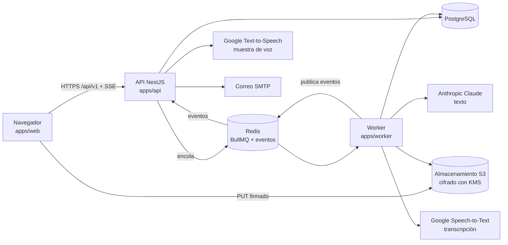
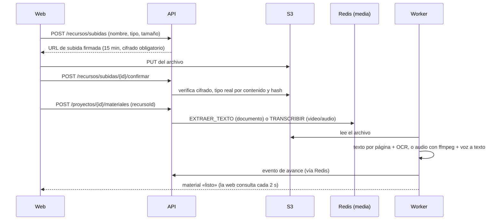

# Aptio SCORM · Manual del sistema

**Versión 0.5 · actualizado con la segunda entrega del Sprint 3 (10 de noviembre de 2026)**

Describe cómo está construido y cómo funciona Aptio SCORM en conjunto: sus componentes, cómo viajan los datos, la seguridad, los proveedores externos, la configuración y la operación. Está pensado para el ingeniero a cargo, el área de infraestructura y quien audite el sistema. El detalle de código está en [`MANUAL-PROGRAMADOR.md`](MANUAL-PROGRAMADOR.md), y el uso de las pantallas, en [`MANUAL-USUARIO.md`](MANUAL-USUARIO.md).

---

## 1. Propósito y alcance

Aptio SCORM es la herramienta interna de AulasEducativas (Grupo de Soluciones Creativas SAC) para producir cápsulas de microaprendizaje con ayuda de IA. Toma el material del cliente y lo convierte en un SCORM revisable. El equipo revisa y ajusta, y nada se publica sin revisión humana.

**Estado al cierre del S2:**

| Área | Estado |
| --- | --- |
| Acceso: correo y clave, Google para invitados, roles, invitaciones y recuperación | Disponible |
| Clientes, kit de marca, personaje, pantallas modelo, glosario y pronunciación | Disponible |
| Proyectos y Nuevo SCORM | Disponible |
| Material del cliente: PDF, Word, PowerPoint (con OCR), video y audio (transcripción) | Disponible |
| Generador: lanzar, ver en vivo, cancelar y continuar | Disponible |
| Etapas 1 a 3: resumen con acta de omitidos, objetivos y estructura, guion por pantalla | Disponible |
| Etapas 4 a 11: pantallas, ilustraciones, voz, boca, subtítulos, inglés, calidad y paquete | Planificadas (S3 en adelante) |
| Revisión pantalla por pantalla, editor, exportación SCORM, fase comercial | Planificadas |

## 2. Arquitectura

| Componente | Tecnología | Responsabilidad |
| --- | --- | --- |
| Web | React 19 + Vite, `@aptio/ui` | Interfaz para celular primero. Sube archivos directo al almacenamiento y recibe el avance en vivo por SSE. |
| API | NestJS sobre Node.js | Sesión, roles, alcance por organización, validación, reglas de negocio, contrato OpenAPI y envío de trabajos a las colas. |
| Worker | BullMQ sobre Node.js | Trabajos largos: extracción de texto y OCR, transcripción, generación por etapas y borrado programado. |
| PostgreSQL 16 | Prisma (`@aptio/db`) | Datos de negocio, resultados de cada etapa, costos y auditoría. |
| Redis 7 | BullMQ (`@aptio/colas`) | Colas `ia`, `voz`, `media` y `export`, cola de mantenimiento y canal de eventos `aptio:eventos`. |
| Almacenamiento | S3 compatible con KMS (`@aptio/almacen`); LocalStack en local | Archivos del cliente y recursos, siempre cifrados y accesibles solo con URL firmada. |

Las decisiones de arquitectura están en `docs/adr/` y en `CLAUDE.md` («Decisiones tomadas»).

## 3. Flujos principales

### 3.1 Subir material del cliente

- **Documentos:** texto por página. Una página con menos de 25 caracteres se trata como escaneada y pasa por OCR (Tesseract, español e inglés).
- **Video y audio:** ffmpeg extrae el audio en tramos de 55 s (FLAC mono, 16 kHz). Cada tramo se transcribe y los tiempos se ajustan al inicio del tramo. Se guardan los fragmentos `{desde, hasta, texto}` y la duración.
- En ambos casos, el texto que parece una orden para la IA se marca como `posibleInstruccion` (CP-102).

### 3.2 Generar un SCORM

1. `POST /proyectos/{id}/generaciones` exige material leído y una sola generación activa por proyecto (protegida con un cerrojo en PostgreSQL). Crea las 11 etapas «En cola», pasa el proyecto a Producción y encola `GENERAR`.
2. El worker corre las etapas en orden y salta las ya completadas. Cada etapa recibe los resultados de las anteriores.
3. Cada etapa publica su estado. La web lo recibe por SSE (`GET /generaciones/{id}/eventos`) y, como respaldo, consulta cada 2 s.
4. Al final:
   - si las 11 etapas terminaron, el proyecto pasa a Revisión;
   - si faltan etapas por habilitar, vuelve a «Por generar» (SUP-24).
5. **Cancelar** conserva lo terminado. Una etapa a medias deja de llamar a la IA y conserva el costo gastado. **Continuar** retoma desde la etapa con error o cancelada.

| Etapa | Tareas de IA | Resultado |
| --- | --- | --- |
| 1 · Leer y resumir | IA-01 mapa de temas, IA-02 conservar, complementario u omitir, IA-03 ideas clave por tema, IA-13 acta | Ideas clave con archivo y página, y acta de omitidos (CP-038) |
| 2 · Objetivos y estructura | IA-04 v2 | Objetivos con nivel de Bloom, y pantallas con tipo, objetivo, actividad y página. Número exacto de pantallas y mínimo de actividades (CP-039) |
| 3 · Storyboard y guion | IA-05 v2 (por cápsula) | Título, texto en pantalla, narración, visual, actividad y origen. Advertencia si pasa de 30 palabras en pantalla o 45 de narración (CP-040) |
| 4 · Pantallas con el kit | IA-15 v2 (por pantalla, hasta 4 a la vez) e IA-07 v2 (por actividad) | Disposición del kit, fondo y campos por pantalla, y los datos de cada actividad (CP-044; el reto final es sumativo), guardados como avance mientras corre (CP-043). Al terminar, el documento del curso validado en `Curso` con su versión (CP-042) |

### 3.3 Toda salida de IA se valida

Cada respuesta se valida contra el esquema JSON de su tarea y contra las reglas propias de la etapa. Si no valida, se reintenta con los errores, hasta 3 intentos. Si sigue fallando, la etapa queda en ERROR y **nada se guarda a medias** (RN-04-2). Cada intento queda registrado con su consumo y costo.

## 4. Datos

El modelo completo está en `docs/12-modelo-datos.md` y en `packages/db/prisma/schema.prisma`. Las entidades usadas hasta el S2:

| Entidad | Contenido |
| --- | --- |
| `Organizacion` | Inquilino: todo dato raíz lleva `organizacionId` (ADR-012) |
| `Usuario`, `TokenAcceso` | Personas, rol, clave (argon2id), versión de sesión, y tokens de invitación y recuperación (guardados como hash) |
| `Cliente`, `KitMarca`, `PantallaModelo`, `GlosarioTermino`, `PronunciacionTermino` | Clientes y su identidad visual y de voz |
| `Proyecto` | Un SCORM: cliente, estado, parámetros y datos técnicos opcionales |
| `Recurso` | Archivo en el almacenamiento: tipo, origen, clave S3, hash, metadatos (por ejemplo, la duración) y fecha de borrado |
| `MaterialFuente` | Material del proyecto: `paginas`, `transcripcion` y `mapaTemas` |
| `Generacion`, `GeneracionEtapa` | Cada generación y sus 11 etapas, con estado, detalle (`{texto, datos}`) y costo. Una etapa en curso puede guardar su avance en el detalle |
| `Curso`, `CursoVersion` | El documento del curso (lo crea la etapa 4) y su historial: generar de nuevo reemplaza el documento y guarda la versión anterior |
| `TrabajoIA` | Cada llamada a un proveedor: tarea, tipo, proveedor, modelo, versión del prompt, consumo, segundos de audio, intentos y costo |
| `Auditoria` | Acciones relevantes: subidas, materiales, ingresos con Google, borrados |

El documento del curso es un JSON que valida contra `packages/schema/esquemas/curso-v0.schema.json`. Es la fuente de verdad del curso. Desde la etapa 4 contiene módulos, cápsulas y pantallas con bloques de texto, personaje, video e interacción, narraciones pendientes de voz y los documentos del cliente como recursos, para la trazabilidad por página.

## 5. Seguridad

| Tema | Cómo se resuelve |
| --- | --- |
| **Sesión** | Cookie `httpOnly` firmada con HMAC-SHA256 (`SESSION_SECRET`), de 12 h. Se invalida al cambiar la clave, el rol o desactivar al usuario. |
| **Fuerza bruta** | 5 intentos fallidos bloquean la cuenta 15 minutos. Se permiten hasta 3 pedidos de recuperación por hora. |
| **Google** | OpenID Connect con PKCE, `state` y `nonce`, y firma del id_token verificada. Solo entran correos invitados y nunca se crean cuentas. |
| **Roles y alcance** | Una guarda global por rol. Toda consulta se limita a la organización de la sesión, y el revisor del cliente, a su cliente. |
| **Archivos** | Cifrados con KMS y bucket no público. Solo se accede con URLs firmadas de 15 minutos. El tipo real se verifica por contenido (un .exe renombrado se rechaza) y el SVG se sanea con una lista cerrada. |
| **Retención** | Los documentos del cliente se borran a la fecha de entrega más los días de retención del cliente (180 por defecto). El worker los borra cada día a las 3:00 (Lima), incluido el texto extraído y las transcripciones, y lo registra en auditoría. |
| **Inyección en la IA** | El material del cliente va escapado y delimitado en `<material_cliente>`. Lo que parece una orden se marca y nunca se obedece (HU-1402). |
| **Secretos** | Solo en variables de entorno. Ninguna clave real va al repositorio. |

## 6. Proveedores externos

| Uso | Proveedor | Modo simulado | Estado |
| --- | --- | --- | --- |
| Texto (etapas 1 a 3) | Anthropic Claude (`claude-opus-5-5` por defecto, SUP-23) | Salidas grabadas del caso LOTO | Integrado. Los prompts v2 de IA-04 e IA-05 todavía no se han evaluado con la clave real. |
| Transcripción | Google Speech-to-Text v1 (`latest_long`) | Fragmentos de relleno cada 10 s, sin costo | Integrado. Sin probar con una clave real, y tarifa por minuto sin verificar (SUP-28). |
| Muestra de voz | Google Text-to-Speech (voces GA) | Audio de silencio | Integrado para la muestra. La narración completa llega en S4. |
| Correo | SMTP (Mailpit en local) | — | Integrado. |

Las licencias, el uso comercial y el tratamiento de datos de cada proveedor están en `docs/19-proveedores-y-licencias.md` (ADR-010). `PROVEEDORES_MODO` (`simulado` o `real`) elige el modo. En modo real sin clave, la transcripción falla con un motivo en vez de inventar texto.

## 7. Configuración y despliegue

- **Entornos:** desarrollo local (docker compose), pruebas y producción en la nube (ADR-009). La infraestructura de la nube (clave KMS, bucket con bloqueo público y CORS solo para la web) es un pendiente de HU-1405.
- **Requisitos de la imagen del worker:** Node.js 24, ffmpeg y ffprobe (transcripción) y los datos de idioma de Tesseract (vienen por npm, sin red).
- **Variables:** la lista completa está en el manual del programador, §10, y en los `.env.example` de `apps/api`, `apps/worker` y `packages/db`.
- **Escalado:** API y worker no guardan estado propio. El worker se escala con más instancias o con `WORKER_CONCURRENCIA`, y los eventos llegan a todas las instancias de la API por Redis.

## 8. Operación

| Tarea | Cómo |
| --- | --- |
| Salud | `GET /api/v1/salud` responde 200, o 503 si la base no responde. |
| Contrato | OpenAPI generado en `/api/v1/docs`. El contrato de referencia es `docs/api/openapi.yaml`. |
| Seguimiento de trabajos | Estado y avance en `GeneracionEtapa`, `MaterialFuente.estado` y `TrabajoIA`. El worker registra en consola los trabajos fallidos con su motivo. |
| Costos | La suma de `TrabajoIA.costoUsd` por proyecto aparece en la lista de proyectos y en cada generación. |
| Borrado programado | Cola de mantenimiento con un trabajo diario a las 3:00 (America/Lima). |
| Errores visibles al usuario | Siempre con un motivo legible: material en error, etapa en error con «Continuar». |

## 9. Supuestos y limitaciones vigentes

Registrados en `docs/ESTADO.md` (SUP-##). Los que más afectan al sistema hoy:

- **SUP-24:** las etapas sin ejecutor quedan «En espera». El proyecto no pasa a Revisión hasta que estén las 11.
- **SUP-26 y SUP-27:** las reglas estrictas de estructura y guion se aplican solo con proveedor real. El caso LOTO grabado tiene 10 de 30 actividades.
- **SUP-30:** el reto sumativo sale de IA-07 con sus propias preguntas; todavía no se exige un banco del doble de preguntas por intento ni se usa el banco de IA-08.
- **SUP-29:** la etapa 4 se compone en paralelo: un tramo de 3 pantallas con la misma disposición puede colarse y queda como advertencia. El curso sale en español, sin imágenes ni datos de actividades (llegan en la etapa 5 y en HU-0407). Al continuar una etapa 4 cancelada, las pantallas se piden de nuevo.
- **SUP-28:** la transcripción usa tramos de 55 s, y una palabra justo en el borde puede quedar partida. La etapa 1 todavía no lee transcripciones.
- **Protección de `main`:** exigir los dos controles de CI es una configuración del repositorio que hace su administrador.

---

## Historial de este manual

| Versión | Fecha | Cambios |
| --- | --- | --- |
| 0.5 | 2026-11-10 | IA-07 en la etapa 4 y seguimiento por nota con reto sumativo. |
| 0.4 | 2026-11-10 | Etapa 4: pantallas con el kit, avance en vivo y documento del curso. |
| 0.3 | 2026-11-10 | Primera versión, al cierre del S2: arquitectura, flujos de material y generación, datos, seguridad, proveedores, configuración y operación. |
