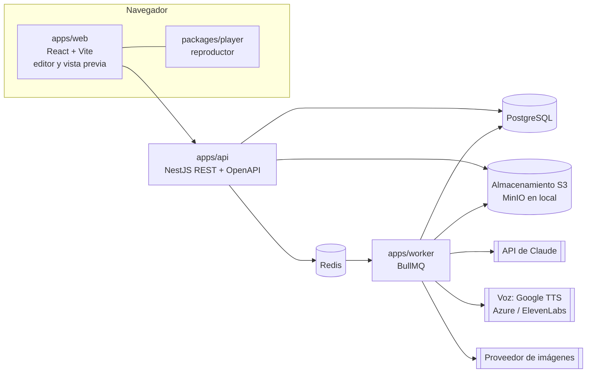
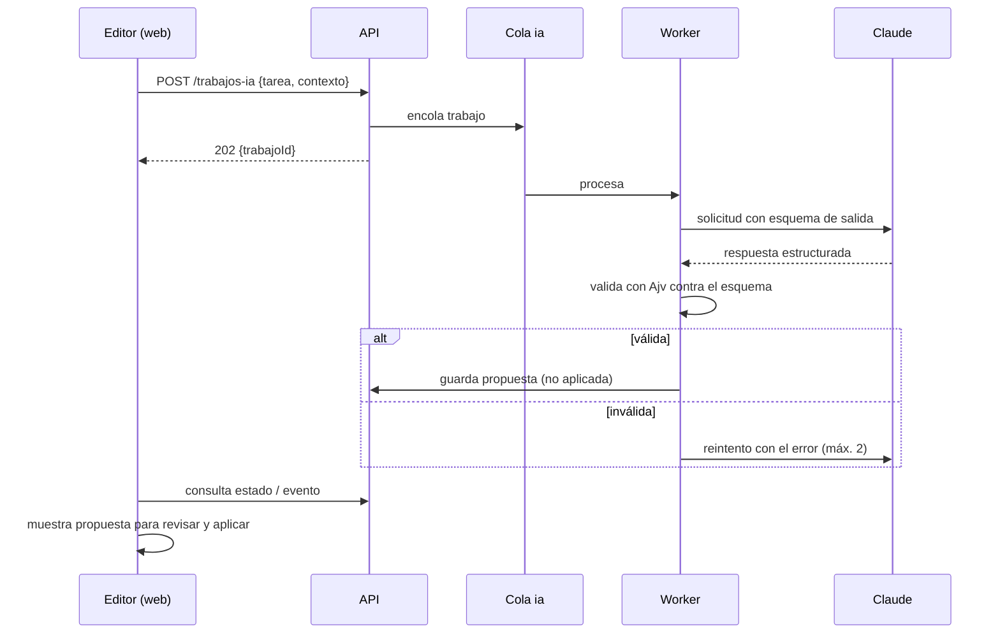

# Arquitectura

Monolito modular en Node.js con TypeScript, organizado como monorepo. Sin microservicios: los procesos pesados (IA, voz, video, exportación) van a workers con colas, que comparten código con la API.

## Contenedores



El reproductor (`packages/player`) se usa dentro del editor para la vista previa y se empaqueta dentro de cada SCORM o HTML (sprint S6). Lo que el productor ve es exactamente lo que se exporta.

## Estructura del monorepo

```text
apps/
  web/            React + Vite + TypeScript. Editor, asistentes, vista previa.
  api/            NestJS. REST versionada (/api/v1), validación, autorización, OpenAPI.
  worker/         Procesos en cola: IA, TTS, lip sync, imágenes, video, exportación.
packages/
  schema/         JSON Schema del curso, tipos TypeScript generados y validador (Ajv).
  player/         Reproductor del curso (TypeScript; Preact recomendado). Sin dependencias del editor.
  interactions/   Componentes INT-01 a INT-08 que usa el reproductor.
  ai/             Capa de proveedores: Claude (texto), voz, imágenes. Plantillas de prompts versionadas.
  estimator/      Fórmulas de la calculadora de producción (compartidas web/api).
  exporters/      json, html, scorm12 (S6), scorm2004 y kit de gamificación; cmi5 después.
  ui/             Componentes de interfaz compartidos del editor.
docs/             Esta documentación.
infra/            docker-compose (PostgreSQL, Redis, MinIO); Moodle de pruebas aparte para S6.
```

## Tecnologías

| Área | Elección | Notas |
| --- | --- | --- |
| Runtime | Node.js LTS activa al iniciar | Fijar la versión en `.nvmrc` y en las imágenes Docker |
| Lenguaje | TypeScript estricto | `strict: true` en todos los paquetes |
| Gestor | pnpm workspaces | Turborepo opcional para caché de builds |
| API | NestJS | Módulos por dominio, DTOs validados, OpenAPI generado (ADR-001) |
| Base de datos | PostgreSQL | El curso se guarda como JSONB validado + tablas relacionales para clientes, proyectos, recursos, trabajos y costos |
| ORM | Prisma (recomendado) | Decisión abierta DA-01 |
| Colas | BullMQ + Redis | Colas separadas: `ia`, `voz`, `media`, `export` |
| Almacenamiento | S3 compatible | MinIO en local; URLs firmadas para descarga |
| Frontend | React + Vite + TypeScript | Estado del editor con Zustand; arrastrar y soltar con dnd-kit; formularios con React Hook Form + Zod |
| Reproductor | TypeScript + Preact (recomendado) | Debe pesar poco: entra en cada paquete |
| IA de texto | Claude vía SDK oficial de Anthropic para Node | Modelo configurable por tarea en variables de entorno |
| Voz | Google Cloud Text-to-Speech por defecto; Azure Speech o ElevenLabs configurables | Proveedor por tarea en `ConfigProveedor` (ADR-008) |
| Lip sync de audio grabado | Rhubarb Lip Sync (CLI en el worker) | Reconocedor fonético para español |
| Media | ffmpeg en el worker | Compresión, transcodificación, extracción de audio |
| Transcripción | Proveedor de voz a texto (Google, Azure u otro) | Para video y audio del cliente |
| Pruebas | Vitest, Playwright | Playwright también para pruebas en Moodle (fase D) |
| Contenedores | Docker Compose | Entorno local idéntico para todo el equipo |

## Modelo de datos (resumen)

| Entidad | Tipo de almacenamiento | Campos clave |
| --- | --- | --- |
| Cliente | Tabla | nombre, LMS habitual, idiomas |
| KitMarca | Tabla + JSONB | cliente, estilo base, paleta, tipografías, logo, personaje, voz por idioma, glosario, diccionario de pronunciación |
| Proyecto | Tabla | cliente, nombre, estado, estimación (JSONB), modalidad de entrega |
| Curso | Tabla + JSONB | proyecto, versión del esquema, documento del curso (JSONB validado) |
| Recurso | Tabla | cliente, tipo (imagen, svg, audio, video, documento), origen (biblioteca, generado, subido), ruta S3, metadatos, licencia |
| DocumentoFuente | Tabla | proyecto, archivo, páginas extraídas, mapa de temas |
| TrabajoIA | Tabla | tipo de tarea (IA-##), proveedor, modelo, versión del prompt, tokens o caracteres, costo, estado, resultado o error |
| Exportacion | Tabla | curso, versión, formato, perfil LMS, peso, informe, ruta del archivo |

Regla: el JSON del curso referencia recursos por identificador, nunca por ruta. La API resuelve rutas y URLs firmadas.

## Flujos principales

### Generar con IA (estructura, storyboard, interacción, traducción)



La IA nunca modifica el curso directamente: genera una **propuesta** que el usuario revisa y aplica.

### Generar narración con boca sincronizada

1. El productor pide narración para una pantalla o para toda la cápsula.
2. El worker envía el texto (con el diccionario de pronunciación aplicado) al proveedor de voz configurado (Google por defecto) y recibe el audio.
3. Calcula las bocas A–F, G, H, X desde el audio con el reconocedor fonético (Rhubarb). Si el proveedor es Azure, puede usar sus visemas.
4. Guarda el MP3, las marcas de boca y los subtítulos WebVTT; registra el hash del texto.
5. Si después cambia el texto, la voz o el idioma, solo se regenera ese bloque.

Para audio grabado por el cliente, el paso 2 se reemplaza por Rhubarb Lip Sync sobre el archivo.

## Seguridad básica del prototipo

- Autenticación simple (correo y contraseña) y un solo rol administrador; roles completos en el MVP.
- Claves de proveedores solo en variables de entorno del servidor; nunca en el navegador.
- Archivos subidos: validación de tipo real, límite de tamaño, sanitización de SVG (eliminar scripts y eventos).
- Textos de clientes tratados como datos no confiables en los prompts (delimitados y con instrucción explícita de no seguir instrucciones contenidas en ellos).
- Límite de gasto por proveedor y registro de costo por trabajo.

## Documentos técnicos relacionados

- Modelo de datos y Prisma: `12-modelo-datos.md`, `packages/db/prisma/schema.prisma`
- API: `13-api.md`, `api/openapi.yaml`
- Módulos: `14-modulos.md` · Flujos: `15-flujos.md`
- Historias y pruebas: `16-historias-y-pruebas.md` · Guía: `17-guia-desarrollo.md` · Sprints: `18-plan-sprints.md`
