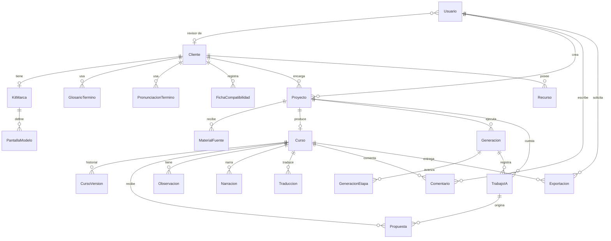

# Modelo de datos

El esquema físico está en `packages/db/prisma/schema.prisma` (PostgreSQL, Prisma). Fue validado con el motor de Prisma 5.22.

## Criterio de diseño

- **El curso es un documento.** Pantallas, bloques, interacciones, navegación, ajustes del editor y textos por idioma viven en `Curso.documento` (JSONB). Ese documento valida contra `docs/04-modelo-contenido/esquema-curso-v0.schema.json` (versión 0.2.0).
- **Las tablas guardan solo lo que necesita una base relacional:** permisos, búsquedas, costos, historial, estados de trabajo y archivos.
- **Bloqueo optimista.** `Curso.version` aumenta con cada cambio guardado. Una escritura con una versión vieja recibe `409 Conflict`.
- **Historial completo.** Cada cambio que se guarda deja una fila en `CursoVersion` con su motivo (generación, propuesta aplicada, edición, restauración). Así se puede volver atrás aunque se cierre el navegador.
- **La IA nunca escribe directo en el curso.** Escribe una `Propuesta` con un JSON Patch (RFC 6902) y la `versionBase` sobre la que se calculó. Solo una acción del usuario la aplica. Si el curso cambió desde esa versión, la propuesta queda `VENCIDA` y se recalcula.
- **Archivos en S3.** El documento referencia recursos por id (`Recurso.id`), nunca por ruta. La API entrega URLs firmadas.
- **Claves de proveedores fuera de la base.** Viven en variables de entorno; `ConfigProveedor` guarda solo proveedor, modelo y parámetros.

## Diagrama entidad-relación

`ConfigProveedor`, `ParametrosNegocio`, `MedicionProceso` y `Auditoria` son tablas de configuración y registro sin relaciones fuertes.

## Entidades

| Entidad | Para qué sirve | Campos clave | Pantalla del prototipo |
| --- | --- | --- | --- |
| Usuario | Acceso y rol | email, rol (5 roles), cliente (solo revisor del cliente) | Todas |
| Cliente | Empresa que encarga los SCORM | nombre, LMS habitual, idiomas | Clientes y kits |
| KitMarca | Identidad visual y de voz del cliente | estilo, paleta, tipografías, logo, personaje, voces, versión | Clientes y kits |
| PantallaModelo | Pantallas base que diseña el equipo gráfico; el generador las combina | disposición, definición (componentes y posiciones relativas) | Clientes y kits |
| GlosarioTermino | Términos con traducción fija o que no se traducen | término, traducción, noTraducir | Idiomas, Clientes y kits |
| PronunciacionTermino | Cómo se pronuncia una palabra en la voz | idioma, escrito, pronunciado | Personaje y voz |
| FichaCompatibilidad | Datos del LMS de cada cliente, incluidos los desconocidos | LMS, versión, límite de subida, resultado del diagnóstico | Entrega |
| Proyecto | Un SCORM a producir | cliente, estado, idiomas, público, tono, pantallas objetivo; `datosTecnicos` **opcional** | Proyectos, Nuevo SCORM |
| MaterialFuente | PDF, Word, PowerPoint, video, audio o solo el tema | tipo, páginas extraídas, transcripción, mapa de temas | Nuevo SCORM |
| Curso | El documento del curso | documento (JSONB), versión del esquema, versión | Revisión, Editor, Vista previa |
| CursoVersion | Historial para deshacer entre sesiones | versión, documento, motivo | Editor |
| Generacion / GeneracionEtapa | Ejecución del generador y sus 11 etapas | estado, detalle por etapa, costo | Producción |
| TrabajoIA | Cada llamada a un proveedor, con su costo | tarea IA-##, proveedor, modelo, consumo, costo, intentos | Conexiones IA, Rentabilidad |
| Propuesta | Cambio sugerido por la IA, pendiente de aplicar | tipo, JSON Patch, versión base, estado | Revisión, Editor, Alineación, Navegación |
| Observacion | Problemas detectados por reglas o IA | tipo, severidad, mensaje, resuelta | Revisión (Control de calidad), Entrega |
| Recurso | Archivo en S3 | tipo, origen, clave S3, hash, alt, licencia | Editor (Imágenes, Subir) |
| Narracion | Audio, bocas y subtítulos por pantalla e idioma | hash del texto, voz, estado (actualizada o desactualizada) | Personaje y voz |
| Traduccion | Estado de cada texto traducido | ruta (JSON Pointer), idioma, estado | Idiomas |
| Comentario | Observaciones del revisor del cliente | pantalla, autor, texto | Revisión |
| Exportacion | Paquetes generados | formato, perfil LMS, peso, informe | Entrega |
| ConfigProveedor | Qué proveedor y modelo usa cada tarea | tarea, proveedor, modelo, límite de gasto | Conexiones IA |
| ParametrosNegocio | Datos de la calculadora de rentabilidad | precios, tarifa, personas, licencias | Rentabilidad |
| MedicionProceso | Horas reales medidas por etapa (hoy y con el generador) | proyecto, escenario, etapa, horas | Rentabilidad |
| Auditoria | Quién hizo qué | acción, entidad, datos | — |

## Regeneración en cascada (cómo se decide qué rehacer)

| Cambio | Se marca para regenerar |
| --- | --- |
| Texto de narración de una pantalla (ES) | `Narracion` ES de esa pantalla, sus bocas y su subtítulo; `Traduccion` EN de ese texto; `Narracion` EN de esa pantalla |
| Título o texto en pantalla (ES) | `Traduccion` EN de esa ruta; las observaciones de longitud y desborde |
| Voz, velocidad o diccionario de pronunciación del kit | Todas las `Narracion` del idioma afectado (por cambio de `textoHash`) |
| Paleta o tipografías del kit | Nada que regenerar: el reproductor aplica el kit al mostrar; se renuevan las miniaturas |
| Disposición de una pantalla | Ajustes (`ajustes`) de esa pantalla se reinician; el contenido se conserva |

`textoHash` = sha256 de texto + voz + velocidad + entradas del diccionario que aparecen en el texto. Si el hash guardado no coincide con el calculado, la narración está `DESACTUALIZADA`.

## Campos opcionales a propósito

- `Proyecto.datosTecnicos` (LMS, formato, horas, fecha de entrega) puede quedar vacío durante todo el proyecto. Si al exportar no hay LMS, se usa el perfil Genérico.
- `MedicionProceso` se llena a mano cuando el equipo mida su proceso. Mientras esté vacía, Rentabilidad usa los supuestos editables.
