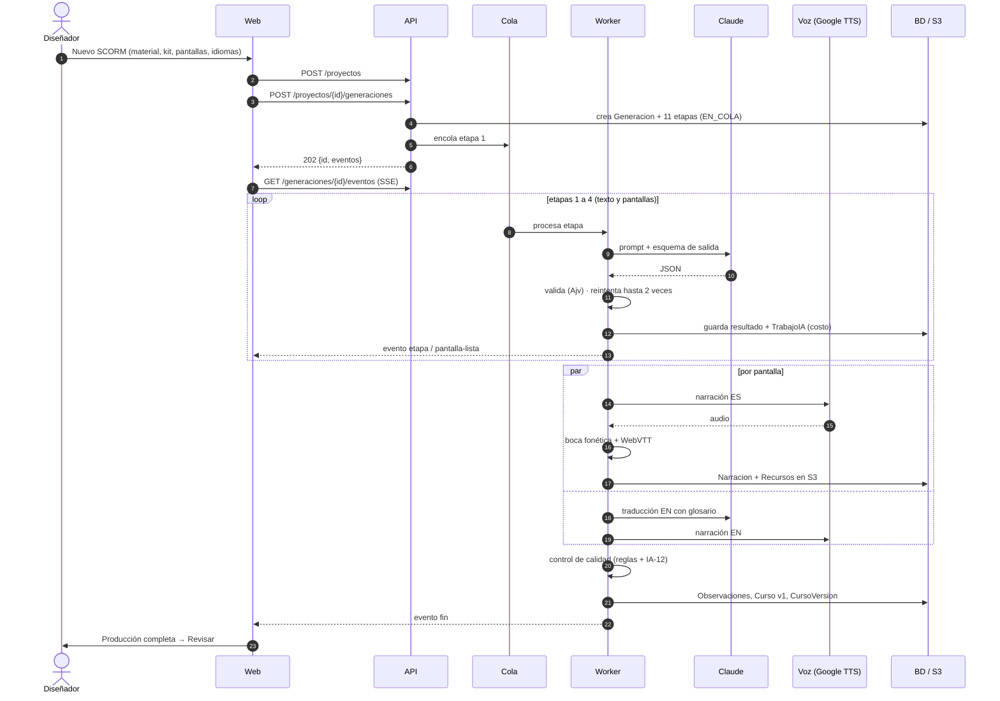
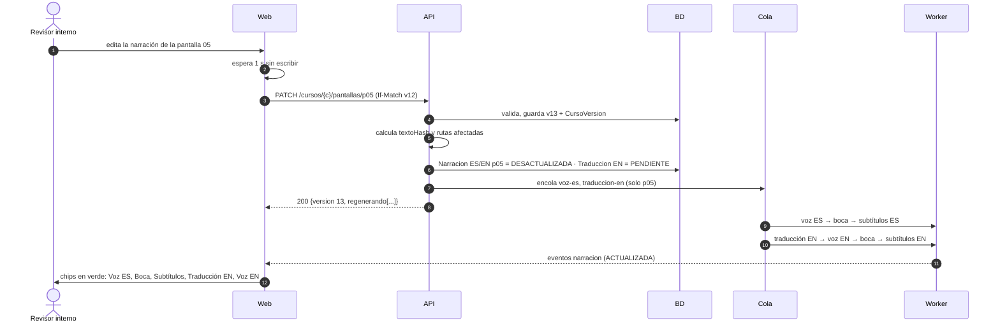
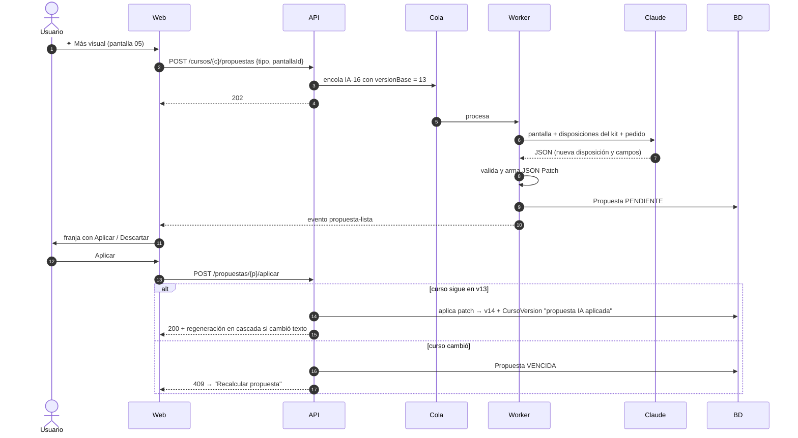
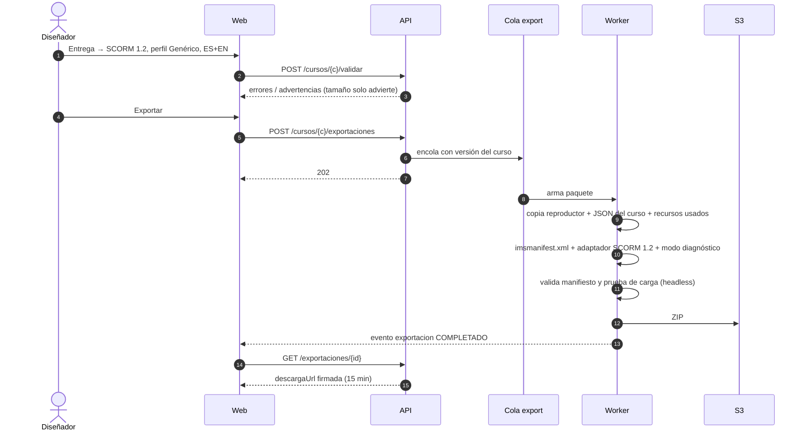
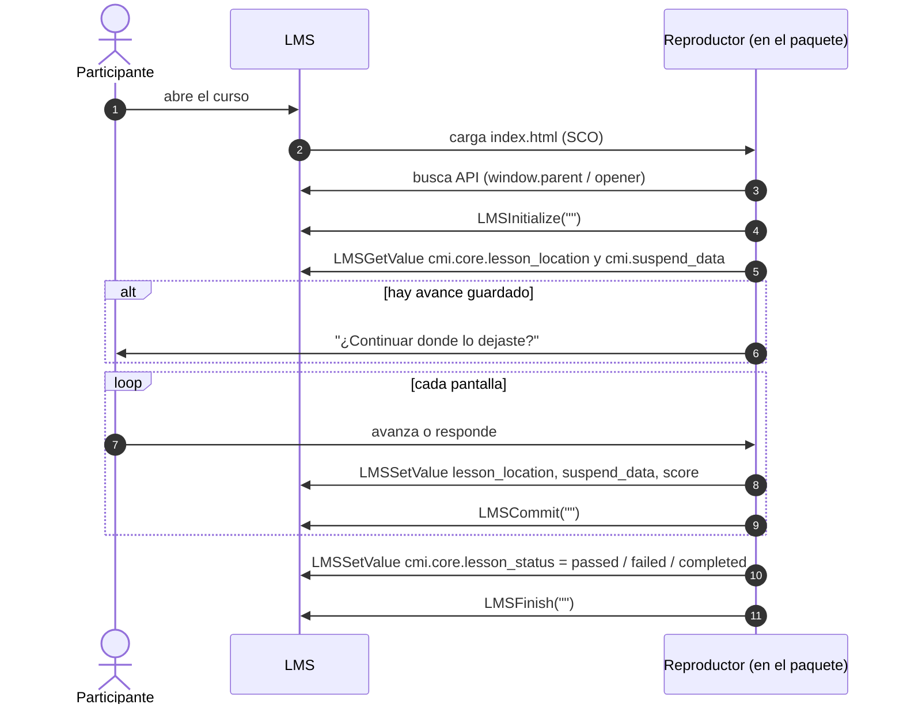
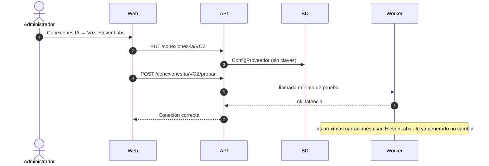

# Flujos principales

Diagramas de secuencia de los procesos que cruzan varios módulos. Participantes: **Web** (`apps/web`), **API** (`apps/api`), **Cola** (BullMQ en Redis), **Worker** (`apps/worker`), **BD** (PostgreSQL), **S3**, proveedores externos.

## F1 · Generar un SCORM

Si una etapa falla tras 2 reintentos, queda en `ERROR` con "Reintentar etapa". No se guarda nada a medias y lo anterior se conserva.

## F2 · Cambiar un texto y regenerar en cascada

Si otra persona guardó antes (versión distinta), la API responde `409` y la web ofrece recargar o comparar.

## F3 · Propuesta de la IA y aplicación

## F4 · Exportar SCORM 1.2

## F5 · El paquete dentro del LMS

Si no encuentra la API, el reproductor muestra el modo diagnóstico con lo que encontró. Sirve para LMS desconocidos y alimenta la ficha de compatibilidad del cliente.

## F6 · Cambio de proveedor de IA

