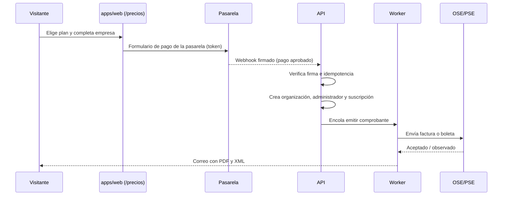

# Sitio comercial, captación y facturación

Fase comercial de Aptio SCORM. Comprende tres partes:
- el **sitio público** multipágina (inicio, producto, precios, landings por sector y agendar demo), con una sección de blog al final;
- el **panel superadmin**, integrado a la aplicación, desde donde se administra todo el sitio;
- la **venta por suscripción**: organizaciones, planes, pago, comprobantes SUNAT y cobranza.

| Recurso | Dónde |
| --- | --- |
| Prototipo (sitio y panel en un solo archivo, con datos ficticios) | `docs/diseno/sitio-comercial.html` |
| Decisiones | ADR-011 y ADR-012 en `docs/adr/README.md` |
| Historias y casos de prueba | Épicas E15–E17 en `docs/16-historias-y-pruebas.md` (HU-1501 a HU-1711, CP-109 a CP-159) |
| Sprints | S11–S14 en `docs/18-plan-sprints.md` |
| Requisitos | REQ-064 a REQ-092, REQ-109 y REQ-110 en `docs/03-requisitos.md` |
| Pantallas de Stitch revisadas (solo referencia de marca) | `docs/diseno/stitch/sitio/` |

## 1. Decisiones

| Tema | Decisión |
| --- | --- |
| Alcance | Se levanta la exclusión del punto 13 de `CLAUDE.md`: multi-organización, planes y facturación entran en la fase comercial (ADR-012). |
| Quién administra | Un rol nuevo, **superadmin** de plataforma. El administrador de cada organización no ve el sitio ni las ventas (ADR-011). |
| Integración | El panel vive en `apps/web`, con la misma barra lateral cobalto, la escala de 6 tamaños de letra y los 32 px de margen (REQ-063). El superadmin ve tres grupos más: Sitio web, Captación y Ventas. |
| Todo administrable | Cada texto, cifra, testimonio, logo, plan, enlace, popup, respuesta rápida, pasarela y cupón sale del panel y tiene orden y **mostrar/ocultar**. Ocultar no borra. |
| Datos ficticios | Pueden existir y mostrarse en pruebas con el distintivo «ficticio». Bloquean la publicación en producción mientras estén visibles (RN-16-3). |
| Blog | Se escribe y publica en **WordPress**. No hay página /blog: es una **sección al final** de las páginas que muestra los artículos publicados, leídos por la API REST, con filtro por categoría y enlace a WordPress. El panel no edita artículos: elige qué categorías y artículos se ven. |
| Landings por sector | El superadmin crea landings por sector (minería y energía, banca y seguros, retail, educación superior, sector público…) con portada propia, testimonios del sector, preguntas propias y categoría inicial del blog (HU-1514). |
| Sitio público | HTML pre-renderizado al publicar, con React `renderToString` en el worker. Se sirve desde el bucket detrás de CDN, sin agregar otro framework. Recomendación de DA-08. |
| Orden | S11–S14 van después del S10. El sitio (S11–S12) no toca el generador y puede adelantarse con un equipo aparte si negocio lo pide. Planes y facturación (S13–S14) necesitan la multi-organización. |

## 2. Roles

| Acción | Superadmin (plataforma) | Administrador (organización) | Resto de roles |
| --- | --- | --- | --- |
| Sitio web, Captación y Ventas | ✓ | — | — |
| Ver y cambiar su plan, consumo y comprobantes | ✓ (todas) | ✓ (solo la suya) | — |
| Usuarios, clientes, kits y proyectos de la organización | ✓ (soporte, con auditoría) | ✓ | Según `14-modulos.md` |

El superadmin entra con correo, clave y segundo factor obligatorio. Cada acción que hace dentro de una organización queda en la auditoría.

## 3. Revisión de las pantallas de Stitch

Se revisaron las 21 pantallas exportadas el 03/11/2026: 10 del panel y 11 del sitio y sus superpuestos. Se tomó la estructura y las ideas que suman. Las pantallas se rehicieron en `sitio-comercial.html` con las reglas de `DESIGN.md`.

### Hallazgos generales

| Tema | En Stitch | En el prototipo |
| --- | --- | --- |
| Tipografía del panel | 7 de las 10 vistas no cargan Plus Jakarta Sans ni Atkinson y caen en una letra serif | Plus Jakarta Sans en todo el panel |
| Escala de letra del panel | Ninguna vista respeta los 6 tamaños: usan entre 6 y 12, con 18, 22 y 24 px | 11, 12, 14, 16, 20 y 26 px, medido con Playwright en las 15 vistas |
| Margen desde la barra lateral | Ajustes, Páginas y Agendamiento centran el contenido (1380–1520 px) | 32 px en todas las vistas y anchos |
| Barra lateral | Blanca, con grupos «Plataforma / General» | Cobalto, como el prototipo de la aplicación, con los grupos Sitio web, Captación, Ventas y Configuración |
| Etiquetas sobre el título | Repiten la ruta («Superadmin / Sitio web / Resumen», «Aptio Web Metrics») | Eliminadas; la ruta va solo en la barra superior |
| Datos de ejemplo | Empresas reales con RUC: BCP, Falabella, Antamina, Rimac, Las Bambas, Universidad del Pacífico, Universidad Peruana | Organizaciones inventadas, marcadas «ficticio» (sección 9) |
| Personaje | Avatar fotorrealista («hiperrealista», «SVG neural») | Ana en SVG con bocas A–X, como fija la decisión 7 |
| Afirmaciones | «En minutos», «99.8 % LMS conforme», «compatibilidad 100 % garantizada», SCORM 2004, Cornerstone y SAP SuccessFactors | Solo lo que el producto hace en el MVP: SCORM 1.2 estricto, HTML y perfiles para Moodle, Blackboard, Chamilo y Canvas |
| Fechas | 2025 | Octubre y noviembre de 2026 |
| Faltaban | Blog, SEO técnico, Popups, Leads y CRM y Contenido (en el panel); Blog y Precios en celular (en el sitio) | Agregadas |

### Dirección visual del sitio público

El sitio sigue los bloques de las propuestas de Stitch (inicio, precios y personaje) con un juego de azules del sistema; el naranja queda solo como acento de lo que hace la IA:
- **Tipografía:** Schibsted Grotesk para títulos, navegación y botones; Source Serif 4 para párrafos y citas. El panel sigue con Plus Jakarta Sans.
- **Azules:** cobalto `#004ECC` (bloques sólidos), azul `#DCE6FF` (bandas), azul hielo `#EFF4FF` (fondos suaves) y borde `#C9D9FF`.
- **Anuncio:** franja cobalto con texto blanco.
- **Sección Blog:** al final del inicio y de las landings de sector, sobre azul hielo, con pestañas de categoría y tarjetas de artículo.
- **Sectores:** tarjetas con el nombre del sector y el título de su landing.
- **Portada (Stitch inicio):** centrada sobre un degradado azul hielo, con etiqueta, dos botones y la captura del producto. Las cifras van como tarjetas: blanca, cobalto sólido, azul y blanca.
- **Cómo funciona:** tres tarjetas sobre azul hielo; la del medio, la que hace la IA, en cobalto sólido.
- **Producto:** dos funcionalidades con captura y el resto en tarjetas con icono azul.
- **LMS:** tarjetas sobre banda azul; «Cualquier LMS» y «HTML» en cobalto.
- **Planes:** tres tarjetas; la destacada con borde e insignia cobalto «Más elegido».
- **Testimonios:** tarjetas blancas con comilla azul sobre azul hielo.
- **Preguntas:** filas con borde azul; la abierta en azul hielo.
- **Llamada final:** recuadro en degradado cobalto con texto blanco.
- **Pie:** fondo azul noche `#0B1C30` con texto claro.

El panel superadmin no cambia: sigue `DESIGN.md` y la auditoría de `22-auditoria-prototipo.md`.

### Por pantalla

| Pantalla de Stitch | Se toma | Se corrige |
| --- | --- | --- |
| Sitio web · Resumen | 4 indicadores, gráfico de visitas y conversiones, origen de leads, próximas demos | Escala, empresas reales, insight sin datos que lo respalden |
| Dashboard general (2) | — | Fuera de alcance: mezcla métricas del generador con las del sitio. El Resumen cubre el sitio. |
| Páginas | Tabla con estado, idioma y puntaje SEO | Contenido centrado; se agregan el menú y el pie con mostrar/ocultar |
| Editor de página (Precios) | Bloques a la izquierda, vista previa y panel SEO con vista de Google | Se suma el interruptor por bloque y el origen de los datos de cada bloque |
| SEO para IA | llms.txt, simulador de respuesta | Se agregan las preguntas objetivo por asistente y el control de rastreadores |
| Chatbot de IA | Identidad, objetivo y campos a pedir | Escala (12 tamaños); se agregan respuestas rápidas con mostrar/ocultar |
| Agendamiento | Tipos de reunión, integraciones | Contenido centrado; feriados de Perú |
| Suscripciones y facturación | MRR, planes editables con «Visible en /precios», SUNAT, Culqi/Niubiz y Stripe, detracción | Se divide en Planes, Suscripciones y Facturación; detracción marcada «por validar con el contador» |
| Ajustes del sitio | Dominio, idiomas, analítica, cookies, WhatsApp, legales | Escala y margen |
| Inicio (celular y escritorio) | Hero con dos acciones, cómo funciona, LMS, planes, testimonios, CTA final | Avatar fotorrealista, afirmaciones sin verificar, «Pack 5 cápsulas» que no coincide con los planes |
| Personaje con boca sincronizada (2) | Antes y ahora, FAQ | «SVG neural» y comparación con video fotorrealista |
| Cápsulas y compatibilidad LMS | Matriz de entrega | Cornerstone y SCORM 2004 fuera del MVP |
| Planes y precios | Tres planes, opción anual, comparativa, FAQ | Precios alineados con Planes del panel |
| Agendar demo | Calendario, franjas, confirmación | Hora de Lima, solo días hábiles |
| Popup de salida, barra y deslizable, chatbot, cookies | Las cuatro piezas | Textos, Ley 29733 en el banner de cookies |

## 4. Vistas

| PNT | Vista | Grupo | Qué se administra |
| --- | --- | --- | --- |
| PNT-24 | Resumen | Sitio web | Visitas, leads, demos y suscripciones nuevas; origen de leads; páginas con más conversiones; próximas demos |
| PNT-25 | Páginas | Sitio web | Páginas generales y landings por sector (estado, idioma, SEO), menú principal y pie de página |
| PNT-26 | Editor de página | Sitio web | Bloques con orden y visibilidad, vista previa escritorio/celular y SEO de la página |
| PNT-27 | Contenido | Sitio web | Cifras, testimonios, logos, funcionalidades, pasos, LMS, preguntas, portada y llamada final |
| PNT-28 | Blog | Sitio web | Conexión con WordPress, categorías y artículos visibles, cuántos se muestran en la sección |
| PNT-29 | SEO | Sitio web | Auditoría, Search Console, robots.txt, sitemap y redirecciones |
| PNT-30 | SEO para IA | Sitio web | llms.txt, preguntas objetivo por asistente, rastreadores de IA y propuestas |
| PNT-31 | Popups | Captación | Popups, barra de anuncio, disparadores y resultados |
| PNT-32 | Chatbot | Captación | Identidad, objetivo, respuestas rápidas, base de conocimiento y conversaciones |
| PNT-33 | Agendamiento | Captación | Tipos de reunión, horarios, integraciones, recordatorios y citas |
| PNT-34 | Leads y CRM | Captación | Leads con origen, etapa y estado de sincronización; conexiones y mapeo |
| PNT-35 | Planes | Ventas | Planes, características, página de precios, comparativa y panel de ingresos |
| PNT-36 | Suscripciones | Ventas | Organizaciones suscritas, consumo, cobranza y acciones |
| PNT-37 | Facturación | Ventas | Comprobantes, pasarelas, cupones y datos fiscales |
| PNT-38 | Ajustes del sitio | Configuración | Dominio, idiomas, analítica, contacto, privacidad y mantenimiento |
| PNT-39 | Sitio público | — | Inicio, Producto, Precios (con pago en 3 pasos), Blog, Agendar demo y superpuestos |
| PNT-40 | Facturación de la organización | Menú de la organización | Plan, consumo, comprobantes y medio de pago (no dibujada) |

## 5. M16 · Sitio web y contenido

**Reglas**
- **RN-16-1:** todo elemento tiene `visible` y `orden`. Ocultar quita el elemento del sitio en la siguiente publicación y lo conserva en el panel con sus datos.
- **RN-16-2:** un elemento nuevo se crea oculto. Se muestra cuando el superadmin lo activa.
- **RN-16-3:** un elemento puede marcarse `ficticio`. Publicar en producción con algún ficticio visible devuelve 409 con la lista; en pruebas se publica con aviso. El panel ofrece «Ocultar todos los ficticios».
- **RN-16-4:** la visibilidad se aplica en cascada: página → bloque → elemento. Un testimonio visible dentro de un bloque oculto no se muestra.
- **RN-16-5:** publicar crea una versión inmutable. El sitio sirve solo la última versión publicada y se puede restaurar cualquier versión anterior.
- **RN-16-6:** una página en borrador responde 404 y no entra al sitemap ni a hreflang. Una programada se publica en su fecha.
- **RN-16-7:** los textos del sitio se escapan al renderizar. No se acepta HTML ni código del superadmin, salvo el bloque «HTML seguro», que se limpia y no ejecuta scripts.
- **RN-16-8:** el blog se lee de WordPress (ver «Blog en WordPress»). Aptio SCORM no edita los artículos: solo guarda una copia de lectura para mostrarlos.

**Qué se puede mostrar u ocultar**

| Colección | Dónde se usa | Elemento |
| --- | --- | --- |
| Páginas y bloques | Todo el sitio | Página (estado) y cada bloque de la página |
| Cifras, testimonios, logos | Inicio y otras páginas que tengan el bloque | Cada cifra, testimonio y logo |
| Funcionalidades, pasos, LMS, preguntas | Inicio, Producto, Precios | Cada uno; las preguntas se asignan a una página |
| Portada | Inicio | Cada viñeta |
| Blog (WordPress) | Sección Blog al final de las páginas y «Últimos artículos» del pie | Cada categoría (como filtro) y cada artículo; imagen destacada y autor |
| Menú y pie | Cabecera y pie | Cada enlace y cada columna; últimos artículos y estado de los sistemas |
| Planes | Inicio, Precios, pago | Plan, cada característica, opción anual, comparativa (por fila) y preguntas de facturación |
| Popups y barra de anuncio | Según páginas | Cada popup y la barra |
| Chatbot | Todo el sitio | El chatbot, cada respuesta rápida y cada fuente de conocimiento |
| Contacto y privacidad | Todo el sitio | WhatsApp, banner de cookies y selector de idioma |
| Pasarelas y cupones | Pago | Cada pasarela en el pago y cada cupón |
| SEO para IA | robots.txt | Cada rastreador de IA (permitir o bloquear) |

### Blog en WordPress

- Los artículos se escriben, programan y publican en WordPress. El SEO de cada artículo (título, descripción, sitemap del blog) lo maneja WordPress; el robots.txt del sitio enlaza ese sitemap.
- El worker lee `/wp-json/wp/v2/posts?status=publish&_embed` y `/wp-json/wp/v2/categories` cada 15 minutos, o al recibir un webhook de WordPress si se instala un plugin que lo envíe. Guarda una copia (título, extracto, categoría, autor, fecha, imagen destacada, enlace) para servir /blog aunque WordPress no responda.
- No hay página /blog en el sitio. La **sección Blog** va al final de las páginas que la incluyen (inicio y landings de sector): muestra los artículos publicados de las categorías visibles, con filtros por categoría y el número de artículos de cada una, y un enlace «Ver todos los artículos en el blog». Cada tarjeta abre el artículo en WordPress (subdominio o subcarpeta /blog, según DA-13).
- En una landing de sector, la sección empieza filtrada por la categoría inicial que elige el superadmin.
- El panel permite: conectar la URL, elegir la frecuencia de sincronización, ordenar y mostrar u ocultar categorías, ocultar artículos puntuales, y elegir si se ven la imagen destacada y el autor. «Editar en WordPress» abre el administrador de WordPress.
- Un borrador, un artículo privado o uno protegido con clave nunca se muestra.

### Landings por sector

- Una landing de sector es una página de tipo `sector` con: nombre del sector, portada propia (título y texto), bloques con mostrar/ocultar y SEO propio. Ruta: `/sectores/{sector}`.
- **Testimonios:** cada testimonio tiene un sector (o «General»). La landing muestra los de su sector; si no hay, muestra todos los visibles.
- **Preguntas:** las asignadas a la landing más las del inicio.
- **Blog:** la sección empieza filtrada por la categoría inicial de la landing.
- El inicio tiene un bloque **Sectores** que lista las landings publicadas; el pie suma una columna «Sectores». Una landing en borrador no aparece en ninguno y responde 404.
- Datos de ejemplo: Minería y energía, Banca y seguros, Retail y consumo, Educación superior (publicadas) y Sector público (borrador).
- **RN-16-9:** una landing nueva se crea en borrador, con los bloques de la plantilla de sector, y no se publica hasta tener portada y meta título.

## 6. M17 · Captación y CRM

- **RN-17-1:** todo lead guarda su origen, la página de entrada y los parámetros UTM. Los orígenes posibles son: formulario, popup, chatbot, agendador, suscripción, boletín y asistente de IA (cuando el referente es un asistente).
- **RN-17-2:** el envío al CRM va por cola. Se hacen 3 reintentos con espera creciente; si fallan, el lead queda en «Error» con el motivo y se puede reintentar a mano. El webhook genérico se firma con HMAC-SHA256.
- **RN-17-3:** un popup se muestra una vez por visitante cada 7 días. Nunca se muestra durante el pago.
- **RN-17-4:** el chatbot responde solo con la base de conocimiento aprobada, con salida estructurada validada como el resto de las tareas de IA. Si no sabe algo, ofrece agendar o pasar a una persona. Los mensajes del visitante son datos no confiables.
- **RN-17-5:** el agendamiento usa la hora de Lima, solo ofrece franjas libres en el calendario del asesor, bloquea los feriados de Perú y envía recordatorios a las 24 h y a 1 h.
- **RN-17-6:** GA4, Tag Manager y Meta Pixel se cargan solo con el consentimiento de esa categoría (Ley 29733). La política de privacidad y el libro de reclamaciones van en el pie.

## 7. M18 · Planes, suscripciones y facturación

**Planes del prototipo (ficticios, editables en Planes)**

| Plan | Precio al mes | Anual (−20 %) | Cápsulas al mes | Usuarios | Cápsula adicional |
| --- | --- | --- | --- | --- | --- |
| Inicial | S/ 490 + IGV | S/ 4,704 + IGV | 5 | 3 | S/ 89 |
| Productora (destacado) | S/ 1,290 + IGV | S/ 12,384 + IGV | 20 | 10 | S/ 69 |
| Empresa | A medida | Contrato anual | Según contrato | Ilimitados | Incluida |

Precios a validar con negocio. Sirven de referencia los costos medidos en `11-medicion-y-piloto.md` y la meta de S/ 1,500–1,800 por SCORM de `CLAUDE.md`.

**Reglas**
- **RN-18-1:** cada dato pertenece a una organización y toda consulta filtra por `organizacionId`. Pedir el recurso de otra organización devuelve 404 y queda en la auditoría.
- **RN-18-2:** un cambio de precio aplica a las altas nuevas. Las suscripciones vigentes mantienen su precio hasta renovar, con aviso de 30 días.
- **RN-18-3:** el pago se confirma solo por el webhook firmado de la pasarela. Cada evento se procesa una vez (clave de idempotencia = id del evento). Aptio SCORM no recibe ni guarda datos de tarjeta: solo el token y los 4 últimos dígitos (REQ-110).
- **RN-18-4:** cada cobro aprobado emite su comprobante por el OSE/PSE: factura con RUC y boleta sin RUC. Un reembolso o un prorrateo a favor emite nota de crédito.
- **RN-18-5:** IGV de 18 % sobre la base. La detracción (tasa y umbral) es configurable y **se valida con el contador** antes de producción; no se toma como verdad del sistema.
- **RN-18-6:** la cuota de cápsulas se descuenta al iniciar la generación. Con la cuota agotada se ofrece comprar adicionales o subir de plan; una cápsula ya en revisión nunca se bloquea.
- **RN-18-7:** un cambio de plan a mitad de período se prorratea por día. La cancelación aplica al fin del período pagado.
- **RN-18-8:** si un pago falla, se reintenta los días 1, 3 y 7, con aviso por correo y WhatsApp en cada intento. El día 10, la organización queda en solo lectura: puede ver y exportar lo entregado, pero no generar.
- **RN-18-9:** moneda PEN por defecto y USD con Stripe para clientes del exterior. El comprobante va en la moneda del cobro.



## 8. Modelo de datos (propuesta)

La propuesta no está validada con `prisma validate`; la validan HU-1502 y HU-1701 al agregarla a `packages/db/prisma/schema.prisma`. Todas las tablas existentes suman `organizacionId`.

```prisma
model Organizacion {
  id          String   @id @default(cuid())
  nombre      String
  ruc         String?
  estado      EstadoOrganizacion @default(ACTIVA) // ACTIVA, SOLO_LECTURA, CANCELADA
  creadaEn    DateTime @default(now())
  suscripcion Suscripcion?
}

model SitioPagina {
  id        String  @id @default(cuid())
  ruta      String
  idioma    String  @default("es")
  titulo    String
  estado    EstadoPagina @default(BORRADOR) // BORRADOR, PROGRAMADA, PUBLICADA
  tipo      String  @default("general") // general, sector
  sector    String?
  portada   Json?   // titulo y texto propios de una landing de sector
  blogCategoriaInicial String?
  publicarEn DateTime?
  seo       Json    // titulo, descripcion, canonical, indexar, schema
  bloques   SitioBloque[]
  @@unique([ruta, idioma])
}

model SitioBloque {
  id       String  @id @default(cuid())
  paginaId String
  tipo     String  // hero, metricas, testimonios, planes, faq...
  orden    Int
  visible  Boolean @default(false)
  ajustes  Json?
  pagina   SitioPagina @relation(fields: [paginaId], references: [id], onDelete: Cascade)
}

// Cifras, testimonios, logos, funcionalidades, pasos, LMS, preguntas, menú, pie...
model SitioElemento {
  id        String  @id @default(cuid())
  coleccion String
  datos     Json    // validado con el esquema JSON de su colección
  orden     Int
  visible   Boolean @default(false)
  ficticio  Boolean @default(false)
  idioma    String  @default("es")
  @@index([coleccion, idioma, visible])
}

model SitioVersion {
  id          String   @id @default(cuid())
  numero      Int      @unique
  instantanea Json     // páginas, bloques y elementos visibles al publicar
  publicadaPor String
  publicadaEn DateTime @default(now())
  entorno     String   // pruebas, produccion
}

model Lead {
  id        String @id @default(cuid())
  nombre    String?
  correo    String?
  empresa   String?
  origen    String  // formulario, popup, chatbot, agendador, suscripcion, boletin, asistente_ia
  pagina    String
  utm       Json?
  etapa     String  @default("nuevo")
  crmEstado String  @default("pendiente")
  crmError  String?
  creadoEn  DateTime @default(now())
}

model Plan {
  id             String  @id @default(cuid())
  nombre         String
  precioMesPen   Decimal? @db.Decimal(10, 2) // null = a medida
  cuotaCapsulas  Int?
  usuarios       Int?
  precioExtraPen Decimal? @db.Decimal(10, 2)
  destacado      Boolean @default(false)
  visible        Boolean @default(false)
  orden          Int
  caracteristicas Json   // [{texto, visible, orden}]
}

model Suscripcion {
  id             String @id @default(cuid())
  organizacionId String @unique
  planId         String
  ciclo          String // mensual, anual
  precioPactado  Decimal @db.Decimal(10, 2)
  moneda         String @default("PEN")
  estado         String // prueba, activa, pago_pendiente, suspendida, cancelada
  periodoFin     DateTime
  pasarela       String
  tokenPago      String?
  ultimos4       String?
  usadasPeriodo  Int @default(0)
  organizacion   Organizacion @relation(fields: [organizacionId], references: [id])
}

model Cobro {
  id            String @id @default(cuid())
  suscripcionId String
  eventoPasarela String @unique // idempotencia
  monto         Decimal @db.Decimal(10, 2)
  estado        String
  intento       Int @default(1)
  creadoEn      DateTime @default(now())
}

model Comprobante {
  id        String @id @default(cuid())
  cobroId   String?
  tipo      String // factura, boleta, nota_credito
  serie     String
  numero    Int
  base      Decimal @db.Decimal(10, 2)
  igv       Decimal @db.Decimal(10, 2)
  detraccion Decimal? @db.Decimal(10, 2)
  estadoSunat String // pendiente, aceptado, observado, rechazado
  pdfKey    String?
  xmlKey    String?
  @@unique([serie, numero])
}
```

La copia del blog se guarda en una tabla de caché:

```prisma
model WpArticulo {
  id        Int      @id // id de WordPress
  slug      String
  titulo    String
  extracto  String
  categoria String
  autor     String?
  fecha     DateTime
  imagen    String?
  enlace    String
  visible   Boolean  @default(true)
  sincronizadoEn DateTime
}
```

Popups, chatbot (configuración y fuentes), tipos de reunión, citas, cupones y pasarelas siguen el mismo patrón: tabla propia con `visible` y `orden`.

## 9. API (resumen)

Todas las rutas `/api/v1/sitio/*` y `/api/v1/ventas/*` exigen el rol superadmin. Las rutas públicas no requieren sesión y tienen límite de peticiones. Las operaciones se agregan a `docs/api/openapi.yaml` dentro de cada historia.

| Método y ruta | Uso |
| --- | --- |
| `GET/POST/PATCH /sitio/paginas`, `/sitio/paginas/{id}/bloques` | Páginas y bloques (orden y visibilidad) |
| `GET/POST/PATCH/DELETE /sitio/elementos?coleccion=` | Contenido con `visible`, `orden` y `ficticio` |
| `POST /sitio/publicar?entorno=` · `POST /sitio/versiones/{n}/restaurar` | Publicar (409 si hay ficticios en producción) y restaurar |
| `GET/PATCH /sitio/blog` · `POST /sitio/blog/sincronizar` | Conexión con WordPress, categorías y artículos visibles |
| `GET /publico/blog?categoria=` | Artículos visibles para la sección Blog |
| `GET/PATCH /sitio/seo`, `/sitio/seo-ia` | robots, redirecciones, llms.txt, rastreadores |
| `GET/POST/PATCH /captacion/popups`, `/captacion/chatbot`, `/captacion/agenda` | Configuración de captación |
| `GET/PATCH /captacion/leads` · `POST /captacion/leads/{id}/sincronizar` | Leads y reintento al CRM |
| `GET/POST/PATCH /ventas/planes`, `/ventas/suscripciones`, `/ventas/cupones` | Ventas |
| `GET /ventas/comprobantes` · `POST /ventas/comprobantes/{id}/reenviar` | Comprobantes |
| `POST /publico/leads`, `/publico/citas`, `/publico/chat`, `/publico/checkout` | Entradas del sitio público |
| `POST /webhooks/pago/{pasarela}`, `/webhooks/ose`, `/webhooks/wordpress` | Webhooks firmados e idempotentes |
| `GET /organizacion/facturacion` | Portal de facturación de cada organización (PNT-40) |

## 10. Datos ficticios del prototipo

El prototipo trae datos inventados para que el sitio y el panel se vean completos. Todos están marcados «ficticio» y se pueden ocultar, editar o borrar desde el panel.

| Colección | Qué hay |
| --- | --- |
| Cifras | 5 (4 visibles): 4 días por cápsula de 30 pantallas, −62 % de costo, 1,240 cápsulas, 2 idiomas, 4.9 / 5 |
| Testimonios | 9 (8 visibles) de personas y organizaciones inventadas: Minera Andina, Banco Altiplano, Universidad del Sur Andino, Retail Pacífico, Estudio Quipu, Energía Costa Verde, Seguros Cóndor, Agroexport Valle Norte, Transportes Qhapaq |
| Logos | Las mismas 9 organizaciones, como texto |
| Analítica | 18,420 visitas, 386 leads, 47 demos y 9 suscripciones en 30 días; origen y páginas con más conversiones |
| Suscripciones | 11 organizaciones con RUC de ejemplo `20999990xxx`, con un ingreso mensual recurrente de S/ 13,834 |
| Comprobantes | 8, entre facturas, una boleta y una nota de crédito, en estados Aceptado, Pendiente de envío y Observado |
| Blog | 9 artículos «de WordPress» en 7 categorías; la categoría Noticias internas y un artículo vienen ocultos |
| Landings por sector | 5 landings (4 publicadas, Sector público en borrador), con testimonios y preguntas por sector |
| Leads, citas, conversaciones, popups | Datos de ejemplo coherentes entre sí |

Antes de salir a producción, cada cifra y cada testimonio se reemplaza por uno real, con la autorización escrita del cliente para usar su nombre y su logo.

## 11. Decisiones abiertas

| ID | Decisión | Recomendación inicial |
| --- | --- | --- |
| DA-08 | Cómo se sirve el sitio público | HTML pre-renderizado con React en el worker al publicar, en el bucket detrás de CDN. Evita sumar otro framework y da buen LCP. |
| DA-09 | Proveedor OSE/PSE para comprobantes SUNAT | Elegir uno con API REST, ambiente de pruebas y webhook de estado. Comparar al menos 3 antes del S14. |
| DA-10 | Pasarela principal en soles | Elegir una con tokenización, cobros recurrentes y Yape. Stripe para USD. Confirmar comisiones y plazos de abono. |
| DA-11 | CRM principal del equipo comercial | El que use hoy ventas; el webhook firmado cubre los demás. |
| DA-12 | Precios definitivos de los planes | Validar con el piloto (S6) y la medición de costos (S10). |
| DA-13 | WordPress del blog en subdominio o en subcarpeta /blog | Subcarpeta /blog con proxy inverso: el blog suma autoridad al dominio principal. El subdominio es más simple de operar. |

## 12. Cómo verificar

La prueba de HU-0110 se extiende a las 15 vistas del panel superadmin: 32 px desde la barra lateral, solo los 6 tamaños de letra y sin desborde a 390 px. El sitio público suma Lighthouse en celular (REQ-109). El prototipo ya pasa la medición a 1280, 1440, 1920 y 390 px, sin desborde horizontal y sin errores de la página (salvo la carga de fuentes sin conexión).
