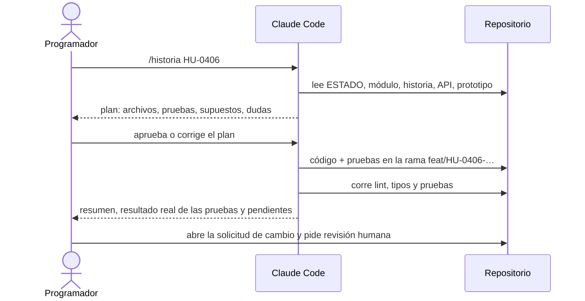

# Desarrollo con Claude Code

Cómo trabaja el equipo con Claude Code en este repositorio, de la primera sesión al cierre de cada sprint. El paquete está preparado para eso:

| Archivo | Para qué le sirve a Claude Code |
| --- | --- |
| `CLAUDE.md` | Contexto, decisiones y reglas. Se carga solo en cada sesión |
| `docs/ESTADO.md` | Dónde va el proyecto. Se lee al empezar y se actualiza al cerrar |
| `docs/14-modulos.md` | Qué construir en cada módulo y sus reglas de negocio |
| `docs/16-historias-y-pruebas.md` | Historias con casos de prueba «Dado / Cuando / Entonces» |
| `docs/api/openapi.yaml` | Contrato de la API |
| `packages/db/prisma/schema.prisma` | Modelo de datos validado |
| `packages/ai/` | Prompts, esquemas de salida y caso de referencia (modo simulado) |
| `docs/diseno/prototipo-unificado.html` + `DESIGN.md` | Cómo se ve y cómo se ordena cada pantalla |
| `.claude/commands/` | Comandos del equipo: `/historia`, `/cierre-sprint`, `/revisar-ui`, `/corregir` |

## Reglas de trabajo con Claude Code

1. **Una historia por sesión y por rama.** Pedir «todo el sprint» de una vez produce cambios grandes, difíciles de revisar.
2. **Primero el plan, después el código.** Claude propone el plan (archivos, pruebas, dudas) y el programador lo aprueba antes de escribir código.
3. **Las pruebas deciden.** Una historia está terminada cuando pasan sus casos de prueba (CP) y la Definición de Terminado de `docs/17-guia-desarrollo.md`. No basta con que Claude diga que funciona.
4. **Revisión humana siempre.** Cada solicitud de cambio la revisa una persona. Claude puede hacer una primera revisión, pero no reemplaza la humana.
5. **Sin secretos en la conversación.** Las claves de API van en `.env` o en el gestor de secretos, nunca pegadas en el chat ni en el código.
6. **Decisiones tomadas.** Si Claude propone cambiar algo de `CLAUDE.md` (stack, formato, proveedores), se hace con un ADR nuevo y aprobación del ingeniero a cargo, no dentro de una historia.
7. **Modo simulado por defecto.** En desarrollo y en la integración continua, las IA responden con el caso LOTO grabado. Las llamadas reales solo se hacen en las pruebas técnicas y en la evaluación semanal de calidad.

## Flujo de una historia



## Prompts por momento

Los comandos de `.claude/commands/` ya contienen estos textos; aquí están para leerlos o usarlos sin comando.

### Primera sesión: revisar el paquete

```text
Eres el ingeniero líder de Aptio SCORM. Lee CLAUDE.md, docs/ESTADO.md y todo docs/.
No escribas código. Entrega docs/revision-inicial.md con:
1. Inconsistencias entre documentos (requisitos, módulos, historias, API, modelo de datos, prototipo).
2. Vacíos que impiden empezar el sprint S0, con una propuesta para cada uno.
3. Tu recomendación para las decisiones abiertas de ESTADO.md (DA-01, DA-02, DA-04, DA-06).
4. Riesgos técnicos no cubiertos en docs/09-riesgos-y-pruebas-tecnicas.md.
Actualiza ESTADO.md con lo que quede pendiente.
```

### Sprint S0: base del proyecto

```text
Sprint S0 de docs/18-plan-sprints.md. Empieza por HU-0101 (entorno local con un comando).
Usa la estructura de docs/17-guia-desarrollo.md, infra/docker-compose.yml y .env.example.
Antes de crear cada package.json, verifica las versiones vigentes y fíjalas.
Entrega el plan primero; cuando lo apruebe, implementa con pruebas.
```

### Una historia (comando `/historia HU-####`)

```text
Implementa la historia HU-#### de docs/16-historias-y-pruebas.md.
Lee: docs/ESTADO.md, el módulo correspondiente en docs/14-modulos.md, sus operaciones en docs/api/openapi.yaml,
el modelo en packages/db/prisma/schema.prisma y, si tiene interfaz, la vista del prototipo y docs/diseno/DESIGN.md.
1. Plan: archivos a crear o cambiar, pruebas por cada CP, supuestos y hasta 5 preguntas con tu recomendación. Espera mi aprobación.
2. Código completo en la rama feat/HU-####-<nombre-corto>, con pruebas (Vitest para lógica, Playwright para flujos).
3. Corre lint, tipos y pruebas; informa el resultado real.
4. Si cambias la API o el esquema, actualiza openapi.yaml o el esquema en la misma rama.
No adelantes historias de otros sprints.
```

### Pantallas (comando `/revisar-ui <vista>`)

```text
Compara la vista <vista> de apps/web con la misma vista del prototipo (docs/diseno/prototipo-unificado.html)
y con las reglas de docs/diseno/DESIGN.md y docs/22-auditoria-prototipo.md:
contenido a 32 px de la barra lateral, escala de 6 tamaños de letra, h1 igual al nombre del menú,
colores por función (cobalto acción, naranja solo marca e IA, verde azulado validado), sin desborde a 390 px.
Lista las diferencias y corrígelas. Agrega o actualiza la prueba Playwright de esa vista.
```

### Pruebas técnicas (S0)

```text
Ejecuta la prueba técnica PT-0# de docs/09-riesgos-y-pruebas-tecnicas.md en spikes/PT-0#/, aislada del producto.
Entrega docs/pruebas/PT-0#.md con la plantilla de docs/pruebas/PLANTILLA-PT.md: objetivo, método, resultado real,
criterio cumplido o no y recomendación. Si una parte requiere juicio humano (calidad de la boca, estilo de las imágenes),
deja el procedimiento listo y marca el resultado como pendiente de evaluación.
```

### Tareas de IA

```text
Implementa la tarea IA-## en packages/ai usando packages/ai/prompts/IA-##.v1.md y packages/ai/esquemas/IA-##.salida.schema.json.
Envía el esquema empaquetado (con los $ref resueltos) como herramienta, valida la respuesta con Ajv,
reintenta hasta 2 veces con los errores y registra el TrabajoIA. En modo simulado responde con
packages/ai/casos/loto/salidas/. Prueba: pnpm ia:casos y una prueba unitaria con una respuesta inválida.
```

### Corregir un error de la demo (comando `/corregir JIRA-123`)

```text
Corrige el error JIRA-123 (pego la descripción y los pasos). Primero escribe una prueba que lo reproduzca y falle;
luego corrige y muestra que la prueba pasa. No cambies otra cosa.
```

### Cierre de sprint (comando `/cierre-sprint S#`)

```text
Cierre del sprint S# de docs/18-plan-sprints.md:
1. Lista las historias del sprint con su estado real (terminada solo si sus CP pasan) y el resultado de las pruebas.
2. Prepara el guion de la demo con la lista «Demo para probar» del sprint y el caso LOTO.
3. Actualiza docs/ESTADO.md: decisiones, supuestos, pendientes y siguiente paso.
No completes estimaciones, responsables ni fechas: los llena el equipo.
```

## Lo que Claude Code no hace en este proyecto

- Decidir tiempos, estimaciones o responsables: esos campos quedan en blanco para el equipo.
- Cambiar decisiones de `CLAUDE.md` sin un ADR aprobado.
- Llamar a proveedores reales de IA en la integración continua.
- Fusionar a `main`: lo hace una persona después de la revisión.
- Tomar las pantallas de Stitch como estructura (solo la marca).
